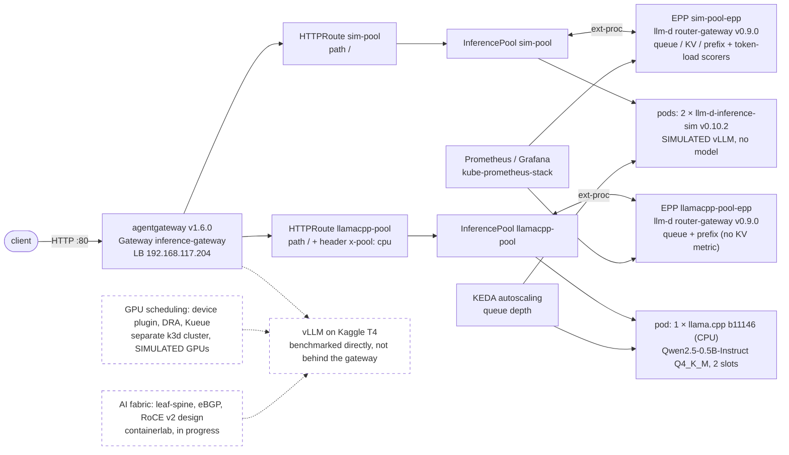

# goodput-stack

Serve open-weight LLMs on Kubernetes within a latency SLO using the fewest GPUs.
The goal: SLO-aware routing, queue-driven autoscaling, GPU sharing and a lossless AI fabric,
measured by TTFT, ITL and cost per million tokens.

Routing is not built here. This repo **integrates, probes and documents the gaps in** an existing stack:
[agentgateway](https://agentgateway.dev) (v1.6.0) + the [Gateway API Inference Extension](https://gateway-api-inference-extension.sigs.k8s.io/)
(InferencePool) + the endpoint picker (EPP) from [llm-d](https://github.com/llm-d) (`llm-d-router-gateway` v0.9.0).
The EPP's load-, KV- and prefix-aware scoring is llm-d's work. Ours is the deployment, the probes,
[GAPS.md](deploy/gateway/GAPS.md), and closing measured gaps with configuration: for example, a probe (P8) showed the stock
EPP routes size-blind, and enabling and tuning llm-d's own `token-load-scorer` fixed it ([ADR 0003](docs/adr/0003-token-aware-scorer.md)).

> **Status:** backends, Helm chart, Gateway API inference routing (with probes P1–P9), Prometheus/Grafana observability
> and KEDA queue-depth autoscaling run on a single-node k3s lab. vLLM runs on a free Kaggle T4 (engine benchmarks,
> quantization, cost). GPU scheduling (device plugin, DRA, Kueue, node health) runs on a separate k3d cluster with
> **simulated** GPUs. The AI fabric is being built. Nothing is claimed as done until it is in the repo with evidence:
> headline numbers with provenance are in [RESULTS.md](RESULTS.md).

## What runs today

Request path on the k3s lab. Dashed = not in the request path yet:



- **Backends** (`deploy/charts/inference`, release `inf`): llama.cpp on CPU (real numbers), and the
  vLLM simulator, calibrated to llama.cpp (every result from it is labelled **SIMULATED**). Both serve the model name
  `qwen2.5-0.5b-instruct`. NetworkPolicy: backend ports only from the gateway proxy, the EPPs and `helm test` pods.
- **Gateway** ([deploy/gateway/](deploy/gateway/)): agentgateway + Gateway API Inference Extension + the llm-d EPP, integrated, not built here. The Gateway is in the `inf` chart.
  Each InferencePool has its own `llm-d-router-gateway` v0.9.0 release (EPP + HTTPRoute),
  [ADR 0002](docs/adr/0002-gateway-in-chart.md). What it does and doesn't do: [GAPS.md](deploy/gateway/GAPS.md).
- **Gateway extension** ([GAPS.md P8](deploy/gateway/GAPS.md#p8--is-the-epp-size-blind-23), [ADR 0003](docs/adr/0003-token-aware-scorer.md)):
  the stock EPP counts queued *requests*, not queued prompt tokens. With a few long prompts on one pod and more short ones on the other,
  it sent 8 of 8 probes to the long-prompt pod (TTFT p50 7.75 s vs 0.53 s). llm-d already ships `token-load-scorer`, but its default
  threshold makes it inert at this scale; tuned (opt-in on sim-pool, `make epp-plugin-on`) it picked the right pod 8 of 8 (0.56 s)
  with no measurable latency cost. SIMULATED backends; limits in GAPS.md.
- **Observability** ([observability/](observability/)): kube-prometheus-stack 92.6.0, monitors for the gateway, both EPPs and
  both engines (19/19 targets up), an inference dashboard (TTFT, ITL, queue time, tok/s, KV, replicas) and EPP alerts.
- **Autoscaling** ([autoscaling/](autoscaling/)): KEDA 2.20.2 scales both pools on queue depth (running + waiting), not CPU.
  Scale-from-zero works through EPP flow control (requests held, not refused), bounded by agentgateway's 10 s ext_proc cut (#26).
- **GPU scheduling** ([scheduling/](scheduling/)): k3d cluster with Run:ai's fake-gpu-operator (SIMULATED GPUs): GPU
  exhaustion, device plugin vs DRA, Kueue quotas / borrowing / preemption / gang / topology-aware placement, and a GPU node
  health controller (fence, evict, requeue, return to service). Time-slicing is not demonstrated (the fake operator doesn't honour it).
- **Benchmarks** ([benchmarks/](benchmarks/)): the engine suite against llama.cpp and the simulator, with recorded provenance.
- **GPU engine track** ([benchmarks/results/t4/](benchmarks/results/t4/README.md)): vLLM 0.31.0 and llama.cpp CUDA on a
  free Kaggle T4, driven from the lab with `make t4-run STAGE=...`. Headline numbers with provenance: [RESULTS.md](RESULTS.md).
- **Probes** ([scripts/](scripts/)): small, single-question tests (queueing, bring-up, EPP routing, fail-open, disconnect, gateway kill,
  size-blind routing, burst vs metrics refresh, EPP overhead, gateway capacity).

## Evidence at a glance

Selected; every row links its source. Full tables: [RESULTS.md](RESULTS.md).

| Question | Answer | Label |
|---|---|---|
| Does the EPP route around a busy pod? | 20 / 20 requests to the idle pod (P1) | SIMULATED |
| What if the EPP dies? | FailOpen: 150 / 150 requests served, routing goes load-blind; alert fires in 36 s (P2) | SIMULATED |
| Is routing size-aware? | Stock: no (8 / 8 to the long-prompt pod, TTFT 7.75 s). Tuned `token-load-scorer`: 0 / 8, 0.56 s (P8) | SIMULATED |
| Does a client disconnect free the engine slot through the gateway? | No, not within 15 s (P3, open gap #19) | workstation CPU |
| Does queue-depth autoscaling help TTFT? | sim-pool 1 → 4 replicas: client TTFT p50 2.7 s → 81–93 ms (one cycle) | SIMULATED |
| Can a pool scale from zero without errors? | Yes for fast-start pods: 0 / 5 errors, first token 4.5–4.8 s; held requests die at 10 s (#26) | SIMULATED |
| How much KV cache fits on a T4? | Llama-3.2-3B FP16 at 0.90 memory: 53,904 tokens measured vs ≈ 55,000 predicted (−2 %) | Kaggle T4, real |
| Cost per 1M output tokens (Qwen2.5-3B, 16 clients, T4 on-demand $0.526/h) | FP16 $0.428 · AWQ INT4 $0.272 · GGUF Q4_K_M $0.480 | Kaggle T4, real; calculated cost |
| What happens when a GPU node fails? | Pods Ready on the healthy node in 3.8–6.7 s after fencing (3 runs) | SIMULATED GPUs |

## Repository

| Dir | What | Status |
|---|---|---|
| [deploy/](deploy/) | Helm chart (backends + Gateway), per-env values (k3s, k3d), release flow, EPP values, GAPS | in use |
| [scripts/](scripts/) | probes and smoke tests; one-line index in its README | in use |
| [benchmarks/](benchmarks/) | engine benchmark harness, T4 runs (vLLM / llama.cpp CUDA), quantization quality, cost model; system suite planned | engine suite + T4 in use |
| [docs/](docs/) | ADRs, pinned environment, upstream issue drafts | in use |
| [router/](router/) | README only: why there is no custom router (agentgateway + Gateway API Inference Extension + the llm-d EPP instead) | not built, by decision |
| [observability/](observability/) | kube-prometheus-stack, monitors for gateway/EPPs/engines, inference dashboard, EPP alerts | in use (lab) |
| [autoscaling/](autoscaling/) | KEDA on queue depth (both pools), step load generator, scale-from-zero experiment (#10) | in use (lab) |
| [scheduling/](scheduling/) | fake GPUs, device plugin vs DRA, Kueue quotas, GPU node health (k3d multi-node, SIMULATED GPUs) | in use (simulated) |
| [fabric/](fabric/) | leaf-spine intent model, eBGP unnumbered, RoCE v2 design (PFC/DCQCN intent only) | in progress |

## Quick start (k3s lab)

Prerequisites: k3s (kube context `default`), helm 4, kubectl, python3. The Gateway API and Inference
Extension CRDs and the agentgateway v1.6.0 controller (GatewayClass `agentgateway`) must already be installed.
The llama.cpp image `localhost/llama-server:b11146` must be imported into k3s containerd ([deploy/charts/inference/values.yaml](deploy/charts/inference/values.yaml)).

```bash
make check-env                # 1. tool versions
make venv                     # 2. .venv with the benchmark deps (smoke_test.py also needs: .venv/bin/pip install openai)
make deploy ENV=k3s           # 3. backends + Gateway: lint -> diff -> confirm -> upgrade -> helm test (deploy/README.md)
make epp-deploy               # 4. one EPP + HTTPRoute per InferencePool, then restart the EPPs to load their config
helm test inf -n inference    # 5. sanity pods: each backend directly, and both routes through the gateway
.venv/bin/python scripts/smoke_test.py --runs 10              # 6. OpenAI SDK via the gateway -> sim-pool
.venv/bin/python scripts/smoke_test.py --runs 10 --pool cpu   #    ... -> llamacpp-pool
```

On a fresh cluster step 3 runs `helm test` before step 4 exists, so the gateway test fails there. That is expected;
step 5 is the real check. After changing `deploy/gateway/epp-*.values.yaml`: `make epp-diff`, then `make epp-deploy`.

Other entry points: `make help` · `make bringup ARGS="--runs 10"` (pod bring-up timing) · `make sim-watch` ·
probes P1–P3, P7 (`make probe-p7`), P8 (`make probe-p8`), P9 (`make probe-burst`) in [scripts/README.md](scripts/README.md) ·
`make obs-up` (observability) · `make keda-up` (autoscaling) · `make gpusim-up` (simulated GPU cluster, [scheduling/](scheduling/README.md)) ·
`make t4-run STAGE=...` (Kaggle T4).

## Environment
- Local: k3s on WSL2 (single node `ravi-home`, i7-10700, CPU only); k3d on Podman for multi-node scheduling work.
- GPU: free Kaggle/Colab T4 (16 GB, FP16/INT4). GPU benchmarks run on the T4 host directly.

## Ground rules
- Every benchmark number comes from a recorded run (date, hardware, versions, config).
- Anything simulated or intent-only (vLLM simulator, fake GPUs, PFC/DCQCN) is labelled as such.
- Third-party versions are pinned exactly, one release behind latest.
