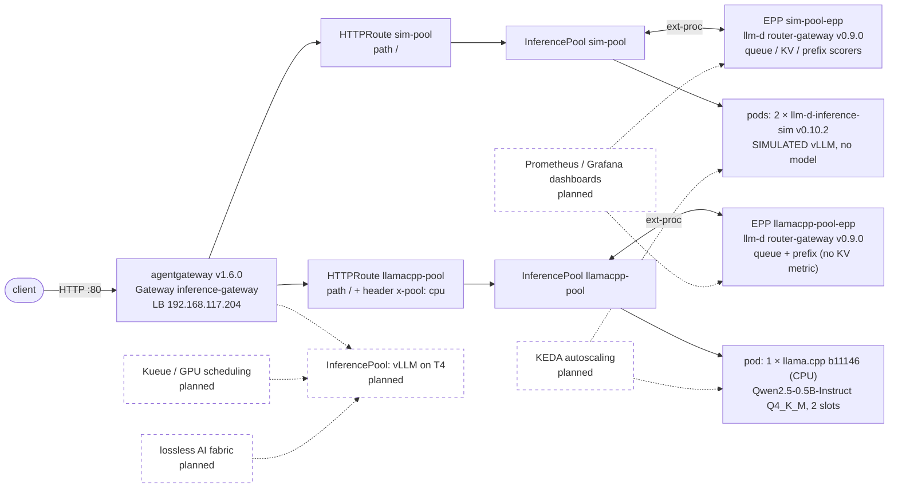

# goodput-stack

Serve open-weight LLMs on Kubernetes within a latency SLO using the fewest GPUs.
The goal: SLO-aware routing, queue-driven autoscaling, GPU sharing and a lossless AI fabric,
measured by TTFT, ITL and cost per million tokens.

Routing is not built here. This repo **integrates, probes and documents the gaps in** an existing stack:
[agentgateway](https://agentgateway.dev) (v1.6.0) + the [Gateway API Inference Extension](https://gateway-api-inference-extension.sigs.k8s.io/)
(InferencePool) + the endpoint picker (EPP) from [llm-d](https://github.com/llm-d) (`llm-d-router-gateway` v0.9.0).
The EPP's load-, KV- and prefix-aware scoring is llm-d's work. Ours is the deployment, the probes and
[GAPS.md](deploy/gateway/GAPS.md).

> **Status:** backends, Helm chart, Gateway API inference routing and probes run on a
> single-node k3s lab. Autoscaling, observability, GPU scheduling and the fabric are not built yet.
> Nothing is claimed as done until it is in the repo with evidence.

## What runs today

Request path. Dashed = planned, not built:



- **Backends** (`deploy/charts/inference`, release `inf`): llama.cpp on CPU (real numbers), and the
  vLLM simulator, calibrated to llama.cpp (every result from it is labelled **SIMULATED**). Both serve the model name
  `qwen2.5-0.5b-instruct`. NetworkPolicy: backend ports only from the gateway proxy, the EPPs and `helm test` pods.
- **Gateway** ([deploy/gateway/](deploy/gateway/)): agentgateway + Gateway API Inference Extension + the llm-d EPP, integrated, not built here. The Gateway is in the `inf` chart.
  Each InferencePool has its own `llm-d-router-gateway` v0.9.0 release (EPP + HTTPRoute),
  [ADR 0002](docs/adr/0002-gateway-in-chart.md). What it does and doesn't do: [GAPS.md](deploy/gateway/GAPS.md).
- **Benchmarks** ([benchmarks/](benchmarks/)): the engine suite against llama.cpp and the simulator, with recorded provenance.
- **Probes** ([scripts/](scripts/)): small, single-question tests (queueing, bring-up, EPP routing, fail-open, disconnect, gateway kill, burst vs metrics refresh).

## Repository

| Dir | What | Status |
|---|---|---|
| [deploy/](deploy/) | Helm chart (backends + Gateway), per-env values (k3s, k3d), release flow, EPP values, GAPS | in use |
| [scripts/](scripts/) | probes and smoke tests; one-line index in its README | in use |
| [benchmarks/](benchmarks/) | engine benchmark harness and results (system suite: planned) | engine suite in use |
| [docs/](docs/) | ADRs, architecture notes | started |
| [router/](router/) | placeholder for a custom router. Not built: routing is agentgateway + Gateway API Inference Extension + the llm-d EPP. Revisit only for SLO/size routing the EPP can't do (#11) | not built |
| [observability/](observability/) | Prometheus + Grafana: TTFT, ITL, queue depth | planned |
| [autoscaling/](autoscaling/) | KEDA on queue depth, scale-from-zero (#10) | planned |
| [scheduling/](scheduling/) | fake GPUs, device plugin vs DRA, time-slicing, Kueue (k3d multi-node) | planned |
| [fabric/](fabric/) | leaf-spine intent model, eBGP unnumbered, RoCE v2 design (intent only) | planned |

## Quick start (k3s lab)

Prerequisites: k3s (kube context `default`), helm 4, kubectl, python3. The Gateway API and Inference
Extension CRDs and the agentgateway v1.6.0 controller (GatewayClass `agentgateway`) must already be installed.
The llama.cpp image `localhost/llama-server:b11146` must be imported into k3s containerd ([deploy/charts/inference/values.yaml](deploy/charts/inference/values.yaml)).

```bash
make check-env                # 1. tool versions
make venv                     # 2. .venv with the benchmark deps (smoke_test.py also needs: .venv/bin/pip install openai)
make deploy ENV=k3s           # 3. backends + Gateway: lint -> diff -> confirm -> upgrade -> helm test (deploy/README.md)
make epp-deploy               # 4. one EPP + HTTPRoute per InferencePool, then restart the EPPs to load their config
helm test inf -n inference    # 5. sanity pods: each backend directly, and both routes through the gateway
.venv/bin/python scripts/smoke_test.py --runs 10              # 6. OpenAI SDK via the gateway -> sim-pool
.venv/bin/python scripts/smoke_test.py --runs 10 --pool cpu   #    ... -> llamacpp-pool
```

On a fresh cluster step 3 runs `helm test` before step 4 exists, so the gateway test fails there. That is expected;
step 5 is the real check. After changing `deploy/gateway/epp-*.values.yaml`: `make epp-diff`, then `make epp-deploy`.

Other entry points: `make help` · `make bringup ARGS="--runs 10"` (pod bring-up timing) · `make sim-watch` ·
probes P1–P3, P7 (`make probe-p7`), P9 (`make probe-burst`) in [scripts/README.md](scripts/README.md).

## Environment
- Local: k3s on WSL2 (single node `ravi-home`, i7-10700, CPU only); k3d on Podman for multi-node scheduling work.
- GPU: free Kaggle/Colab T4 (16 GB, FP16/INT4). GPU benchmarks run on the T4 host directly.

## Ground rules
- Every benchmark number comes from a recorded run (date, hardware, versions, config).
- Anything simulated or intent-only (vLLM simulator, fake GPUs, PFC/DCQCN) is labelled as such.
- Third-party versions are pinned exactly, one release behind latest.
