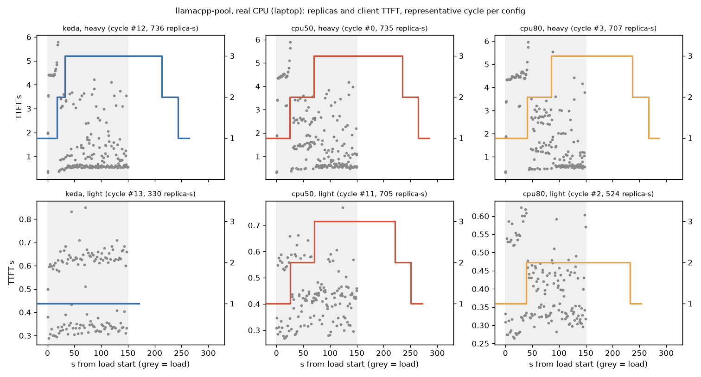
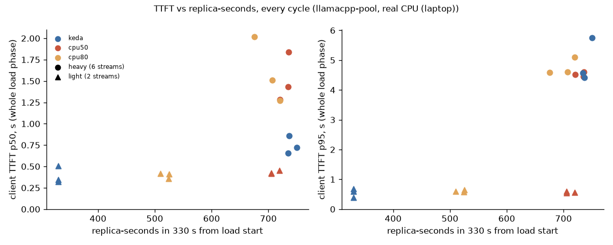

# Queue depth (KEDA) vs CPU utilisation (HPA) autoscaling on llamacpp-pool (real CPU (laptop))

Build 17, Task A. Question: on the same pool and the same load, does scaling on queue depth (KEDA, current config) give
better user latency per replica-second than the standard HPA scaling on CPU utilisation?

## Predictions (written 2026-11-03 before any run; verbatim from the assignment, not edited afterwards)

- Light load: KEDA stays at 1 replica (no queue); CPU-HPA scales up anyway because llama.cpp drives CPU high whenever a
  slot is busy → more replica-seconds for no TTFT gain.
- Heavy load: both scale out; CPU-HPA reacts no faster than KEDA and cannot tell 1 from 10 waiting requests; TTFT p95
  during the first 60 s similar or worse for CPU-HPA.
- 80 % target scales later than 50 % under heavy load.
- Scale-down timing set by the matched stabilization windows, not the signal.

## A0 — setup and fairness (recorded 2026-11-03 before the runs)

| Item | Value | Read from |
|---|---|---|
| Node | 1 node `ravi-home`, k3s v1.36.2+k3s1, WSL2; **16 CPUs** (Intel i7-10700, 8 cores × 2 threads); allocatable cpu 16 | `kubectl get node -o jsonpath={.status.capacity}`, `lscpu` |
| llama.cpp | image `localhost/llama-server:b11146`; `-m qwen2.5-0.5b-instruct-q4_k_m.gguf -c 4096 --parallel 2 --threads 4 --metrics` | `kubectl get deploy inf-llamacpp` (args) |
| Slots per pod | **2** (`--parallel 2`) | same |
| Pod CPU requests / limits | **requests cpu 4**, memory 1Gi; limits memory 2Gi, **no CPU limit**; QoS **Burstable** | `.spec.template.spec.containers[0].resources`, pod `qosClass` |
| CPU pinning | **not pinned**: `Cpus_allowed_list: 0-15` for the llama-server process; kubelet CPU manager not static. The Build 12 pinned setup (`make cpu-pin-on`) needs sudo and restarts k3s; sudo needs an interactive password here, so it was not applied. Requests were already set (4 CPU), so HPA utilisation is % of 4 CPU. | `/proc/<pid>/status`, `sudo -n true` → "interactive authentication is required" |
| KEDA | 2.20.2 (`ghcr.io/kedacore/keda:2.20.2`); ScaledObject `inf-llamacpp` live spec = `autoscaling/scaledobject-llamacpp.yaml` (only difference: defaulted `scalingModifiers: {}`) | `kubectl get deploy keda-operator`, diff of live spec vs file |
| metrics-server | `rancher/mirrored-metrics-server:v0.8.1`, **`--metric-resolution=15s`**; APIService `v1beta1.metrics.k8s.io` Available | `kubectl -n kube-system get deploy metrics-server` args |
| HPA sync period | 15 s (kube-controller-manager default; `/etc/rancher/k3s/config.yaml` sets no controller-manager args) | config file |
| Prometheus | scrapeInterval 15 s global; llamacpp ServiceMonitor 5 s (the KEDA query's source) | `kubectl get prometheus`, `servicemonitor` |
| llama.cpp readiness | `/health` every 5 s, failureThreshold 2 | deployment readinessProbe |

**Autoscaler configs (only one owns the Deployment at a time).**

| | 1. KEDA queue depth (production, unchanged) | 2. HPA CPU 50 % | 3. HPA CPU 80 % |
|---|---|---|---|
| Object | ScaledObject `inf-llamacpp` → HPA `keda-hpa-inf-llamacpp` | HPA `inf-llamacpp-cpu` ([hpa-cpu-50.yaml](../queue-vs-util/hpa-cpu-50.yaml)) | HPA `inf-llamacpp-cpu` ([hpa-cpu-80.yaml](../queue-vs-util/hpa-cpu-80.yaml)) |
| Signal | `sum(avg_over_time(llamacpp:requests_processing[30s])) + sum(avg_over_time(llamacpp:requests_deferred[30s]))`, AverageValue 2 per pod | `resource cpu`, averageUtilization 50 % of the 4-CPU request (= 2 cores per pod) | 80 % (= 3.2 cores per pod) |
| min / max | 1 / 3 | 1 / 3 | 1 / 3 |
| scale-up | stabilization 0 s; max(+2 pods, +100 %) per 15 s | same | same |
| scale-down | stabilization 60 s; −1 pod per 30 s | same | same |
| Tolerance | HPA default 10 % | same | same |
| How the signal reaches the HPA | Prometheus (5 s scrape) → KEDA metrics adapter, read on the 15 s HPA sync | metrics-server (15 s resolution) → HPA, 15 s sync | same |

Behaviour values: the live `keda-hpa-inf-llamacpp` `.spec.behavior` (`{"scaleDown":{"policies":[{"periodSeconds":30,"type":"Pods","value":1}],"selectPolicy":"Min","stabilizationWindowSeconds":60},"scaleUp":{"policies":[{"periodSeconds":15,"type":"Pods","value":2},{"periodSeconds":15,"type":"Percent","value":100}],"selectPolicy":"Max","stabilizationWindowSeconds":0}}`) copied verbatim into the HPA manifests.
Switching: [run_cycles.py](../queue-vs-util/run_cycles.py) deletes the other autoscaler (KEDA → `kubectl delete scaledobject inf-llamacpp`, which removes
`keda-hpa-inf-llamacpp`; CPU HPA deleted and re-created fresh for every CPU cycle), then requires `kubectl get hpa` to list
exactly one HPA targeting `inf-llamacpp` (recorded per cycle in `order.jsonl`, field `autoscaler`).

**Load profiles** (existing [loadgen.py](../loadgen.py) through the gateway, `x-pool: cpu`; TTFT = first non-empty
`delta.content`, ITL = gaps between content chunks, `scripts/stream_client.py`):

- heavy: `--concurrency 6 --max-tokens 64 --idle 20 --high 150 --tail 300` (the 2026-10-14 cycle);
- light: `--concurrency 2` (= slots of one pod), otherwise the same.
- Both with `--fixed-prompts` (new): prompt = `[<worker>-<n>] Write a short story about a lighthouse keeper.`, so every
  cycle sends the same prompt sequence. There is no sampling seed in the load generator; the "seed" is the run order seed.

**Measurement additions to loadgen.py (Build 17).** Per ~1 s sample: per-pod CPU in cores from the pod cgroup
`cpu.stat usage_usec` (the host is the node), node CPU busy share from `/proc/stat`, the HPA's `currentMetrics`. Per
request: ITL p50 / mean. At the end: the KEDA query over the run window from Prometheus (`prom-queue.json`, 5 s step),
recorded for every config, so the queue signal is visible even when the CPU HPA owns the Deployment.

**Between cycles:** `run_cycles.py` waits until the Deployment is at spec = ready = 1 with exactly one pod and queue 0
(direct `/metrics` scrape) for 60 s in a row, then records pod CPU and node CPU over 5 s (`order.jsonl`, field `start`).

**Order:** 3 configs × 2 profiles × 3 cycles, shuffled with `random.Random(17)`:

```
cpu50:heavy, cpu50:heavy, cpu80:light, cpu80:heavy, cpu80:heavy, keda:light, cpu50:light, keda:heavy, keda:heavy,
cpu80:light, cpu50:heavy, cpu50:light, keda:heavy, keda:light, keda:light, cpu50:light, cpu80:heavy, cpu80:light
```

Command: `.venv/bin/python autoscaling/queue-vs-util/run_cycles.py --seed 17 --prom http://10.43.105.58:9090`
(Prometheus ClusterIP, reachable from the k3s host).

**Cluster state before Task A** (`kubectl get pods -A`, `kubectl get scaledobject,hpa -A`; full output in
[queue-vs-util/state-before.txt](queue-vs-util/state-before.txt)): ScaledObjects `inf-llamacpp` (1–3, READY True,
not paused) and `inf-vllm-sim` (1–4, **PAUSED True**, annotation `autoscaling.keda.sh/paused-replicas: "2"`); one HPA
`keda-hpa-inf-llamacpp` (1/3, 1 replica); llamacpp 1 pod, sim 2 pods.

## First attempt discarded: `--fixed-prompts` let the EPP's prefix-cache scorer pin load to one pod

The first 10 cycles (07:08–08:28, same order, seed 17) used a new `--fixed-prompts` option. The aim was a "same prompt
set" every cycle: prompt = `[<worker>-<n>] Write a short story about a lighthouse keeper.` They are **not used for
the comparison**, because the option added a confound that grew with every cycle:

- The llamacpp-pool EPP scores endpoints with `prefix-cache-scorer` weight **3**, `queue-scorer` 2 and
  `kv-cache-utilization-scorer` 2 ([deploy/gateway/epp-llamacpp.values.yaml](../../deploy/gateway/epp-llamacpp.values.yaml)).
  Only one pod (`inf-llamacpp-…-j9t6j`) survives from cycle to cycle. Once the fixed prompts had been served there, the
  prefix scorer kept routing them there, even with 3 replicas up.
- Mean queue per pod at 3 replicas, 90–150 s after load start (direct `/metrics` scrapes, `samples.jsonl`):

  | cycle | config | long-lived pod j9t6j | new pod 1 | new pod 2 |
  |---|---|---:|---:|---:|
  | 0 | cpu50 heavy | 2.04 | 2.04 | 1.82 |
  | 1 | cpu50 heavy | 2.98 | 1.58 | 1.27 |
  | 3 | cpu80 heavy | **4.41** | 0.61 | 0.78 |
  | 7 | keda heavy | **4.45** | 0.38 | 1.02 |
  | 8 | keda heavy | **4.38** | 0.60 | 0.80 |

- Result: at 3 replicas, client TTFT p50 stayed at 2.6–4.1 s per 10 s step in the KEDA and cpu80 cycles. In cycle 0,
  the only one with empty prefix history, it was 0.47 s. The autoscaler added pods the router did not use. The
  comparison would have favoured whichever config ran first (cpu50).
- The 2026-10-14 loadgen used a unique `[worker-n-time_ns]` prefix per request, and that is what the rerun uses
  (`run_cycles.py --prompts unique`, the default now). Same template and same order; the prompt prefixes differ.
- Raw: [queue-vs-util/runs-fixed-prompts/](queue-vs-util/runs-fixed-prompts/),
  [order-fixed-prompts.jsonl](queue-vs-util/order-fixed-prompts.jsonl), tables
  [fixed-prompts/cycles.md](queue-vs-util/fixed-prompts/cycles.md). The light-load cycles in it (2, 5, 6, 9) show the same
  scaling as the rerun's predictions concern: KEDA stayed at 1 (330 replica-s), CPU-HPA went to 2 (495–540 replica-s).
- This is a finding in its own right. With prefix affinity weighted above queue depth, scaling out did not help a
  workload whose prompts repeat: the new replicas got 0.4–1.0 of the 6 requests each (cycles 3, 7, 8), and TTFT stayed
  high at max replicas under both autoscalers.

## A2 — runs (llamacpp-pool, real CPU (laptop))

18 cycles, 08:08–09:52 EST 2026-11-03, the order above, all `rc 0`, **0 failed requests in every cycle**. Every cycle
started at 1 Ready replica with queue 0 for ≥ 60 s (waited 65–68 s); over the 5 s before load the pod used 0.009–0.012
cores and the node was 4.7–8.0 % busy (`order.jsonl`, `start`). `order.jsonl` also records which HPA owned the
Deployment: exactly one per cycle (`keda-hpa-inf-llamacpp` or `inf-llamacpp-cpu`).

Raw per cycle: [queue-vs-util/runs/](queue-vs-util/runs/) (`log.jsonl` events, `samples.jsonl` 1 Hz with replicas,
HPA reading, per-pod queue and CPU, node CPU; `requests.jsonl` with TTFT / ITL; `prom-queue.json` = the KEDA query
over the run; `hpa-events.txt`; `summary.md` 10 s steps). Per-cycle table: [queue-vs-util/cycles.md](queue-vs-util/cycles.md).
Analysis: `.venv/bin/python autoscaling/queue-vs-util/analyze.py` →
[analysis.json](queue-vs-util/analysis.json), [summary.md](queue-vs-util/summary.md).

## A3 — results

Median (min–max) over 3 cycles per config × profile. TTFT and ITL are client-side over the gateway, for requests sent
during the 150 s load; "first 60 s" = requests sent in the first 60 s after load start. Replica-seconds = ∫ spec.replicas
over a fixed 330 s from load start (load + 180 s, enough for 3 → 1). Pod CPU is the sum over the pool's pods (cgroup);
the queue is processing + deferred summed over pods (direct scrape), i.e. the signal KEDA uses.

| metric | cpu50:heavy | cpu50:light | cpu80:heavy | cpu80:light | keda:heavy | keda:light |
|---|---:|---:|---:|---:|---:|---:|
| cycles | 3 | 3 | 3 | 3 | 3 | 3 |
| TTFT p50 ms | 1,430 (1,282–1,838) | 425 (416–453) | 1,511 (1,272–2,016) | 414 (356–416) | 721 (654–857) | 344 (320–505) |
| TTFT p95 ms | 4,514 (4,454–4,609) | 558 (540–590) | 4,606 (4,581–5,093) | 597 (586–647) | 4,566 (4,417–5,755) | 589 (398–680) |
| TTFT max ms | 5,904 (5,726–6,134) | 659 (573–769) | 6,267 (5,972–6,498) | 686 (624–699) | 6,394 (5,798–7,955) | 700 (594–851) |
| TTFT p50 first 60 s | 2,604 (2,177–3,177) | 362 (340–418) | 4,344 (3,538–4,446) | 414 (350–437) | 1,342 (1,039–1,567) | 341 (337–466) |
| TTFT p95 first 60 s | 4,693 (4,691–4,877) | 585 (553–630) | 4,797 (4,737–5,900) | 602 (523–625) | 4,822 (4,713–6,986) | 630 (464–674) |
| TTFT max first 60 s | 5,904 (5,726–6,134) | 638 (573–662) | 6,267 (5,972–6,498) | 624 (602–686) | 6,394 (5,798–7,955) | 700 (594–832) |
| ITL p50 ms | 39 (37–40) | 25 (24–31) | 36 (35–43) | 26 (24–27) | 45 (44–46) | 26 (23–27) |
| ok | 193 (193–200) | 140 (122–141) | 186 (184–189) | 135 (128–146) | 200 (180–203) | 131 (128–149) |
| failed | 0 (0–0) | 0 (0–0) | 0 (0–0) | 0 (0–0) | 0 (0–0) | 0 (0–0) |
| load → scale-up decision s | 25 (25–28) | 26 (20–33) | 41 (27–54) | 33 (25–38) | 19 (18–24) | — |
| → new pod Ready s | 29 (28–31) | 30 (23–37) | 45 (32–56) | 37 (29–41) | 23 (21–28) | — |
| → new pod serving s | 29 (28–32) | 30 (23–37) | 45 (32–57) | 37 (34–42) | 23 (22–30) | — |
| max replicas | 3 (3–3) | 3 (3–3) | 3 (3–3) | 2 (2–2) | 3 (3–3) | 1 (1–1) |
| load → max replicas (spec) s | 70 (58–71) | 71 (50–78) | 86 (57–100) | 33 (25–39) | 33 (24–35) | — |
| replica-s (330 s) | 735 (720–736) | 705 (705–719) | 707 (675–720) | 524 (510–526) | 736 (734–750) | 330 (330–330) |
| stop → scale-down decision s | 81 (69–82) | 69 (63–77) | 81 (69–83) | 69 (62–81) | 62 (60–64) | — |
| stop → back at 1 s | 111 (100–112) | 99 (93–107) | 111 (100–114) | 69 (62–81) | 92 (91–94) | 0.60 (0–0.70) |
| pod CPU cores (load mean) | 8.93 (8.81–8.96) | 5.97 (5.90–6.12) | 8.07 (7.43–9.10) | 5.40 (5.17–5.45) | 9.94 (9.56–9.95) | 3.99 (3.98–3.99) |
| node CPU busy (load mean) | 0.70 (0.69–0.70) | 0.52 (0.51–0.54) | 0.65 (0.61–0.72) | 0.49 (0.47–0.49) | 0.76 (0.74–0.76) | 0.40 (0.38–0.40) |
| queue mean (load) | 5.66 (5.64–5.71) | 1.94 (1.93–1.98) | 5.70 (5.69–5.73) | 1.95 (1.93–1.95) | 5.68 (5.68–5.73) | 1.92 (1.83–1.97) |
| queue max (load) | 6 (6–6) | 2 (2–2) | 6 (6–6) | 2 (2–2) | 6 (6–6) | 2 (2–2) |





**What the CPU HPA saw at its first scale-up** (HPA `currentMetrics` at the decision, `analysis.json` field
`first_up_hpa_reading`). At 1 replica the pod used ~4 cores (100 % of its 4-CPU request) whenever any slot was busy:

| | light (2 streams, queue ≤ 2) | heavy (6 streams, queue 6) |
|---|---|---|
| cpu80 | 100 %, 99 %, 99 % | 100 %, 100 %, 99 % |
| cpu50 | 65 %, 85 %, 77 % (metrics-server window still rising) | 56 %, 58 %, 100 % |

The KEDA HPA read 3.83, 4.17 and 3 (per pod, target 2) at its first heavy scale-up, and never left 1 replica under light
load: the 30 s average of processing + deferred stayed ≤ 2.

**Per replica-second (CALCULATED from the table's medians).**
- Light: KEDA 330 replica-s with TTFT p50 / p95 344 / 589 ms. cpu80 used 524 (1.59×) for 414 / 597 ms, and cpu50 used
  705 (2.14×) for 425 / 558 ms. The extra replicas bought no TTFT; ITL p50 was 25–26 ms in all three.
- Heavy: replica-seconds were the same (KEDA 736, cpu50 735, cpu80 707). TTFT p50 over the load phase was 721 ms for
  KEDA vs 1,430 (cpu50) and 1,511 (cpu80). In the first 60 s it was 1,342 vs 2,604 vs 4,344 ms. KEDA reached 3 replicas
  at 33 s (24–35) vs 70 s (58–71) and 86 s (57–100).
- TTFT p95 under heavy load was ~4.5–4.6 s for all three configs. It is set by the first ~20 s at 1 replica, which no
  config avoids: detection takes ≥ 18 s with a 15 s HPA sync.
- ITL p50 under heavy load was **higher with KEDA** (45 ms vs 36–39). KEDA ran 3 pods (12 llama.cpp threads) for longer
  on the shared 16-thread laptop CPU: pod CPU 9.9 cores, node 76 % busy, vs 8.1–8.9 and 65–70 % (see "Does NOT show").

## Secondary: sim-pool (SIMULATED), heavy, KEDA vs CPU-HPA 50 %, 2 cycles each

`run_cycles.py --pool sim --cycles 2 --seed 17` (order keda, cpu50, keda, cpu50; 09:53–10:19). llm-d-inference-sim
v0.10.2, pod request **100m** CPU, no limit. Configs: the sim ScaledObject (`scaledobject-vllm-sim.yaml`: queue =
running + waiting, AverageValue 2, 1–4) with its `paused-replicas` annotation removed, vs HPA `inf-vllm-sim-cpu`
([hpa-sim-cpu-50.yaml](../queue-vs-util/hpa-sim-cpu-50.yaml): 50 % of 100m, 1–4, the same behaviour). Load as on
2026-10-14: 8 streams, `--max-tokens 96`, 150 s. Latencies are SIMULATED (configured in the simulator); pods, HPA, KEDA
and the simulator's own CPU use are real. Raw: [queue-vs-util-sim/](queue-vs-util-sim/).

| metric | cpu50:heavy | keda:heavy |
|---|---:|---:|
| cycles | 2 | 2 |
| TTFT p50 ms | 362 (264–460) | 88 (87–89) |
| TTFT p95 ms | 2,662 (2,364–2,959) | 1,056 (1,017–1,095) |
| TTFT max ms | 3,853 (3,775–3,932) | 3,921 (3,858–3,984) |
| TTFT p50 first 60 s | 1,626 (1,075–2,177) | 106 (98–114) |
| TTFT p95 first 60 s | 3,513 (3,332–3,695) | 2,171 (1,933–2,409) |
| TTFT max first 60 s | 3,853 (3,775–3,932) | 3,921 (3,858–3,984) |
| ITL p50 ms | 16 (16–16) | 16 (16–16) |
| ok | 854 (785–924) | 1,158 (1,131–1,184) |
| failed | 0 (0–0) | 0 (0–0) |
| load → scale-up decision s | 42 (34–50) | 14 (11–17) |
| → new pod Ready s | 44 (35–52) | 16 (13–20) |
| → new pod serving s | 44 (36–52) | 16 (13–20) |
| max replicas | 4 (4–4) | 4 (4–4) |
| load → max replicas (spec) s | 117 (109–125) | 29 (26–33) |
| replica-s (330 s) | 900 (871–929) | 967 (944–991) |
| stop → scale-down decision s | 78 (77–79) | 51 (46–55) |
| stop → back at 1 s | 168 (167–169) | 111 (106–116) |
| pod CPU cores (load mean) | 0.15 (0.14–0.16) | 0.20 (0.19–0.20) |
| node CPU busy (load mean) | 0.16 (0.16–0.17) | 0.17 (0.16–0.17) |
| queue mean (load) | 7.86 (7.84–7.87) | 7.90 (7.89–7.90) |
| queue max (load) | 8 (8–8) | 8 (8–8) |

- **The simulator's CPU does track its load, roughly.** Idle sim pods use 18–22m (= 18–22 % of the 100m request, before
  every cycle, `order.jsonl` `start`). At the first CPU-HPA scale-up the HPA read 68 % and 62 %, so the 50 % HPA scaled,
  reaching 4 pods 117 s (109–125) after load start vs 29 s (26–33) for KEDA. The first decision came at 42 s vs 14 s.
- The idle floor (~20 % of the request) sits close under the 50 % target: with a smaller request or a lower target
  the CPU-HPA would hold extra replicas with no load at all. Not run here.
- Same shape as on llama.cpp: KEDA reached max replicas sooner (TTFT p50 88 vs 362 ms, ok requests 1,158 vs 854 in
  the closed loop) and scaled down sooner (back at 1 after 111 vs 168 s), at 967 vs 900 replica-s.

## Predicted vs measured

| Prediction | Measured (llamacpp-pool, real CPU (laptop), n = 3 per cell) | Verdict |
|---|---|---|
| Light load: KEDA stays at 1 replica (no queue) | 1 replica in 3 / 3 cycles; queue max 2 (= slots); 330 replica-s | **confirmed** |
| Light load: CPU-HPA scales up anyway because llama.cpp drives CPU high whenever a slot is busy | the pod used 3.99 cores = 100 % of its 4-CPU request with ≤ 2 requests; cpu50 → 3 replicas (705 replica-s), cpu80 → 2 (524) in 6 / 6 cycles | **confirmed** |
| Light load: … more replica-seconds for no TTFT gain | 1.59× (cpu80) and 2.14× (cpu50) KEDA's replica-seconds; TTFT p50 414 / 425 vs 344 ms, p95 597 / 558 vs 589 ms, ITL p50 25–26 ms in all | **confirmed** (no gain: equal p95 within the cycle-to-cycle range, p50 slightly worse) |
| Heavy: both scale out | all 9 heavy cycles reached 3 replicas | **confirmed** |
| Heavy: CPU-HPA reacts no faster than KEDA | first decision 25 s (cpu50) / 41 s (cpu80) vs 19 s (KEDA); at 3 replicas 70 / 86 s vs 33 s | **confirmed** (slower) |
| Heavy: CPU-HPA cannot tell 1 from 10 waiting requests | at 1 replica the HPA read 99–100 % for queue 2 (light) and for queue 6 (heavy) alike (cpu80, 6 / 6 decisions); KEDA read 3–4.17 per pod. CPU saturates at the request once one slot is busy. 10 waiting was not run (max 6 streams) | **confirmed** for 2 vs 6 |
| Heavy: TTFT p95 during the first 60 s similar or worse for CPU-HPA | 4,693 (cpu50) / 4,797 (cpu80) vs 4,822 ms (KEDA): **similar**; p50 in the first 60 s 2,604 / 4,344 vs 1,342 ms: worse for CPU-HPA | **confirmed** (similar p95, worse p50) |
| 80 % target scales later than 50 % under heavy load | first decision 41 (27–54) vs 25 (25–28) s; at 3 replicas 86 (57–100) vs 70 (58–71) s | **confirmed** for the median; the ranges touch (27 vs 28 s) |
| Scale-down timing set by the matched stabilization windows, not the signal | stop → first scale-down decision 62 s (KEDA), 69–81 s (CPU); back at 1 after 92 vs 99–111 s. The 60 s window and −1 pod / 30 s set most of it; the signal adds 2–23 s (metrics-server's 15 s resolution vs KEDA's 30 s average on a 5 s scrape) | **mostly confirmed**: the window dominates, but the signal's lag adds up to ~20 s |

**Verdict (one sentence).** On this pool and load, KEDA on queue depth gave the same or better TTFT for the same
replica-seconds under heavy load (TTFT p50 721 vs 1,430–1,511 ms at 707–736 replica-s), and the same TTFT for
0.47–0.63× the replica-seconds under light load. CPU utilisation saturates at the request as soon as one slot is busy,
so it cannot see the queue.

## Does NOT show

- **One laptop, shared cores.** All replicas run on one 16-thread i7-10700 under WSL2, unpinned (Burstable, cpus 0-15).
  A new replica adds slots but competes for the same cores: ITL p50 rose to 45 ms with 3 pods for most of the load
  (KEDA) vs 36–39 ms. On separate nodes a replica would add real capacity, and the TTFT gain from scaling out would
  likely be larger. Pinning (Build 12) needs sudo and was not applied.
- **No GPU utilisation.** A GPU-utilisation HPA (DCGM `GPU_UTIL`) is not testable here. CPU utilisation of a CPU engine
  is the analogue: both read "busy" once any request is running, not how many wait. Whether GPU util saturates as early
  with continuous batching is not shown.
- **n = 3 per cell** (2 for the SIMULATED secondary). Where the load starts in the 15 s HPA loop moves decision times by
  up to 15 s; ranges are shown, no significance test.
- One load shape (step to 6 or 2 closed-loop streams, 64 output tokens), one model (Qwen2.5-0.5B Q4_K_M), one target
  per signal (queue 2 per pod; CPU 50 / 80 %), max 3 replicas (node capacity). 10 waiting requests were not tested.
- Light-load TTFT here includes no queueing at all, so the "no TTFT gain" holds for this pool; whether a second
  replica helps by removing 2-slot interference on a pod (the cpu80 light timeline shows lower TTFT at 2 replicas) is
  within the cycle-to-cycle range here.

## Cluster state restored

- llamacpp-pool: CPU HPA `inf-llamacpp-cpu` deleted; `kubectl apply -f autoscaling/scaledobject-llamacpp.yaml` from this
  worktree (live spec = file, except the defaulted `scalingModifiers: {}`); HPA `keda-hpa-inf-llamacpp` 1/3, 1 replica
  (pod `…-j9t6j`, the same as before).
- sim-pool: HPA `inf-vllm-sim-cpu` deleted, ScaledObject re-applied and re-paused at 2
  (`autoscaling.keda.sh/paused-replicas=2`), 2/2 Ready (one pod name changed: `…-tx6qc` replaced `…-xjzbw`).
- `kubectl get scaledobject,hpa -A` after: the same two ScaledObjects (llamacpp active, sim PAUSED) and one HPA
  `keda-hpa-inf-llamacpp`, as before: [state-after.txt](queue-vs-util/state-after.txt) vs
  [state-before.txt](queue-vs-util/state-before.txt).
- Not restorable by config: the llamacpp-pool EPP's in-memory prefix index still holds the fixed prompts from the
  discarded first attempt (it ages out; restarting the EPP would clear it, not done).

## Decisions made

- **Pinning not applied** (needs interactive sudo); recorded unpinned, Burstable, request 4 CPU (already set, so no
  request change was needed for HPA utilisation).
- **Switching** = delete the other autoscaler (ScaledObject deletion removes its HPA; KEDA `restoreToOriginalReplicaCount`
  unset → replicas stay), CPU HPA deleted and re-created fresh per cycle, one-HPA check per cycle.
- **Replica-seconds** over a fixed 330 s window from load start, of `spec.replicas` (what the autoscaler asked for).
- **ITL p50** per cycle = median over requests of each request's own ITL p50.
- **Prompts:** first attempt with fixed prompts discarded (prefix-cache confound, section above); rerun with the
  original unique-per-request prompts, same order and seed.
- **Prometheus** reached at its ClusterIP (10.43.105.58:9090) from the host for `prom-queue.json`.
- **Sim secondary** ran (time allowed): heavy only, keda vs cpu50, 2 cycles each, as specified.
