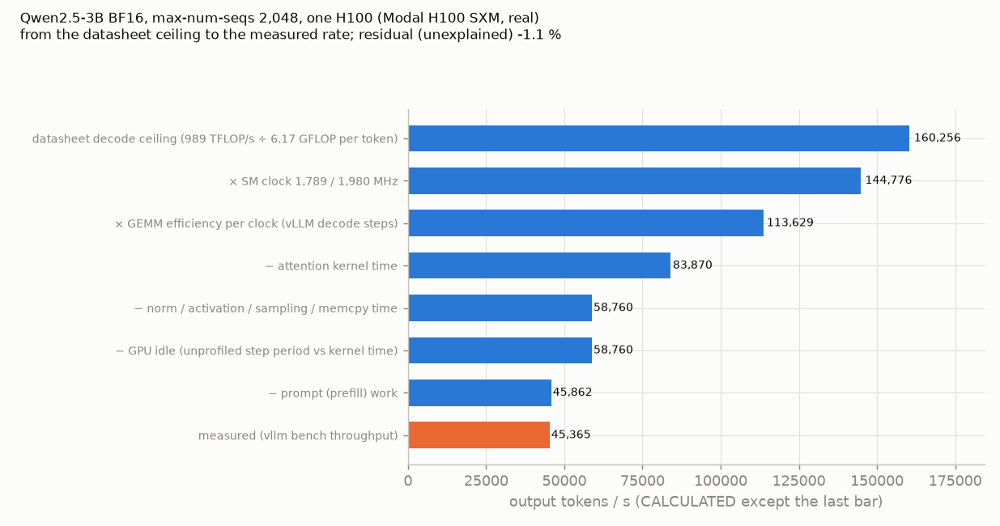
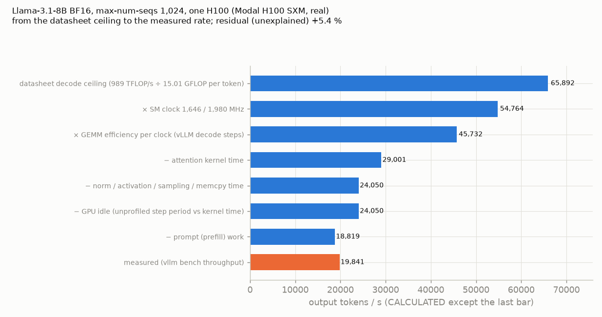
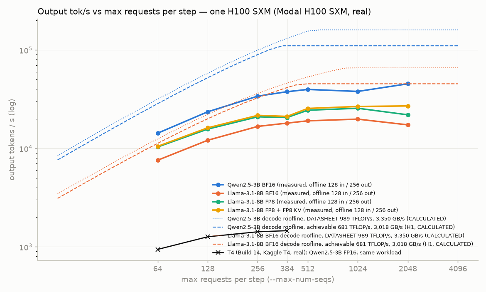
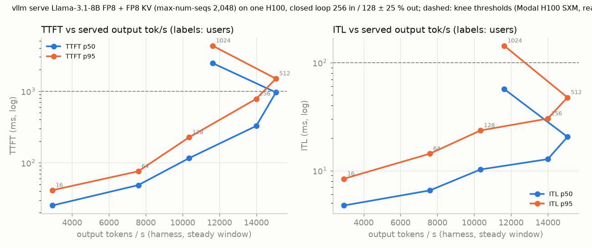

# Maximum output throughput on one H100 SXM (Modal H100 SXM, real)

Question: how many output tokens per second does one H100 reach with vLLM, where does the step time go (measured), and
how does every number compare with the T4 results of Builds 14–16 ([../t4/ridge.md](../t4/ridge.md),
[../t4/bottlenecks.md](../t4/bottlenecks.md))?

Every measured number comes from a JSONL row or a raw file under [raw/](raw/) with the command that made it. Numbers
marked CALCULATED are arithmetic on measured numbers, the model config or a price. Datasheet numbers are labelled
DATASHEET and used only for predictions and ceilings. Anything not attributed goes into "residual / unexplained".

**At a glance (Modal H100 SXM, real; vLLM 0.31.0; offline `vllm bench throughput`, in 128 / out 256 unless stated):**
- Qwen2.5-3B BF16: **45,365.2 output tok/s** at max-num-seqs 2,048 (46,232.7 with CUDA graphs up to 2,048) — **31.1×**
  the T4's 1,458.6; 37,697.9 at the T4's 384 (25.8×).
- Llama-3.1-8B: BF16 **19,840.9** (max-num-seqs 1,024), FP8 weights **25,598.6** (1,024), FP8 + FP8 KV **27,022.4**
  (2,048; 27,050.9 with graphs to 2,048). Served (vllm serve + HTTP harness, FP8 + FP8 KV, 256 in / 128 ± 25 % out):
  max **15,064** tok/s at 512 users; knee (TTFT p95 < 1 s, ITL p95 < 100 ms) at 256 users, 13,995 tok/s.
- Ceilings without vLLM: copy 3,018 GB/s; 8192³ GEMM sustained BF16 681, FP8 1,259 TFLOP/s — every sustained GEMM and
  every large-batch decode run is held by the 700 W power cap (SM 1,276–1,806 MHz instead of 1,980).
- Where the time goes at the best points: attention (8B) / small kernels (3B), the power-capped clock, prefill work and
  GEMM efficiency; the GPU does not idle at the best points (CALCULATED from vLLM's step counter), but without CUDA
  graphs it loses 34–66 % at 64 sequences.
- Cost per 1M output tokens (CALCULATED, GPU price only): Qwen $0.0242 on the H100 vs $0.1124 on the T4 (4.65×
  cheaper); Llama-3.1-8B $0.0406 (FP8 + FP8 KV) – $0.0553 (BF16).
- Spend: 2.39 GPU-h, $11.09 in total (Modal billing report), below the 4.5 GPU-h / $20 hard stop.

## Predictions (written before H1, verbatim from the assignment)

- P1 power/clock: decode workloads stay below the 700 W cap; SM clock near max boost (~1,980 MHz) with no sw_power_cap most of the time. A dense FP8/BF16 GEMM may hit the power cap and drop clock.
- P2 copy bandwidth: 2.6–3.0 TB/s (78–90 % of 3.35).
- P3 8192³ BF16 GEMM sustained 60 s: 600–800 TFLOP/s; FP8 (torch._scaled_mm) 1,000–1,500 TFLOP/s.
- P4 Qwen2.5-3B, T4 reference workload, offline, best max-num-seqs: 15,000–30,000 output tok/s (10–20× T4). Knee at much larger max-num-seqs than T4's 384.
- P5 At this small model the GPU is no longer the only limit: GPU idle between kernels 10–30 % of step time (T4: 0.2 %), and CUDA graphs off (`--enforce-eager`) costs > 20 % (T4: ~0 %).
- P6 With FlashAttention on sm_90, attention share of decode GPU time drops to 20–35 % (T4: 52 %).
- P7 Llama-3.1-8B BF16 offline best: 8,000–15,000 output tok/s; FP8 weights: +20–50 % over BF16; FP8 KV cache: further gain at large batch through more KV blocks.
- P8 Served (HTTP, same container): max output tok/s 70–90 % of the offline number at the same max-num-seqs; TTFT p95 rises sharply past the knee.
- P9 Cost per 1M output tokens at $3.95/h (CALCULATED) is lower on H100 than on the T4 at Kaggle-equivalent pricing ($0.59/h Modal T4 rate) for both models.

## Setup

- Platform: Modal (serverless, billed per second), app `goodput-h100`; region and cloud differ per container and are
  recorded per run (`MODAL_REGION`, `MODAL_CLOUD_PROVIDER` in each run's `container_start.txt` and on every row). Code: [benchmarks/modal/](../../modal/) (README there).
- Image: `nvidia/cuda:13.0.2-devel-ubuntu24.04` + Python 3.12.15, `uv pip install vllm==0.31.0` (the T4 pin; it ran,
  no fallback needed) → torch 2.13.0+cu130 (CUDA runtime 13.0.88), flashinfer-python 0.7.0.post1, triton 3.7.1,
  transformers 5.17.0, nvidia-cublas 13.1.1.3, NCCL 2.29.7 (H0 `logs/pip-freeze.txt`, `logs/vllm-collect-env.txt`).
  Plus nsight-systems 2026.3.2 and datacenter-gpu-manager-4-cuda13 from the image's CUDA apt repo; ncu 2025.3.1 ships
  in the devel image.
- Models (CPU-only `download` function into the `goodput-hf-cache` volume, revisions in `/hf/revisions.json`):
  `Qwen/Qwen2.5-3B-Instruct` @ `aa8e72537993ba99e69dfaafa59ed015b17504d1` (same as T4),
  `meta-llama/Llama-3.1-8B-Instruct` @ `0e9e39f249a16976918f6564b8830bc894c89659`,
  `RedHatAI/Meta-Llama-3.1-8B-Instruct-FP8` @ `870a1177ed082c0ba5dbefd62573ab8f91803f6a` (pre-quantised FP8 checkpoint).
- Engine defaults unless a row says otherwise: `--dtype bfloat16 --gpu-memory-utilization 0.95
  --no-enable-prefix-caching --max-num-batched-tokens 8192` (offline `vllm bench throughput`, random dataset, range
  ratio 0, temperature 1.0 hard-coded by the tool, as on T4).

## Decisions made

- **Worktree:** new, `/home/veldanda3415/workspace/goodput-stack-h100` on branch `ravi/h100-modal`, created from
  `origin/main` at `a4ea482` (`git rev-parse --show-toplevel` and `git branch --show-current` checked).
- **No own venv.** No local package beyond what the main checkout's `.venv` already has (modal 1.6.3, matplotlib) is
  needed; that venv is only read, never changed. Everything else runs in the Modal image.
- **Weights are downloaded by a CPU-only function** before any GPU container, so no H100 second is spent on downloads.
- **vLLM's compile cache (`VLLM_CACHE_ROOT`) and FlashInfer's JIT workspace (`FLASHINFER_WORKSPACE_BASE`, from
  flashinfer/jit/env.py in the installed 0.7.0.post1 wheel) live on the hf-cache volume** so later containers skip the
  rebuilds. H0 ran with both cold; from H1 on FlashInfer's is on the volume.
- **H0 ran with uncommitted code** (`git a4ea482-dirty` on its rows). The H0 commit `2cb63c2` holds that code plus three
  additions made after H0 ran: `FLASHINFER_WORKSPACE_BASE`, the CUDA-version parse in `gpu_identity`, the H1 tool probes.
- **Task budgets are applied to Modal's billed H100 time.** H0 showed that Modal bills ~124 s per container outside
  the function (boot / image load / shutdown), so later tasks get an in-container budget 0.04 h below the task budget.
- **`--max-num-batched-tokens 8192` is passed explicitly on every offline row.** vLLM 0.31.0 picks 16,384 for the offline
  LLM class on this 80 GB GPU (the T4 got 8,192 by default). The first H2 container ran without it and was stopped
  after one point; that point is kept as [20261103-073941_h2](raw/20261103-073941_h2/) and not used.
- **The 384 point of the H2 sweep is the start reference** (`ref-start`), not a separate run; the end reference
  (`ref-end`) measures drift.
- **num-prompts = 4 × max-num-seqs everywhere** (decode-only: 2 ×, prefill-only: 512 prompts, long context: 4 × with 8
  warm-ups). With ~60–90 s of engine start per point on the H100, the timed part of a run is 4–120 s.
- **Sweeps ended at 2,048** (the assigned list). Qwen did not fall twice; a 4,096 point was tried in the H4 container
  and does not start (out of memory at util 0.95).
- **Long-context and decode-only max-num-seqs** = min(best, KV pool ÷ (in + out)) with the pool from H3 minus 3 %, so
  those runs do not preempt; prefix caching was run at the best BF16 point (1,024) as assigned, where the "off" run
  preempts (stated with the result).
- **Profiles: the torch profiler as in Build 16, plus a profiler-free idle measurement.** Both the torch profiler and
  nsys lengthen the H100's steps, so the H6 waterfalls take GPU idle from the unprofiled runs' own step counters and
  the prompt share from kernel busy time (method in H6). The H4 nsys runs with vLLM's `profiler: "cuda"` capture range
  wrote no report (forked EngineCore); a follow-up container (0.056 h, within H4's budget) used `--trace-fork-before-exec=true`
  and a time window.
- **Extra points beyond the assignment, each in a container that was running anyway:** CUDA graphs captured up to the
  batch size (Qwen H2, Llama H5), Qwen `--enforce-eager` at 64 (P5), Qwen at 4,096. They are labelled as follow-ups.
- **H5: 16 vCPUs** (client and server in one container), 4 client processes above 128 users, plus one 1-process run
  at 512 users to show the client limit. Model and max-num-seqs from H3's winner (FP8 + FP8 KV, 2,048). The knee
  thresholds are the assignment's (TTFT p95 < 1 s and ITL p95 < 100 ms).
- **Modal idle containers**: after a function returns, Modal keeps the container for its scale-down window, billed.
  From H5 on `scaledown_window=2`; the failed first H4 container was stopped by hand.
- **Launch logs** went to a scratch directory from H3 on, so `git status` stays clean at launch; rows marked `-dirty`
  differ from the named commit only in result files (noted per run in [spend.md](spend.md)).
- **The FP8 checkpoint** is RedHatAI's pre-quantised `Meta-Llama-3.1-8B-Instruct-FP8` (the official Neural Magic /
  Red Hat one), not `--quantization fp8` on BF16 weights.

## H0 — smoke and permissions

Run [20261103-071355_h0](raw/20261103-071355_h0/) (Modal H100 SXM, real; app `ap-GEP4aKMRj18Zgy1CP6pk4h`, task
`ta-01M6GN943R5QBDHH9SWVF0FZER`, 2026-11-03 12:14–12:19 UTC). Rows: `h0/h0.jsonl`; raw output in `h0/logs/`.

**GPU** (`nvidia-smi -q`, `logs/nvidia-smi-q-full.txt`; `--query-gpu`, `logs/gpu-identity.txt`):

| field | value |
|---|---|
| product name | NVIDIA H100 80GB HBM3 (Hopper) — the `!` in `gpu="H100!"` held; the abort check passed |
| UUID | GPU-8328fef1-46fe-d8af-a9da-30a07eb94f90 |
| SXM or PCIe | **SXM**: power limit 700 W (default / max 700 W, min 200 W), "Platform Info → Module Id 4" (HGX baseboard module; PCIe cards have none), board part 692-2G520-0200-502, HBM3 |
| driver / CUDA (driver) | 610.57.04 / 13.3 |
| max clocks | SM 1,980 MHz, memory 2,619 MHz; 110 supported graphics clocks |
| memory | 81,559 MiB; ECC enabled; MIG disabled; persistence mode enabled |
| PCIe link (host) | Gen 5 ×16 |
| idle, 30 s at 2 Hz (`idle.gpu.csv`) | 72–139 W (mean 75.5 W), SM 345 MHz (1,980 in one sample), 43–45 °C, reason `gpu_idle` 97 % of samples, every other reason 0 % |

**CPU / RAM** (`logs/lscpu.txt`, `logs/cpu-ram.txt`): the container is a gVisor sandbox (kernel `4.19.0-gvisor`).
`nproc` = **8** (the 8 vCPUs requested); `lscpu` shows vendor AuthenticAMD, model name "unknown", 24 cores / 1 socket
visible, 1 thread per core. `free` and `/proc/meminfo` report 1,024 GiB (the sandbox's view, not the 32 GiB requested;
no cgroup `memory.max` file is visible). Runs as uid 0.

**Tools and permissions** (`h0.jsonl` row `tools`, files in `logs/`):

| tool / command | permitted? | exact result |
|---|---|---|
| `dcgmi discovery -l`, `dcgmi dmon -e 1002,1004` | **no** (installed, no host engine) | rc 235: `Error: unable to establish a connection to the specified host: localhost` / `Error: Unable to connect to host engine. Host engine connection invalid/disconnected.` |
| `nsys profile` (trace of a 2048² FP16 matmul) | **yes** | rc 0, `nsys-probe.nsys-rep` written (Nsight Systems 2026.3.2.476) |
| `ncu --metrics sm__throughput...` (default clock control) | **no** | rc 9: `==ERROR== Failed to lock GPU clock frequencies! Try locking the clocks externally (e.g. using 'nvidia-smi --lock-gpu-clocks=tdp,tdp') or profile without fixed frequencies (see '--clock-control').` (retried with `--clock-control none` in H1) |
| `nvidia-smi -i 0 -pl 200.00` | **no** | rc 4: `Failed to set power management limit for GPU 00000000:B9:00.0: Insufficient Permissions`; the reset to 700.00 W failed the same way; limit read back 700 W |
| `nvidia-smi -i 0 -lgc 1980,1980` | **no** | rc 4: `The current user does not have permission to change clocks for GPU 00000000:B9:00.0.`; `-rgc` the same |

The sampler ([benchmarks/gpu_sampler.py](../../gpu_sampler.py)) needed no change for the H100: every wanted field is
listed by this driver's `nvidia-smi --help-query-gpu` (`missing: []`), including `power.draw.average` (N/A on the T4).

**vLLM start, one request, stop** (`vllm serve Qwen/Qwen2.5-3B-Instruct --revision aa8e7253… --dtype bfloat16
--gpu-memory-utilization 0.95 --max-num-seqs 384 --max-num-batched-tokens 8192 --no-enable-prefix-caching`, row
`serve-smoke`, log `logs/serve-smoke.log`; compile and JIT caches cold):

| phase (log timestamps, UTC) | time |
|---|---:|
| `vllm serve` launched → first API-server log line (Python imports) | 12:16:05.6 → 12:16:24 ≈ 18 s |
| → EngineCore initialising (config, tokenizer, process spawn) | → 12:16:52 ≈ 28 s |
| weights: "Loading weights took 5.24 seconds"; "Model loading took 5.79 GiB memory and 10.14 seconds" | 10.1 s |
| torch.compile (Dynamo 7.02 s + "Compiling a graph for compile range (1, 8192) takes 8.75 s"), cold cache | 20.4 s |
| CUDA graph capture, first pass ("Graph capturing finished in 10 secs") | 10 s |
| FlashInfer JIT: "Building JIT module sampling; this can take several minutes on first use." 12:17:43 → FULL-graph capture start ≈ 12:18:59 | ≈ 76 s |
| second capture (FULL, 43 sizes; "finished in 13 secs") | 13 s |
| "init engine (profile, create kv cache, warmup model) took 130.13 s (compilation: 20.36 s)" | 130.1 s |
| launch → `/health` 200 (`startup_s`) | **194.2 s** |
| one request (35 prompt tokens, 9 output): TTFT 0.318 s, e2e 0.346 s; server stop | stop 4.9 s |

Startup log facts: attention backend **FLASH_ATTN** ("Using FLASH_ATTN attention backend out of potential backends:
['FLASH_ATTN', 'FLASHINFER', 'TRITON_ATTN', 'FLEX_ATTENTION']"; T4 used TRITON_ATTN); **GPU KV cache 1,970,608 tokens**
(67.66 GiB available for KV; T4 at the same util: 192,960 FP16 tokens). Container: function wall 324 s.

**Spend** ([spend.md](spend.md)): before H0 the workspace report for today was empty ($0). H0's app was billed
H100 $0.4916 (= 448 GPU-s CALCULATED, 0.124 GPU-h — over the 0.1 GPU-h budget by 0.024 h: the function ran 324 s, the
other 124 s are container boot / image load / shutdown that Modal bills), CPU $0.0471, memory $0.0319: **$0.5705**.
The image builds and the CPU-only download cost $0.057. Total after H0: **$0.627**.

## H1 — hardware ceilings without vLLM

Run [20261103-072712_h1](raw/20261103-072712_h1/) (Modal H100 SXM, real; app `ap-240LOU5bUwiFBrfJ8oQPnw`, git
`2cb63c2`; NVIDIA H100 80GB HBM3 **GPU-45d696cd-a31d-e9f9-a8ac-be292f6fec00**, region us-east (GCP) — a different card
from H0's (uk, AWS); driver
610.57.04; torch 2.13.0+cu130, 132 SMs). [benchmarks/microbench/gpu_ceilings.py](../../microbench/gpu_ceilings.py),
now dtype-generic (BF16 / FP16 `torch.matmul`, FP8 `torch._scaled_mm`) with layer shapes read from each model's
config.json. Command (row `micro` in `h1/h1.jsonl`): `python -m benchmarks.microbench.gpu_ceilings --nvml-index 0
--out .../micro --label "Modal H100 SXM, real" --bw-gib 4 --bw-repeats 20 --dtypes bfloat16,fp8 --gemm-dtypes
bfloat16,fp8,fp8fast,float16 --sustain-s 60 --m-list 1,16,64,256,512,1024,2048,8192 --shape-min-s 1.5 --interval 0.25
--model-config llama3.1-8b=<config.json> --model-config qwen2.5-3b=<config.json>`. Raw: `micro/microbench.jsonl`,
`micro/gemm_sustained_<dtype>.csv` (one row per 0.1 s chunk), `micro/gpu.csv` (sampler, 4 Hz).
`allow_bf16_reduced_precision_reduction` = True (torch default). FP8 `_scaled_mm` ran for every shape, M = 1 included.

| measurement | value |
|---|---:|
| copy, 4 GiB fp32, median of 20 (GB/s) | **3,018.4** (min 3,010.1, max 3,022.9) |
| triad, 4 GiB fp32, median of 20 (GB/s) | **3,047.3** (min 3,040.0, max 3,052.3) |

| 8192³ GEMM, 60 s | first 0.1 s chunk | first 1 s | median after 10 s | SM MHz after 10 s (mean / min) | power W after 10 s (mean / max) | temp max °C | throttle reasons after 10 s | TFLOP/s per GHz (CALCULATED) |
|---|---:|---:|---:|---:|---:|---:|---|---:|
| bfloat16 (torch.matmul) | 786.1 | 713.9 | **681.2** | 1,363 / 1,320 | 698.4 / 701.4 | 57 | sw_power_cap 100 % | 499.7 |
| fp8 (torch._scaled_mm) | 1,361.1 | 1,291.2 | **1,259.1** | 1,276 / 1,260 | 698.3 / 700.6 | 58 | sw_power_cap 100 % | 986.8 |
| fp8fast (torch._scaled_mm, fast accum) | 1,427.7 | 1,331.5 | **1,291.3** | 1,330 / 1,275 | 697.3 / 702.3 | 60 | sw_power_cap 100 % | 970.8 |
| float16 (torch.matmul) | 695.9 | 674.0 | **651.5** | 1,303 / 1,290 | 697.3 / 699.2 | 60 | sw_power_cap 100 % | 499.9 |

llama3.1-8b, bfloat16 (TFLOP/s; `torch.matmul(x[M,K], W[N,K].t())`)

| shape (K → N) | M=1 | M=16 | M=64 | M=256 | M=512 | M=1024 | M=2048 | M=8192 |
|---|---:|---:|---:|---:|---:|---:|---:|---:|
| qkv (4,096 → 6,144) | 2.3 | 36.1 | 145.4 | 491.9 | 596.2 | 640.0 | 668.7 | 671.8 |
| o (4,096 → 4,096) | 2.9 | 45.5 | 228.3 | 488.7 | 589.7 | 654.2 | 666.9 | 678.2 |
| gate_up (4,096 → 28,672) | 2.8 | 44.7 | 171.6 | 544.0 | 651.5 | 672.5 | 680.1 | 689.2 |
| down (14,336 → 4,096) | 2.6 | 41.1 | 158.2 | 474.3 | 643.5 | 698.1 | 694.9 | 697.6 |
| lm_head (4,096 → 128,256) | 2.8 | 44.5 | 173.8 | 584.3 | 612.1 | 656.6 | 678.6 | 685.4 |
| **step mix (CALCULATED)** | **2.7** | **42.7** | **167.9** | **517.4** | **635.6** | **672.5** | **681.4** | **688.3** |
| step mix GB/s, minimum bytes (CALCULATED) | 2,715 | 2,682 | 2,676 | 2,184 | 1,441 | 868 | 547 | 301 |
| SM clock, mean over the 5 shapes (MHz) | 1,901 | 1,980 | 1,980 | 1,502 | 1,372 | 1,392 | 1,372 | 1,366 |

llama3.1-8b, fp8 (TFLOP/s; `torch.matmul(x[M,K], W[N,K].t())` / `torch._scaled_mm` e4m3, out bf16)

| shape (K → N) | M=1 | M=16 | M=64 | M=256 | M=512 | M=1024 | M=2048 | M=8192 |
|---|---:|---:|---:|---:|---:|---:|---:|---:|
| qkv (4,096 → 6,144) | 4.0 | 64.8 | 259.4 | 912.4 | 1,087.5 | 1,129.3 | 1,155.8 | 1,232.1 |
| o (4,096 → 4,096) | 2.7 | 43.3 | 176.2 | 696.6 | 1,113.6 | 1,143.8 | 1,141.9 | 1,211.1 |
| gate_up (4,096 → 28,672) | 5.2 | 81.4 | 313.7 | 996.3 | 1,128.2 | 1,182.8 | 1,224.1 | 1,241.9 |
| down (14,336 → 4,096) | 4.5 | 70.9 | 300.0 | 841.5 | 1,169.0 | 1,233.4 | 1,210.3 | 1,240.1 |
| lm_head (4,096 → 128,256) | 5.6 | 87.8 | 341.1 | 1,014.7 | 1,208.7 | 1,229.8 | 1,260.5 | 1,245.8 |
| **step mix (CALCULATED)** | **4.6** | **72.6** | **289.4** | **917.9** | **1,137.8** | **1,189.3** | **1,209.2** | **1,238.4** |
| step mix GB/s, minimum bytes (CALCULATED) | 2,302 | 2,286 | 2,335 | 2,029 | 1,404 | 887 | 607 | 394 |
| SM clock, mean over the 5 shapes (MHz) | 1,836 | 1,980 | 1,980 | 1,580 | 1,412 | 1,347 | 1,353 | 1,320 |

qwen2.5-3b, bfloat16 (TFLOP/s; `torch.matmul(x[M,K], W[N,K].t())`)

| shape (K → N) | M=1 | M=16 | M=64 | M=256 | M=512 | M=1024 | M=2048 | M=8192 |
|---|---:|---:|---:|---:|---:|---:|---:|---:|
| qkv (2,048 → 2,560) | 1.1 | 18.1 | 64.1 | 245.6 | 461.9 | 578.1 | 658.8 | 650.4 |
| o (2,048 → 2,048) | 0.9 | 14.3 | 59.2 | 237.1 | 394.5 | 590.2 | 652.6 | 654.5 |
| gate_up (2,048 → 22,016) | 2.5 | 40.3 | 149.8 | 523.8 | 612.6 | 641.8 | 638.9 | 672.6 |
| down (11,008 → 2,048) | 2.2 | 34.0 | 126.8 | 323.4 | 466.7 | 669.5 | 697.9 | 710.6 |
| lm_head (2,048 → 151,936) | 2.9 | 44.8 | 170.9 | 568.3 | 642.5 | 644.2 | 669.6 | 679.1 |
| **step mix (CALCULATED)** | **2.1** | **33.5** | **125.7** | **408.1** | **544.7** | **641.9** | **658.5** | **680.5** |
| step mix GB/s, minimum bytes (CALCULATED) | 2,105 | 2,113 | 2,037 | 1,833 | 1,382 | 1,002 | 706 | 481 |
| SM clock, mean over the 5 shapes (MHz) | 1,886 | 1,980 | 1,980 | 1,753 | 1,576 | 1,477 | 1,452 | 1,420 |

qwen2.5-3b, fp8 (TFLOP/s; `torch.matmul(x[M,K], W[N,K].t())` / `torch._scaled_mm` e4m3, out bf16)

| shape (K → N) | M=1 | M=16 | M=64 | M=256 | M=512 | M=1024 | M=2048 | M=8192 |
|---|---:|---:|---:|---:|---:|---:|---:|---:|
| qkv (2,048 → 2,560) | 0.8 | 13.6 | 50.1 | 192.8 | 405.8 | 826.3 | 1,066.9 | 1,110.4 |
| o (2,048 → 2,048) | 0.6 | 10.5 | 40.5 | 163.1 | 306.2 | 676.5 | 1,060.1 | 1,068.9 |
| gate_up (2,048 → 22,016) | 4.4 | 71.4 | 268.4 | 862.9 | 986.0 | 1,096.8 | 1,135.6 | 1,175.5 |
| down (11,008 → 2,048) | 3.1 | 46.4 | 228.9 | 797.2 | 1,020.9 | 1,202.1 | 1,206.9 | 1,216.6 |
| lm_head (2,048 → 151,936) | 5.6 | 85.9 | 328.8 | 1,001.4 | 1,100.9 | 1,137.2 | 1,174.9 | 1,164.3 |
| **step mix (CALCULATED)** | **2.6** | **42.8** | **171.0** | **603.3** | **838.0** | **1,071.3** | **1,148.8** | **1,174.8** |
| step mix GB/s, minimum bytes (CALCULATED) | 1,319 | 1,358 | 1,419 | 1,470 | 1,224 | 1,042 | 837 | 640 |
| SM clock, mean over the 5 shapes (MHz) | 1,883 | 1,980 | 1,980 | 1,740 | 1,659 | 1,602 | 1,482 | 1,368 |

Ridge (CALCULATED): achievable BF16 681.2 TFLOP/s ÷ 3,018.4 GB/s = **226 FLOP/byte**; FP8 1259.1 ÷ 3,018.4 = **417**; DATASHEET BF16 989 ÷ 3,350 = 295, FP8 1,979 ÷ 3,350 = 591.

- Bandwidth: the copy runs 20 × 2.9 ms, shorter than one 4 Hz sampler interval, so no clock / power sample falls in
  its window. 3,018 GB/s is **90.1 % of the 3,350 GB/s DATASHEET** (CALCULATED); triad 91.0 %.
- **Every sustained GEMM is power-capped.** After 10 s each 8192³ GEMM runs at 697–698 W of the 700 W limit with
  sw_power_cap active in 100 % of samples and the SM clock at **1,276–1,363 MHz** (max 1,980). In the first 0.1 s
  chunk the BF16 GEMM made 786 TFLOP/s; by 1 s it averaged 714; the median after 10 s is 681.
- **Per clock, BF16 cuBLAS reaches 499.7 TFLOP/s per GHz.** The DATASHEET 989 TFLOP/s divided by the card's
  1,980 MHz max clock is 499.5 per GHz (CALCULATED). The datasheet does not say at which clock its 989 is quoted;
  if it is 1,980 MHz, cuBLAS is at 100 % of peak per clock and the whole gap to 989 is the power-capped clock
  (681 ÷ 989 = 0.69 ≈ 1,363 ÷ 1,980 = 0.69). FP8: 986.8 TFLOP/s per GHz vs DATASHEET 1,979 ÷ 1.98 = 999.5 (98.7 %).
- Layer GEMMs: at M ≤ 64 they stream weights at 2,680–2,720 GB/s (Llama BF16 mix, CALCULATED minimum bytes),
  89–90 % of the copy rate, with the clock at 1,980 MHz and 470–580 W — memory-bound and not power-capped. From
  M ≈ 512 the mix is compute-bound and the clock falls to 1,370–1,410 MHz as power reaches 697–699 W. The Llama BF16
  step mix reaches 635.6 TFLOP/s at M = 512 (93 % of the sustained 681) and 688.3 at 8192. Qwen's narrow layers
  (2,048 wide) need larger M: 544.7 at 512, 641.9 at 1,024.
- FP8 doubles the large-M rate (Llama mix 1,137.8 at M = 512, 1,238.4 at 8192) and, since it reads half the
  weight bytes, ~1.7× the rate at M ≤ 64 (Llama 289.4 vs 167.9 TFLOP/s at M = 64).

**Tool probes** (rows `ncu-noclock`, `nsys-gpu-metrics`; logs in `h1/logs/`): with `--clock-control none`, **ncu
counters are permitted**: `ncu --clock-control none --metrics sm__throughput.avg.pct_of_peak_sustained_elapsed,
dram__throughput.avg.pct_of_peak_sustained_elapsed -c 3 python -c <2048² FP16 matmul>` returned rc 0 with
sm__throughput 70.3–70.8 % and dram__throughput 9.4 % for the `nvjet_sm90_hsh_256x128_64x4_1x2_h_bz_coopA_NNT` kernel
(ncu warns: "Data collection happened without fixed GPU frequencies."). `nsys profile --gpu-metrics-devices=0` also
returned rc 0 ("GPU 0: General Metrics for NVIDIA GH100 … Collecting data"). So on Modal, unlike Kaggle, kernel
counters are available — but clocks cannot be fixed for them.

## H2 — Qwen2.5-3B, the T4 comparison

Run [20261103-074323_h2](raw/20261103-074323_h2/) (Modal H100 SXM, real; app `ap-uNzv0KBqB2z00yuHC9sL0H`, git
`ed3c1ca`; NVIDIA H100 80GB HBM3 **GPU-faa07b54-0c80-daf3-0106-53eb7839f8d6**, region us-east (GCP); driver 610.57.04,
CUDA 13.3; vLLM 0.31.0, torch 2.13.0; `Qwen/Qwen2.5-3B-Instruct` @ `aa8e7253…`). Every row: offline
`vllm bench throughput --backend vllm --model Qwen/Qwen2.5-3B-Instruct --revision aa8e7253… --dtype bfloat16
--gpu-memory-utilization 0.95 --no-enable-prefix-caching --max-num-seqs N --dataset-name random --random-input-len 128
--random-output-len 256 --random-range-ratio 0.0 --num-prompts 4N --num-warmups 32 --seed 0 --max-num-batched-tokens
8192` (+ the row's flags; full command in each row's `bench_cmd`), GPU sampler at 2 Hz, CPU sampler at 1 Hz (`bench`
= the bench process tree, `EngineCore` = the engine process alone), engine metrics at 1 Hz. "start+stop s" = process
wall − the bench's timed `elapsed_time`. Throttle column: share of sampler rows inside the timed window with the
reason active (gpu_idle excluded).

A first H2 container ([20261103-073941_h2](raw/20261103-073941_h2/), stopped after 3 min) ran without an explicit
`--max-num-batched-tokens`: vLLM 0.31.0 chose **16,384** for the offline LLM on this 80 GB GPU ("Chunked prefill is
enabled with max_num_batched_tokens=16384"), not the T4 workload's 8,192. Its one finished point (ref-start, 384) made
37,131.7 output tok/s. All later rows pass 8,192 explicitly.

Sweep (in 128 / out 256, util 0.95, max-num-batched-tokens 8,192, num-prompts 4 x max-num-seqs; 384 = ref-start):

| key | max-num-seqs | prompts | output tok/s | total tok/s | timed s | running mean | KV use max | preempt. | SM MHz mean | power W mean | throttle (excl. idle) | GPU util % | EngineCore CPU % mean / max | start+stop s |
|---|---|---|---|---|---|---|---|---|---|---|---|---|---|---|
| `sweep-mns64` | 64 | 256 | **14,283.2** | 21,424.8 | 4.6 | 38 | 0.008 | 0 | 1,948 | 428 | sw_power_cap 33 % | 67 | 113 / 128 | 51 |
| `sweep-mns128` | 128 | 512 | **23,563.3** | 35,345.0 | 5.6 | 96 | 0.025 | 0 | 1,947 | 504 | sw_power_cap 27 % | 85 | 104 / 112 | 52 |
| `sweep-mns256` | 256 | 1024 | **33,975.9** | 50,963.9 | 7.7 | 185 | 0.041 | 0 | 1,917 | 568 | sw_power_cap 31 % | 87 | 114 / 127 | 58 |
| `ref-start` | 384 | 1536 | **37,697.9** | 56,546.9 | 10.4 | 338 | 0.073 | 0 | 1,919 | 648 | sw_power_cap 35 % | 90 | 94 / 126 | 63 |
| `sweep-mns512` | 512 | 2048 | **39,761.2** | 59,641.7 | 13.2 | 463 | 0.100 | 0 | 1,924 | 659 | sw_power_cap 63 % | 91 | 89 / 115 | 61 |
| `sweep-mns1024` | 1024 | 4096 | **37,954.7** | 56,932.0 | 27.6 | 936 | 0.195 | 0 | 1,898 | 613 | sw_power_cap 64 % | 80 | 98 / 134 | 58 |
| `sweep-mns2048` | 2048 | 8192 | **45,365.2** | 68,047.8 | 46.2 | 1,792 | 0.391 | 0 | 1,789 | 669 | sw_power_cap 97 % | 94 | 100 / 153 | 61 |

Ablations, profiles, end reference:

| key | max-num-seqs | prompts | output tok/s | total tok/s | timed s | running mean | KV use max | preempt. | SM MHz mean | power W mean | throttle (excl. idle) | GPU util % | EngineCore CPU % mean / max | start+stop s |
|---|---|---|---|---|---|---|---|---|---|---|---|---|---|---|
| `mbt16384-mns2048` | 2048 | 8192 | **43,186.4** | 64,779.6 | 48.6 | 1,771 | 0.405 | 0 | 1,823 | 641 | sw_power_cap 95 % | 88 | 91 / 152 | 62 |
| `mbt32768-mns2048` | 2048 | 8192 | **44,595.0** | 66,892.5 | 47.0 | 1,795 | 0.418 | 0 | 1,783 | 661 | sw_power_cap 98 % | 93 | 107 / 141 | 66 |
| `half-mns2048` | 2048 | 8192 | **44,613.2** | 66,919.9 | 47.0 | 1,833 | 0.392 | 0 | 1,737 | 670 | sw_power_cap 98 % | 95 | 101 / 154 | 63 |
| `eager-mns2048` | 2048 | 8192 | **41,011.2** | 61,516.9 | 51.1 | 1,792 | 0.374 | 0 | 1,819 | 633 | sw_power_cap 95 % | 85 | 109 / 155 | 30 |
| `cg2048-mns2048` | 2048 | 8192 | **46,232.7** | 69,349.1 | 45.4 | 1,727 | 0.394 | 0 | 1,758 | 674 | sw_power_cap 98 % | 93 | 109 / 152 | 90 |
| `prof-mns64` | 64 | 256 | **2,928.0** | 4,391.9 | 22.4 | 56 | 0.010 | 0 | 1,980 | 160 | sw_power_cap 2 % | 7 | 117 / 125 | 60 |
| `prof-mns384` | 384 | 1536 | **10,536.7** | 15,805.0 | 37.3 | 341 | 0.069 | 0 | 1,966 | 247 | sw_power_cap 9 % | 22 | 116 / 158 | 64 |
| `prof-mns2048` | 2048 | 8192 | **12,829.1** | 19,243.7 | 163.5 | 1,972 | 0.389 | 0 | 1,946 | 271 | sw_power_cap 33 % | 25 | 114 / 155 | 67 |
| `ref-end` | 384 | 1536 | **37,684.4** | 56,526.6 | 10.4 | 343 | 0.075 | 0 | 1,915 | 645 | sw_power_cap 29 % | 90 | 101 / 123 | 37 |

GPU GPU-faa07b54-0c80-daf3-0106-53eb7839f8d6, Modal task ta-01M6GPZ2E6TDP8NFWS4QF39WKR, region us-east, CLOUD_PROVIDER_GCP; KV cache 1,970,896 tokens; backend lines: ["(EngineCore pid=86) INFO 11-03 12:43:54 [cuda.py:526] Using FLASH_ATTN attention backend out of potential backends: ['FLASH_ATTN', 'FLASHINFER', 'TRITON_ATTN', 'FLEX_ATTENTION']."]

**Results.**
- **Best: 45,365.2 output tok/s at max-num-seqs 2,048** (68,047.8 total tok/s), 31.1× the T4's 1,458.6 at 384
  (CALCULATED). At the T4's own 384 the H100 makes 37,697.9 (25.8×). The sweep did not stop early: output fell once
  (512 → 1,024: 39,761 → 37,955) and rose again at 2,048, the end of the assigned list, so the maximum may lie above
  2,048 (a 4,096 point is queued in the H4 container). No point preempted; KV use stays ≤ 0.39 of the 1,970,896-token
  pool.
- Drift: ref-start 37,697.9 at 1,919 MHz, ref-end 37,684.4 at 1,915 MHz (−0.04 %), same card.
- **Power and clock:** at 64–384 the mean SM clock is 1,917–1,948 MHz and power 428–648 W; sw_power_cap is active in
  27–35 % of samples. At 2,048 it is 1,789 MHz, 669 W, sw_power_cap 97 %. Thermal / hardware reasons: 0 % everywhere.
  GPU util (NVML "a kernel was running") is 67 % at 64, 85–91 % at 128–512, 80 % at 1,024, 94 % at 2,048.
- **CPU:** the EngineCore process uses 89–114 % of one core on average (max 126–155 %) at every point. The container's
  system-wide CPU % (gVisor shows 24 cores, 8 allowed) is not used.

Ablations at the best point (max-num-seqs 2,048), same session:

| ablation | output tok/s | vs best | SM MHz | output tok/s per MHz vs best (CALCULATED) |
|---|---:|---:|---:|---:|
| best (`sweep-mns2048`), BF16, mbt 8,192 | 45,365.2 | — | 1,789 | — |
| `--max-num-batched-tokens 16384` | 43,186.4 | −4.8 % | 1,823 | −6.6 % |
| `--max-num-batched-tokens 32768` | 44,595.0 | −1.7 % | 1,783 | −1.4 % |
| `--dtype half` | 44,613.2 | −1.7 % | 1,737 | +1.2 % |
| `--enforce-eager` | 41,011.2 | **−9.6 %** | 1,819 | −11.1 % |
| `--max-cudagraph-capture-size 2048` (graphs up to the batch) | **46,232.7** | +1.9 % | 1,758 | +3.7 % |

- dtype is not a hidden variable: FP16 is within 1.7 % of BF16 (+1.2 % per MHz).
- **CUDA graphs.** By default vLLM 0.31.0 captures sizes 1…512 (`cudagraph_capture_sizes` [1, 2, 4, 8, …, 512], mode
  FULL_AND_PIECEWISE: logs show 51 PIECEWISE + 51 FULL graphs at max-num-seqs ≥ 512), so a 2,048-request decode step
  runs without a graph. Capturing up to 2,048 (147 sizes, +29 s start) gains 1.9 %. `--enforce-eager` turns off both
  the graphs and torch.compile (`cudagraph_capture_sizes: []`) and costs 9.6 % at 2,048. The T4 saw −0.1 % at 384.
- Attention backend: **FLASH_ATTN** ("Using FLASH_ATTN attention backend out of potential backends: ['FLASH_ATTN',
  'FLASHINFER', 'TRITON_ATTN', 'FLEX_ATTENTION']", "Using FlashAttention version 3"); top-p/top-k sampling via
  FlashInfer ("Using FlashInfer for top-p & top-k sampling."); "Using V2 Model Runner".

**Profiles** (vLLM's torch profiler, same config as Build 16 G2: `--profile --profiler-config '{"profiler": "torch",
"torch_profiler_with_stack": false, "torch_profiler_record_shapes": false, "torch_profiler_use_gzip": true,
"detailed_trace_annotation": true, "ignore_frontend": true, "delay_iterations": 300, "max_iterations": 300}'`,
`VLLM_CUSTOM_SCOPES_FOR_PROFILING=1`; traces in `trace-prof-mns*/`, summaries `prof-mns*.breakdown.json` from
[trace_breakdown.py](../../kaggle/trace_breakdown.py) run locally by `report_h100.py traces`; every device event joined
to its launch). The classifier now treats `nvjet_*` as GEMM and FlashAttention-3 kernels (cutlass templates named
`flash::…`) as attention.

| category (share of the profiled window) | 64 | 384 | 2,048 |
|---|---:|---:|---:|
| GEMM (cuBLAS `nvjet_sm90_*`) | 65.7 % | 40.3 % | 36.6 % |
| attention (FlashAttention 3 `FlashAttnFwdSm90` + combine, KV write) | 16.0 % | 18.1 % | 14.0 % |
| sampling (`_gumbel_sample_kernel`, …) | 1.3 % | 1.9 % | 2.0 % |
| norms / activation / other elementwise (incl. `_post_update_kernel`) | 7.7 % | 9.5 % | 10.8 % |
| memcpy / memset | 0.2 % | 1.1 % | 1.2 % |
| **GPU idle between kernels** (inflated by the profiler, see below) | 9.1 % | 30.1 % | 36.6 % |
| window / steps | 1,368 ms / 299 | 4,070 ms / 299 | 19,187 ms / 299 |

| decode-only steps (CALCULATED from the trace) | 64 | 384 | 2,048 |
|---|---:|---:|---:|
| steps | 296 | 291 | 254 |
| GPU step period, mean (ms) | 4.27 | 12.16 | 59.28 |
| busy (%) | 92.4 | 66.5 | 54.0 |
| GEMM share of step (%) | 66.3 | 35.4 | 27.9 |
| attention share of step (%) | 17.1 | 19.9 | 14.2 |
| idle share of step (%) | 7.6 | 33.5 | 46.0 |
| GEMM rate inside GEMM kernels (TFLOP/s) | 139.6 | 550.8 | 763.0 |
| KV tokens read per step | 15,761 | 94,354 | 495,960 |
| attention kernel time per step (ms) | 0.65 | 2.33 | 8.16 |
| KV read rate inside attention (GB/s, 36,864 B/token) | 896 | 1,490 | 2,240 |
| CPU time in execute_model, p50 (ms) | 1.52 | 2.15 | 20.68 |
| CPU step period, p50 (ms) | 4.21 | 12.05 | 59.00 |
| decode tok/s inside the window | 15,000 | 31,566 | 34,546 |

- **The torch profiler slows the larger batches.** Inside the window, decode-only steps ran at 15,000 tok/s at 64 (the
  unprofiled run: 14,283 overall), but at 31,566 tok/s at 384 and 34,546 at 2,048, against 37,698 and 45,365 unprofiled
  *including* prefill steps. The CPU step period equals the GPU step period (12.06 vs 12.03 ms at 384), i.e. the GPU
  waits for the CPU, and the profiler's own CPU work lengthens that wait. So the idle shares at 384 / 2,048 (34 / 46 %
  of decode steps) are upper bounds, not the unprofiled idle. Kernel durations are not affected by this; kernel *rates*
  are, slightly, through the clock: the profiled runs drew 160–271 W and ran at 1,946–1,980 MHz instead of 1,789–1,948.
  The idle share without a profiler is measured in H6 (≈ 0 at 2,048, 12.3 % at 384).
- **Attention is 14–20 % of decode step time** (T4: 52–58 %). FlashAttention 3 reads KV at **2,240 GB/s at 2,048**
  (74 % of the 3,018 GB/s copy rate, CALCULATED) and 1,490 GB/s at 384; the T4's Triton kernel managed 29 GB/s
  (12 % of its copy rate).
- **GEMM rate inside the GEMM kernels:** 140 TFLOP/s at 64 (memory-bound: 6.2 GB of weights per step in 2.8 ms ≈
  2.2 TB/s, CALCULATED), 551 at 384, 763 at 2,048 (at the profiled run's 1,946 MHz: 392 TFLOP/s per GHz, 78 % of the
  499.7 per GHz cuBLAS reached in H1). CPU time in execute_model per step: 1.5 ms at 64, 2.2 ms at 384, **20.7 ms at
  2,048** (likely because a batch above 512 runs without a CUDA graph and launches its kernels one by one; not separately measured).
- Elementwise work is 8–11 % of the window; one kernel, `_post_update_kernel` (one launch per step), alone is 5–8 % at
  384 / 2,048.

**Spend:** H2's app `ap-uNzv0KBqB2z00yuHC9sL0H`: see [spend.md](spend.md) (refreshed at each commit); the stopped first
try cost $0.24 (188 GPU-s).

## H3 — Llama-3.1-8B-Instruct

Run [20261103-081737_h3](raw/20261103-081737_h3/) (Modal H100 SXM, real; app `ap-QprtvcB3ROj4kwXZPpiS8X`, git
`e513d7b`; NVIDIA H100 80GB HBM3 **GPU-ee3bcf17-9cec-bcb5-82d5-b8bbe96a353f**, region uk (GCP), task
`ta-01M6GRXR9Q9Q17617W96KKTX8R`; driver 610.57.04, CUDA 13.3, vLLM 0.31.0, torch 2.13.0). Same workload, flags and sweep
rule as H2 (`--dtype bfloat16`, util 0.95, in 128 / out 256, `--max-num-batched-tokens 8192`, num-prompts 4 ×
max-num-seqs). Configurations:
(a) **BF16** `meta-llama/Llama-3.1-8B-Instruct` @ `0e9e39f249a16976918f6564b8830bc894c89659`;
(b) **FP8 weights**: the pre-quantised checkpoint `RedHatAI/Meta-Llama-3.1-8B-Instruct-FP8` @
`870a1177ed082c0ba5dbefd62573ab8f91803f6a` (no `--quantization` flag; vLLM reads the checkpoint's quantization config;
GEMMs run as `vllm::cutlass_3x_gemm_sm90_fp8<float_e4m3_t, bfloat16_t, …>`);
(c) (b) + `--kv-cache-dtype fp8` (log: "Using fp8 data type to store kv cache").
Each model's config.json is saved in `h3/logs/config-*.json`. Attention backend FLASH_ATTN (FlashAttention 3) in all
three; for (c) the candidate list drops FLEX_ATTENTION.

a-bf16: `meta-llama/Llama-3.1-8B-Instruct` @ `0e9e39f2`, KV cache 480,320 tokens, weights 15.0 GiB, KV memory 58.63 GiB

| key | max-num-seqs | prompts | output tok/s | total tok/s | timed s | running mean | KV use max | preempt. | SM MHz mean | power W mean | throttle (excl. idle) | GPU util % | EngineCore CPU % mean / max | start+stop s |
|---|---|---|---|---|---|---|---|---|---|---|---|---|---|---|
| `a-bf16-mns64` | 64 | 256 | **7,588.1** | 11,382.2 | 8.6 | 56 | 0.049 | 0 | 1,929 | 584 | sw_power_cap 18 % | 92 | 83 / 109 | 87 |
| `a-bf16-mns128` | 128 | 512 | **12,102.6** | 18,153.9 | 10.8 | 101 | 0.098 | 0 | 1,921 | 637 | sw_power_cap 23 % | 91 | 84 / 116 | 62 |
| `a-bf16-mns256` | 256 | 1024 | **16,740.2** | 25,110.3 | 15.7 | 212 | 0.181 | 0 | 1,764 | 659 | sw_power_cap 94 % | 94 | 73 / 119 | 66 |
| `a-bf16-mns384` | 384 | 1536 | **18,078.3** | 27,117.4 | 21.8 | 340 | 0.299 | 0 | 1,712 | 680 | sw_power_cap 98 % | 95 | 81 / 100 | 74 |
| `a-bf16-mns512` | 512 | 2048 | **19,074.4** | 28,611.6 | 27.5 | 481 | 0.399 | 0 | 1,674 | 681 | sw_power_cap 98 % | 94 | 59 / 88 | 70 |
| `a-bf16-mns1024` | 1024 | 4096 | **19,840.9** | 29,761.4 | 52.8 | 968 | 0.828 | 0 | 1,646 | 683 | sw_power_cap 98 % | 98 | 108 / 167 | 73 |
| `a-bf16-mns2048` | 2048 | 8192 | **17,352.3** | 26,028.4 | 120.9 | 1,438 | 1.000 | 2649 | 1,610 | 689 | sw_power_cap 99 % | 99 | 83 / 154 | 79 |

b-fp8: `RedHatAI/Meta-Llama-3.1-8B-Instruct-FP8` @ `870a1177`, KV cache 533,536 tokens, weights 8.51 GiB, KV memory 65.13 GiB

| key | max-num-seqs | prompts | output tok/s | total tok/s | timed s | running mean | KV use max | preempt. | SM MHz mean | power W mean | throttle (excl. idle) | GPU util % | EngineCore CPU % mean / max | start+stop s |
|---|---|---|---|---|---|---|---|---|---|---|---|---|---|---|
| `b-fp8-mns64` | 64 | 256 | **10,349.8** | 15,524.6 | 6.3 | 53 | 0.040 | 0 | 1,895 | 514 | sw_power_cap 17 % | 85 | 89 / 117 | 82 |
| `b-fp8-mns128` | 128 | 512 | **15,711.7** | 23,567.5 | 8.3 | 100 | 0.073 | 0 | 1,944 | 535 | sw_power_cap 18 % | 87 | 95 / 117 | 70 |
| `b-fp8-mns256` | 256 | 1024 | **20,958.9** | 31,438.4 | 12.5 | 219 | 0.185 | 0 | 1,913 | 636 | sw_power_cap 24 % | 90 | 86 / 117 | 76 |
| `b-fp8-mns384` | 384 | 1536 | **20,606.3** | 30,909.5 | 19.1 | 337 | 0.280 | 0 | 1,904 | 645 | sw_power_cap 23 % | 95 | 78 / 123 | 79 |
| `b-fp8-mns512` | 512 | 2048 | **24,437.1** | 36,655.7 | 21.5 | 454 | 0.368 | 0 | 1,876 | 662 | sw_power_cap 95 % | 94 | 97 / 115 | 79 |
| `b-fp8-mns1024` | 1024 | 4096 | **25,598.6** | 38,397.9 | 41.0 | 980 | 0.716 | 0 | 1,781 | 676 | sw_power_cap 98 % | 97 | 102 / 155 | 78 |
| `b-fp8-mns2048` | 2048 | 8192 | **21,948.8** | 32,923.3 | 95.5 | 1,508 | 1.000 | 2245 | 1,698 | 684 | sw_power_cap 96 % | 99 | 76 / 133 | 77 |

c-fp8kv: `RedHatAI/Meta-Llama-3.1-8B-Instruct-FP8` @ `870a1177`, KV cache 1,067,088 tokens, weights 8.51 GiB, KV memory 65.13 GiB

| key | max-num-seqs | prompts | output tok/s | total tok/s | timed s | running mean | KV use max | preempt. | SM MHz mean | power W mean | throttle (excl. idle) | GPU util % | EngineCore CPU % mean / max | start+stop s |
|---|---|---|---|---|---|---|---|---|---|---|---|---|---|---|
| `c-fp8kv-mns64` | 64 | 256 | **10,495.5** | 15,743.2 | 6.2 | 46 | 0.023 | 0 | 1,977 | 449 | sw_power_cap 23 % | 84 | 92 / 109 | 68 |
| `c-fp8kv-mns128` | 128 | 512 | **16,194.8** | 24,292.2 | 8.1 | 96 | 0.037 | 0 | 1,886 | 515 | sw_power_cap 38 % | 81 | 79 / 119 | 74 |
| `c-fp8kv-mns256` | 256 | 1024 | **21,682.4** | 32,523.6 | 12.1 | 200 | 0.081 | 0 | 1,917 | 602 | sw_power_cap 24 % | 88 | 115 / 145 | 78 |
| `c-fp8kv-mns384` | 384 | 1536 | **21,151.6** | 31,727.4 | 18.6 | 356 | 0.140 | 0 | 1,890 | 633 | sw_power_cap 19 % | 92 | 76 / 97 | 74 |
| `c-fp8kv-mns512` | 512 | 2048 | **25,488.8** | 38,233.1 | 20.6 | 473 | 0.170 | 0 | 1,891 | 641 | sw_power_cap 49 % | 95 | 83 / 120 | 78 |
| `c-fp8kv-mns1024` | 1024 | 4096 | **26,684.6** | 40,026.9 | 39.3 | 959 | 0.372 | 0 | 1,837 | 651 | sw_power_cap 96 % | 96 | 96 / 139 | 82 |
| `c-fp8kv-mns2048` | 2048 | 8192 | **27,022.4** | 40,533.6 | 77.6 | 1,882 | 0.728 | 0 | 1,806 | 668 | sw_power_cap 99 % | 98 | 71 / 114 | 82 |

Profiled runs (speed not used):

| key | max-num-seqs | prompts | output tok/s | total tok/s | timed s | running mean | KV use max | preempt. | SM MHz mean | power W mean | throttle (excl. idle) | GPU util % | EngineCore CPU % mean / max | start+stop s |
|---|---|---|---|---|---|---|---|---|---|---|---|---|---|---|
| `prof-a-bf16-mns1024` | 1024 | 4096 | **7,620.6** | 11,430.8 | 137.6 | 981 | 0.830 | 0 | 1,885 | 323 | sw_power_cap 38 % | 34 | 123 / 159 | 73 |
| `prof-c-fp8kv-mns2048` | 2048 | 8192 | **9,664.2** | 14,496.3 | 217.0 | 1,986 | 0.724 | 0 | 1,929 | 302 | sw_power_cap 34 % | 34 | 110 / 139 | 87 |

| config | best output tok/s | at max-num-seqs | KV cache tokens at util 0.95 (startup log, range over the sweep) | preemptions at the best point | SM MHz / power W at the best point |
|---|---:|---:|---:|---:|---|
| (a) BF16 | **19,840.9** | 1,024 | 466,064 – 480,320 (weights 15.0 GiB, KV 58.6 GiB) | 0 (2,649 at 2,048: KV full) | 1,646 / 683 |
| (b) FP8 weights | **25,598.6** (+29.0 % vs a) | 1,024 | 519,344 – 533,536 (weights 8.51 GiB, KV 65.1 GiB) | 0 (2,245 at 2,048) | 1,781 / 676 |
| (c) FP8 weights + FP8 KV | **27,022.4** (+36.2 % vs a, +5.6 % vs b) | 2,048 | 1,038,704 – 1,067,088 | 0 | 1,806 / 668 |

- **(a) and (b) peak at 1,024 and fall at 2,048 because the KV pool is full** (KV use max 1.000, 2,649 / 2,245
  preemptions). FP8 KV doubles the pool (1.04 M tokens), so (c) keeps climbing to 2,048 with KV use 0.73 and no
  preemption — at 1,024 (c) is only +4.2 % over (b); the extra comes from the larger batch the pool allows.
- Power: every config sits at 668–689 W with sw_power_cap 94–99 % of samples from max-num-seqs 256 (BF16) / 512 (FP8)
  up, and the SM clock falls with batch size: BF16 1,929 MHz at 64 → 1,646 at 1,024; FP8 1,895 → 1,781.
- A dip at 384 in (b) and (c) (below 256) and in Qwen at 1,024 (H2) is not explained by any recorded quantity here.

Profiles of the best points of (a) and (c) (same torch-profiler config as H2; traces `trace-prof-*`, summaries
`prof-*.breakdown.json`, KV bytes per token from config.json: 32 layers × 2 × 8 KV heads × 128 × 2 B (BF16) or 1 B (FP8)):

| (torch profiler, 300 steps) | BF16, max-num-seqs 1,024 | FP8 + FP8 KV, max-num-seqs 2,048 |
|---|---:|---:|
| gemm share of window | 46.8 % | 45.6 % |
| attention share of window | 23.4 % | 33.1 % |
| sampling share of window | 0.9 % | 1.4 % |
| elementwise share of window | 7.0 % | 11.6 % |
| memcpy share of window | 0.8 % | 1.7 % |
| idle share of window | 21.8 % | 8.3 % |
| decode step: GPU period, mean (ms) | 51.2 | 64.6 |
| decode step: busy % | 72.6 | 88.5 |
| decode step: GEMM % | 38.2 | 39.7 |
| decode step: attention % | 26.6 | 35.8 |
| decode step: idle % | 27.4 | 11.5 |
| GEMM rate inside GEMM kernels (TFLOP/s) | 786 | 1,198 |
| KV read rate inside attention (GB/s; 131,072 / 65,536 B per token) | 2,455 | 1,457 |
| CPU time in execute_model, p50 (ms) | 28.8 | 20.9 |
| CPU step period, p50 (ms) | 51.1 | 64.2 |
| decode tok/s inside the window | 19,997 | 31,704 |

- **In the profiled run, BF16 at 1,024 shows the GPU idle 27 % of each decode step** while the CPU spends 28.8 ms per
  step in execute_model (CPU step period 51.1 ms = GPU step period 51.2 ms; the batch is above the default CUDA-graph
  limit of 512). That idle is the profiler's: the unprofiled run's own step counter gives 49.2 ms per step *including*
  prefill steps, no longer than the kernel time (H6), so without the profiler the GPU does not wait.
- **Attention is 26.6 % (BF16) and 35.8 % (FP8 KV) of a decode step.** FlashAttention 3 reads BF16 KV at 2,455 GB/s
  (81 % of the 3,018 GB/s copy rate, CALCULATED) but FP8 KV at 1,457 GB/s of FP8 bytes (48 %): with an FP8 cache,
  attention reads half the bytes but runs at ~60 % of the BF16 byte rate, so it takes a larger share.
- GEMM rate inside the GEMM kernels: BF16 786 TFLOP/s at the profiled 1,885 MHz (417 per GHz, 83 % of cuBLAS's 499.7
  in H1); FP8 1,198 TFLOP/s at 1,929 MHz (621 per GHz, 63 % of `_scaled_mm`'s 986.8). FP8 runs also spend 6.6 % of device time
  in `act_and_mul_quant_kernel` (SiLU fused with the activation quantisation for the next FP8 GEMM).

## H4 — ablations at the best Llama points

Run [20261103-090523_h4](raw/20261103-090523_h4/) (Modal H100 SXM, real; app `ap-0lQ9vphWMSeZ3vnhAgEM9M`, git
`c8c87a6`; NVIDIA H100 80GB HBM3 **GPU-f55094d5-7cb2-3876-c1c5-141e6f149915**, region uk (GCP), task `ta-01M6GVN78Z6P5FDXEPBG21QXTR`;
driver 610.57.04, vLLM 0.31.0). A first container (`ap-aLoWnUbZebes4qht7vuWdw`) exited in seconds on an argument error
(`--prefix-args --random-prefix-len=1024`: "argument --prefix-args: expected one argument"); it was relaunched as
`--prefix-args=--random-prefix-len=1024`. Inputs from H3: best max-num-seqs BF16 1,024, FP8 + FP8 KV 2,048; KV pools
470,512 and 1,038,704 tokens, used with a 3 % margin (456,000 / 1,007,000) to pick max-num-seqs that do not preempt.
Every row: the H2 command with the row's model, lengths and flags (`bench_cmd` in the JSONL).

| key | max-num-seqs | prompts | output tok/s | total tok/s | timed s | running mean | KV use max | preempt. | SM MHz mean | power W mean | throttle (excl. idle) | GPU util % | EngineCore CPU % mean / max | start+stop s |
|---|---|---|---|---|---|---|---|---|---|---|---|---|---|---|
| `long2048-a-bf16-mns197` | 197 | 788 | **3,126.1** | 28,134.6 | 64.5 | 178 | 0.932 | 0 | 1,571 | 691 | sw_power_cap 98 % | 99 | 37 / 144 | 82 |
| `long2048-c-fp8kv-mns437` | 437 | 1748 | **4,610.4** | 41,493.4 | 97.1 | 388 | 0.937 | 0 | 1,590 | 689 | sw_power_cap 96 % | 99 | 40 / 140 | 85 |
| `long8192-a-bf16-mns53` | 53 | 212 | **761.9** | 25,143.3 | 71.2 | 48 | 0.929 | 0 | 1,584 | 685 | sw_power_cap 71 % | 99 | 40 / 73 | 69 |
| `long8192-c-fp8kv-mns119` | 119 | 476 | **1,146.6** | 37,837.0 | 106.3 | 105 | 0.939 | 0 | 1,609 | 683 | sw_power_cap 83 % | 98 | 45 / 83 | 81 |
| `dec-a-bf16-mns863` | 863 | 1726 | **23,796.7** | 24,540.4 | 37.1 | 840 | 0.967 | 0 | 1,744 | 684 | sw_power_cap 99 % | 97 | 109 / 136 | 66 |
| `pre-a-bf16-in2048` | 1024 | 512 | **20.9** | 42,731.2 | 24.6 | 4 | 0.017 | 0 | 1,407 | 683 | sw_power_cap 98 % | 96 | 31 / 69 | 45 |
| `eager-a-bf16-mns64` | 64 | 256 | **4,968.9** | 7,453.4 | 13.2 | 59 | 0.051 | 0 | 1,961 | 409 | sw_power_cap 12 % | 68 | 107 / 135 | 40 |
| `eager-a-bf16-mns1024` | 1024 | 4096 | **19,721.9** | 29,582.9 | 53.2 | 961 | 0.809 | 0 | 1,632 | 690 | sw_power_cap 99 % | 98 | 72 / 144 | 31 |
| `prefix-on-a-bf16-mns1024` | 1024 | 4096 | **14,080.4** | 77,442.3 | 74.5 | 873 | 0.818 | 0 | 1,648 | 688 | sw_power_cap 99 % | 98 | 87 / 147 | 64 |
| `prefix-off-a-bf16-mns1024` | 1024 | 4096 | **4,828.8** | 26,558.6 | 217.1 | 331 | 1.000 | 582 | 1,522 | 693 | sw_power_cap 98 % | 100 | 40 / 142 | 65 |
| `nsys-qwen-mns2048` | 2048 | 8192 | **36,360.0** | 54,540.0 | 57.7 | 1,828 | 0.390 | 0 | 1,854 | 584 | sw_power_cap 96 % | 75 | 115 / 148 | 66 |
| `nsys-a-bf16-mns1024` | 1024 | 4096 | **19,733.2** | 29,599.8 | 53.1 | 959 | 0.820 | 0 | 1,637 | 689 | sw_power_cap 99 % | 97 | 103 / 153 | 54 |
| `qwen-eager-mns64` | 64 | 256 | **4,874.4** | 7,311.6 | 13.4 | 59 | 0.012 | 0 | 1,968 | 239 | sw_power_cap 7 % | 35 | 130 / 140 | 27 |
| `qwen-mns4096` | 4096 | 16384 | rc 1 |  |  | 0 | 0.000 |  | 0 | 0 | none | 0 | 0 / 0 |  |
| `nsys-qwen-mns384` | 384 | 1536 | **35,875.2** | 53,812.8 | 11.0 | 343 | 0.075 | 0 | 1,931 | 631 | sw_power_cap 27 % | 89 | 120 / 139 | 50 |

**1. Long context** (num-prompts 4 × max-num-seqs, 8 warm-ups; max-num-seqs = min(best, KV pool ÷ (in + 256))):

| config | in / out | max-num-seqs (rule) | output tok/s | prompt tok/s (total − output) | KV use max | preemptions | SM MHz / W |
|---|---|---:|---:|---:|---:|---:|---|
| BF16 | 2,048 / 256 | 197 (456,000 ÷ 2,304) | **3,126.1** | 25,008.5 | 0.932 | 0 | 1,571 / 691 |
| FP8 + FP8 KV | 2,048 / 256 | 437 (1,007,000 ÷ 2,304) | **4,610.4** | 36,883.0 | 0.937 | 0 | 1,590 / 689 |
| BF16 | 8,192 / 256 | 53 (456,000 ÷ 8,448) | **761.9** | 24,381.4 | 0.929 | 0 | 1,584 / 685 |
| FP8 + FP8 KV | 8,192 / 256 | 119 (1,007,000 ÷ 8,448) | **1,146.6** | 36,690.4 | 0.939 | 0 | 1,609 / 683 |

With 2,048-token prompts the GPU spends its time on prefill: 25–37 k prompt tok/s, 6–8× the output rate. FP8 + FP8 KV
gives +47–50 % output tok/s here (twice the sequences fit, and FP8 GEMMs), more than its +36 % at 128 / 256.

**2. Decode-only and prefill-only** (BF16):
- Decode-only 16 in / 512 out (bench ignore_eos), max-num-seqs 863 (= 456,000 ÷ 528, below the best 1,024 so it does
  not preempt), 2 × 863 prompts: **23,796.7 output tok/s** at 1,744 MHz, 684 W; 0 preemptions. CALCULATED: × 15.01
  GFLOP per decode token (2 × 7.505 G linear + lm_head parameters, config.json) = **357 TFLOP/s** of GEMM work
  (52 % of the 681 sustained), attention not counted.
- Prefill-only 2,048 in / 1 out, max-num-seqs 1,024, 512 prompts: **42,710.4 prompt tok/s** (total − output) at
  1,407 MHz, 683 W, sw_power_cap 100 %. CALCULATED: 29.69 TFLOP per prompt (linear 2 × 6.979 G × 2,048 + lm_head for
  one token + causal attention 2 × 32 × 4,096 × 2,048² = 3.7 %) → **619 TFLOP/s**, 91 % of H1's sustained 681
  (440 TFLOP/s per GHz, 88 % of cuBLAS's 499.7 per GHz).

**3. `--enforce-eager`** (BF16; graphs + torch.compile off):

| max-num-seqs | with graphs (H3) | eager | change | SM MHz graphs / eager |
|---:|---:|---:|---:|---|
| 64 | 7,588.1 | 4,968.9 | **−34.5 %** | 1,929 / 1,961 |
| 1,024 | 19,840.9 | 19,721.9 | −0.6 % | 1,646 / 1,632 |
| Qwen2.5-3B, 64 (H2 sweep vs `qwen-eager-mns64` here) | 14,283.2 | 4,874.4 | **−65.9 %** | 1,948 / 1,968 |

The H3 and H4 rows come from different cards in different containers (H3 GPU-ee3bcf17…, H4 GPU-…6f149915; H2
GPU-faa07b54…); the clocks are within 2 %. At small batch the H100 is CPU-launch-bound without graphs (Qwen eager at
64: GPU util 35 %, EngineCore 130 % of a core). At 1,024 the default graphs end at 512 anyway, so eager changes little.

**4. Prefix caching** (BF16, max-num-seqs 1,024, `--random-prefix-len 1024` = one shared 1,024-token prefix + 128
random tokens per prompt, out 256):

| | output tok/s | total tok/s | engine prompt tok/s | KV use max | preemptions |
|---|---:|---:|---:|---:|---:|
| `--enable-prefix-caching` | **14,080.4** | 77,442.3 | 64,436 | 0.818 | 0 |
| `--no-enable-prefix-caching` | 4,828.8 | 26,558.6 | 21,796 | 1.000 | **582** |

On: 2.9× the output rate. Part of that is memory, not compute: without sharing, 1,024 sequences × 1,408 tokens
(1.44 M, CALCULATED) do not fit the 472 k-token pool, so the run preempts 582 times; with sharing the prefix is stored
once. The flag name and the prefix option are from `vllm bench throughput --help=all` (`--enable-prefix-caching`,
`--random-prefix-len`); bench warned "Both --prefix-len and --random-prefix-len are specified. The random version
(--random-prefix-len) will be preferred".

**Extras in the same container (H2 / H3 follow-ups):**
- Qwen at max-num-seqs **4,096** (above the H2 sweep's top): **does not start** at util 0.95:
  `torch.OutOfMemoryError: CUDA out of memory. Tried to allocate 2.32 GiB. GPU 0 has a total capacity of 79.17 GiB of
  which 1.73 GiB is free.` (EngineCore init). So 2,048 is the largest max-num-seqs tested that runs at this util.
- Nsight Systems with vLLM's `profiler: "cuda"` capture range (`nsys profile -t cuda,nvtx --cuda-graph-trace=node
  --capture-range=cudaProfilerApi …`): vLLM logged "GPU profiling will start 300 steps after start_profile" and
  "Profiler stopped successfully", but nsys ended with **"No reports were generated"** for all three runs (Qwen 2,048,
  Qwen 384, Llama BF16 1,024). The EngineCore is a forked child and nsys was not told to follow a fork without exec.
  Their speed rows show what the `--profile` path costs even with nothing captured: Qwen 2,048 36,360 tok/s vs
  45,365 unprofiled (−19.9 %, GPU util 75 % vs 94 %), Qwen 384 35,875 vs 37,698 (−4.8 %), Llama BF16 1,024 19,733 vs
  19,841 (−0.5 %). Retried in a follow-up container with `--trace-fork-before-exec=true` and a time window instead of
  the profiler API (below).

## H5 — served maximum

Run [20261103-094019_h5](raw/20261103-094019_h5/) (Modal H100 SXM, real; app `ap-sv8goss5w0ObdMGYS6lnXq`, git
`b255523`; NVIDIA H100 80GB HBM3 **GPU-7743f906-b6d9-9451-cb34-2ce4e63b7f87**, region eu-north, task
`ta-01M6GXN66JRV9T8DKGF07NSX7R`; **16 vCPUs** requested for this container because the client runs next to the server).
Model: H3's winner, FP8 weights + FP8 KV (`RedHatAI/Meta-Llama-3.1-8B-Instruct-FP8` @ `870a1177`), at H3's best
max-num-seqs 2,048. Server: `vllm serve RedHatAI/Meta-Llama-3.1-8B-Instruct-FP8 --revision 870a1177… --dtype bfloat16
--gpu-memory-utilization 0.95 --max-num-seqs 2048 --max-num-batched-tokens 8192 --no-enable-prefix-caching
--kv-cache-dtype fp8` (started in 52.1 s with warm caches; KV 1,045,264 tokens). Client: the repo harness
([benchmarks/harness/client.py](../../harness/client.py), via `http_run` in t4_notebook.py), closed loop, `/v1/completions`
streamed, prompt 256 tokens (calibrated with the server tokenizer; usage reports 257), `max_tokens` 128 ± 25 % (uniform,
`max_tokens_jitter` 0.25), temperature 0, ignore_eos, 4 requests per user, 1 client process up to 128 users and 4
processes above. "output tok/s" = the harness's steady-window rate (sum over client processes); /metrics scraped at
1 Hz; GPU / CPU columns are over the "full window" (running ≥ 0.9 × users), ¹ = that window was never reached, so the
/metrics columns are over the whole run and the GPU / CPU columns are empty.

Offline twin at the same max-num-seqs and request shape (`vllm bench throughput … --random-input-len 256
--random-output-len 128 --random-range-ratio 0.25 --kv-cache-dtype fp8 --max-num-seqs 2048 --num-prompts 8192`; the
ratio jitters the input length by ± 25 % too), and two offline extras (H3 follow-ups, below):

| key | max-num-seqs | prompts | output tok/s | total tok/s | timed s | running mean | KV use max | preempt. | SM MHz mean | power W mean | throttle (excl. idle) | GPU util % | EngineCore CPU % mean / max | start+stop s |
|---|---|---|---|---|---|---|---|---|---|---|---|---|---|---|
| `offline-mns2048-256-128` | 2048 | 8192 | **14,695.2** | 44,078.4 | 71.3 | 1,730 | 0.671 | 0 | 1,669 | 681 | sw_power_cap 97 % | 98 | 58 / 152 | 89 |
| `cg1024-a-bf16-mns1024` | 1024 | 4096 | **19,965.4** | 29,948.1 | 52.5 | 968 | 0.826 | 0 | 1,621 | 682 | sw_power_cap 98 % | 98 | 51 / 104 | 89 |
| `cg2048-c-fp8kv-mns2048` | 2048 | 8192 | **27,050.9** | 40,576.3 | 77.5 | 1,898 | 0.725 | 0 | 1,765 | 674 | sw_power_cap 98 % | 98 | 54 / 99 | 112 |

Served:

| users | client procs | requests ok / all | output tok/s (harness steady, sum) | engine gen tok/s (/metrics, full window) | TTFT p50 / p95 ms | ITL p50 / p95 ms | running mean | waiting mean / max | KV use max | SM MHz | power W | client CPU % mean / max | server CPU % mean |
|---:|---:|---:|---:|---:|---:|---:|---:|---:|---:|---:|---:|---:|---:|---:|
| 16 | 1 | 64 / 64 | **2,931** | 2,832 | 25 / 41 | 4.8 / 8.4 | 16 | 0 / 0 | 0.005 | 1,980 | 445 | 168 / 168 | 138 |
| 64 | 1 | 256 / 256 | **7,590** | 7,461 | 49 / 76 | 6.6 / 14.3 | 62 | 0 / 0 | 0.020 | 1,965 | 584 | 237 / 245 | 172 |
| 128 | 1 | 512 / 512 | **10,347** | 10,315 | 116 / 226 | 10.2 / 23.5 | 121 | 0 / 0 | 0.041 | 1,954 | 641 | 264 / 271 | 180 |
| 256 | 4 | 1024 / 1024 | **13,995** | 8,806 (whole run¹) | 326 / 780 | 12.8 / 30.3 | 118¹ | 0 / 0 | 0.074 | — | — | — / — | — |
| 512 | 1 | 2048 / 2048 | **11,087** | 12,887 | 1,232 / 1,837 | 29.4 / 127.7 | 409 | 12 / 91 | 0.172 | 1,819 | 641 | 236 / 332 | 155 |
| 512 | 4 | 2048 / 2048 | **15,064** | 15,231 | 959 / 1,493 | 20.5 / 47.5 | 495 | 0 / 0 | 0.159 | 1,905 | 679 | 556 / 762 | 188 |
| 1024 | 4 | 4096 / 4096 | **11,629** | 13,174 | 2,460 / 4,303 | 56.9 / 143.0 | 791 | 54 / 358 | 0.338 | 1,822 | 655 | 488 / 2360 | 175 |

- **Served maximum: 15,064 output tok/s at 512 users** (4 client processes; engine /metrics 15,231 tok/s over its
  2.2 s full window). At 1,024 users it falls to 11,629 with 54 requests waiting on average (max 358) although
  max-num-seqs is 2,048, TTFT p95 4.3 s and ITL p95 143 ms.
- **Served vs offline at the same max-num-seqs and request shape: 15,064 ÷ 14,695 = 1.025** (CALCULATED). The offline
  twin ran 1,730 sequences at a time on average; the best served point had 495.
- **Knee** (my thresholds, as assigned: TTFT p95 < 1 s **and** ITL p95 < 100 ms): **256 users** — 13,995 output tok/s,
  TTFT p95 780 ms, ITL p95 30.3 ms. At 512 users TTFT p95 is 1,493 ms (ITL p95 47.5 ms).
- **The client is a bottleneck in one process.** At 512 users one client process made 11,087 tok/s (client tree
  236 % of a core mean, 332 % max; 91 requests waiting at most, ITL p95 128 ms) against 15,064 with four processes
  (556 % mean). All rows above 128 users use four processes.
- The served runs are short (4 requests per user: 7–35 s of wall time per level), so ramp-up and tail are a large part
  of each run; the harness's steady window (6–35 s per client process) is the rate quoted.

**H3 follow-ups in this container (offline, same workload as H3):** CUDA graphs captured up to the batch size,
`--max-cudagraph-capture-size` = max-num-seqs: BF16 at 1,024 **19,965.4** tok/s (H3: 19,840.9, +0.6 %) and FP8 + FP8 KV
at 2,048 **27,050.9** (H3: 27,022.4, +0.1 %). Different cards (H3 GPU-ee3bcf17…, H5 GPU-7743f906…), clocks 1,621 vs
1,646 MHz and 1,765 vs 1,806 MHz. For the 8B model graphs beyond 512 change nothing measurable; for Qwen (H2) they gave
+1.9 %. **The highest output rate measured on one H100 in this build: 46,232.7 tok/s** (Qwen2.5-3B, graphs to 2,048,
H2); for Llama-3.1-8B **27,050.9** (FP8 + FP8 KV, graphs to 2,048).

**H4 follow-up: Nsight Systems on a time window** (run [20261103-095405_h4](raw/20261103-095405_h4/), app
`ap-CzUpLLSGEifhnGU31WyyYH`, git `a4797ca`; GPU-30c9903f-cb63-23ad-4537-70139f207bc9, us-east, AWS; 0.056 h in the
container). No vLLM profiler at all; `nsys profile -t cuda
--cuda-graph-trace=node --sample=none --cpuctxsw=none --trace-fork-before-exec=true --delay D --duration 6` around the
unchanged best-point commands (D = 80 s Qwen @ 2,048, 95 s Llama BF16 @ 1,024, inside the timed decode phase by H2 / H3
start-up times). Both reports were written. nsys stores the profiled process's environment, which held the HF token, so neither the
`.nsys-rep` nor the full SQLite export is committed; `nsysw-*.kernels.sqlite.gz` keeps the kernel / memcpy / memset /
CUDA-runtime tables and the strings they reference (all the analysis reads), and the task code now clears `HF_TOKEN`
for nsys runs. `--duration` also ends the application, so
these rows have no tok/s. Steps were delimited by the once-per-step `_gumbel_sample_kernel`
(`report_h100.py nsys_windows`):

| 6 s window | steps | step period mean | busy | GEMM | attention | idle |
|---|---:|---:|---:|---:|---:|---:|
| Qwen @ 2,048 | 102 | 57.7 ms | 53.6 % | 29.2 % | 16.3 % | 46.3 % |
| Llama BF16 @ 1,024 | 119 | 49.9 ms | 76.8 % | 39.8 % | 31.6 % | 23.2 % |

nsys stretches the steps too: Qwen's 57.7 ms per 2,048-token decode step is 35.5 k tok/s, below the unprofiled run's
*mixed* rate (45.4 k). Tracing every CUDA call costs CPU time, and at these batch sizes the CPU sets the step period
once anything is added to it. So neither profiler measures idle here; H6 measures it without a profiler.

## H6 — analysis

### Where the step time goes: waterfalls

Method: Build 16 G5 ([../t4/bottlenecks.md](../t4/bottlenecks.md)) with two changes, because on the H100 both
profilers lengthen the steps (H2, H3, H4 follow-up). (1) **GPU idle** = 1 − (kernel busy time per step from the torch
trace, its GEMM part rescaled from the profiled run's clock to the measured run's clock) ÷ (the measured, unprofiled
run's own mean step period: timed window ÷ the increase of vLLM's `vllm:iteration_tokens_total` histogram count, sampled
at 1 Hz in every offline run). (2) **Prompt share** = generated tokens per second of *kernel busy time*, all steps ÷
decode-only steps (instead of per second of wall time). GEMM efficiency per clock, the attention share and the
other-kernel share come from the decode-only steps of the trace, as before. Datasheet: 989 TFLOP/s dense BF16 taken at
the card's max SM clock 1,980 MHz (`clocks.max.sm`). FLOP per decode token = 2 × (linear + lm_head parameters) from
config.json. All factors and inputs: [waterfall-qwen.json](waterfall-qwen.json), [waterfall-llama-bf16.json](waterfall-llama-bf16.json),
[waterfall-qwen384.json](waterfall-qwen384.json) (`report_h100.py h6`).

**Qwen2.5-3B BF16, max-num-seqs 2,048, one H100 (Modal H100 SXM, real)**

| step | factor | tok/s after |
|---|---:|---:|
| datasheet decode ceiling (989 TFLOP/s ÷ 6.17 GFLOP per token) | — | 160,256 |
| × SM clock 1,789 / 1,980 MHz | 0.903 | 144,776 |
| × GEMM efficiency per clock (vLLM decode steps) | 0.785 | 113,629 |
| − attention kernel time | 0.738 | 83,870 |
| − norm / activation / sampling / memcpy time | 0.701 | 58,760 |
| − GPU idle (unprofiled step period vs kernel time) | 1.000 | 58,760 |
| − prompt (prefill) work | 0.781 | 45,862 |
| **measured** (`sweep-mns2048`, 20261103-074323_h2) | | **45,365.2** |
| **residual (unexplained)** | **-1.1 %** | |

unprofiled step 42.48 ms (1070 steps, 2940 tokens/step, ITL 42.48 ms); trace busy 40.70 ms/step at 1,946 MHz -> 42.77 ms at 1,789 MHz; busy/period 1.007

**Llama-3.1-8B BF16, max-num-seqs 1,024, one H100 (Modal H100 SXM, real)**

| step | factor | tok/s after |
|---|---:|---:|
| datasheet decode ceiling (989 TFLOP/s ÷ 15.01 GFLOP per token) | — | 65,892 |
| × SM clock 1,646 / 1,980 MHz | 0.831 | 54,764 |
| × GEMM efficiency per clock (vLLM decode steps) | 0.835 | 45,732 |
| − attention kernel time | 0.634 | 29,001 |
| − norm / activation / sampling / memcpy time | 0.829 | 24,050 |
| − GPU idle (unprofiled step period vs kernel time) | 1.000 | 24,050 |
| − prompt (prefill) work | 0.782 | 18,819 |
| **measured** (`a-bf16-mns1024`, 20261103-081737_h3) | | **19,840.9** |
| **residual (unexplained)** | **+5.4 %** | |

unprofiled step 49.20 ms (1046 steps, 1504 tokens/step, ITL 48.57 ms); trace busy 47.19 ms/step at 1,885 MHz -> 51.29 ms at 1,646 MHz; busy/period 1.043

**Qwen2.5-3B BF16, max-num-seqs 384 (the T4's point), one H100 (Modal H100 SXM, real)**

| step | factor | tok/s after |
|---|---:|---:|
| datasheet decode ceiling (989 TFLOP/s ÷ 6.17 GFLOP per token) | — | 160,256 |
| × SM clock 1,919 / 1,980 MHz | 0.969 | 155,339 |
| × GEMM efficiency per clock (vLLM decode steps) | 0.561 | 87,144 |
| − attention kernel time | 0.700 | 61,034 |
| − norm / activation / sampling / memcpy time | 0.760 | 46,385 |
| − GPU idle (unprofiled step period vs kernel time) | 0.877 | 40,667 |
| − prompt (prefill) work | 0.844 | 34,321 |
| **measured** (`ref-start`, 20261103-074323_h2) | | **37,697.9** |
| **residual (unexplained)** | **+9.8 %** | |

unprofiled step 11.00 ms (820 steps, 561 tokens/step, ITL 9.53 ms); trace busy 9.51 ms/step at 1,966 MHz -> 9.65 ms at 1,919 MHz; busy/period 0.877

- **At the best points the GPU does not wait.** The unprofiled step period (42.48 ms Qwen, 49.20 ms Llama) is no
  longer than the kernel time per step (42.77 / 51.29 ms at the measured clock); busy ÷ period > 1 by 0.7 % / 4.3 %,
  i.e. within the error of the clock rescaling, and the factor is capped at 1. At max-num-seqs 384 (Qwen), 12.3 % of
  the step is idle. The profilers' 23–46 % idle at the best points is their own CPU overhead.
- Residuals: **−1.1 % (Qwen @ 2,048), +5.4 % (Llama BF16 @ 1,024), +9.8 % (Qwen @ 384)**. Likely parts (not measured):
  the attention and small-kernel shares were measured at the profiled run's higher clock (1,885–1,966 MHz) and applied
  unchanged at the measured clock; the trace's 300-step window holds one wave's mix of prefill and decode, not the run's.

### T4 vs H100, same workload (Qwen2.5-3B, in 128 / out 256, util 0.95, max-num-batched-tokens 8,192, offline)

| | T4 (Kaggle T4, real; Builds 14–16) | H100 SXM (Modal H100 SXM, real; this build) | H100 ÷ T4 (CALCULATED) |
|---|---:|---:|---:|
| dtype | FP16 | BF16 (FP16: −1.7 %, H2) | |
| best output tok/s (max-num-seqs) | 1,458.6 (384; the T4 sweep ended at 384) | **45,365.2** (2,048; 46,232.7 with graphs to 2,048) | **31.1×** |
| output tok/s at max-num-seqs 384 | 1,458.6 | 37,697.9 | 25.8× |
| SM clock under load (MHz) / max | 967 / 1,590 (×0.61) | 1,789 at 2,048, 1,919 at 384 / 1,980 (×0.90 / 0.97) | 1.85× / 1.98× |
| power W / limit; throttle | 65.3 / 70; sw_power_cap 99 % | 669 / 700 at 2,048 (sw_power_cap 97 %); 648 at 384 (35 %) | 10.2× |
| copy bandwidth (GB/s) | 234.3 | 3,018.4 | 12.9× |
| 8192³ GEMM sustained (TFLOP/s) | 20.2 FP16 at 557 MHz | 681.2 BF16 at 1,363 MHz (651.5 FP16) | 33.7× |
| KV pool at util 0.95 (tokens) | 192,112 | 1,970,896 | 10.3× |
| attention share of decode-step GPU time at 384 | 58.5 % (Triton; 51.7 % of window) | 19.9 % (FlashAttention 3; 14.2 % at 2,048) | |
| attention KV read rate at 384 (GB/s, CALCULATED) | 28.7 (12 % of copy) | 1,490 (49 %); 2,240 at 2,048 (74 %) | 52× |
| GEMM rate inside vLLM's GEMM kernels at 384 (TFLOP/s) | 30.1 | 550.8 (762.9 at 2,048) | 18.3× |
| GPU idle share of a step at 384 | 0.2 % (trace) | **12.3 %** (CALCULATED, unprofiled step period vs kernel time); ≈ 0 at 2,048 | |
| `--enforce-eager` at the best point | −0.1 % (384) | −9.6 % (2,048); **−65.9 % at 64** | |
| price used ($/h, GPU only) | $0.59 (Modal T4 rate) | $3.95 (Modal H100 rate) | 6.69× |
| **cost per 1M output tokens (CALCULATED)** | **$0.1124** | **$0.0242** at 2,048 ($0.0291 at 384) | **4.65× cheaper** |

Prices: `modal billing rates`, read 2026-11-03 (Nvidia T4 $0.59 / h, Nvidia H100 $3.95 / h; CPU $0.0473 / core / h,
memory $0.008 / GiB / h). Kaggle's T4 itself costs nothing; the Modal T4 rate is the assignment's "Kaggle-equivalent"
price. With the CPU and memory this build's containers request (8 cores, 32 GiB: +$0.634 / h, CALCULATED) the H100 is
$4.584 / h → $0.0281 per 1M output tokens at the best Qwen point. Cost = $/h ÷ (tok/s × 3,600) × 10⁶.

**Llama-3.1-8B, cost per 1M output tokens on the H100 (CALCULATED, $3.95 / h):** BF16 19,840.9 tok/s → **$0.0553**;
FP8 25,598.6 → $0.0429; FP8 + FP8 KV 27,022.4 → **$0.0406**; served (H5) 15,064 → $0.0728.
No T4 throughput for Llama-3.1-8B exists in Builds 14–16 (only an AWQ-INT4 KV-capacity grid; the BF16 weights alone are
15.0 GiB in the H3 log, the whole T4 has 15,360 MiB), so the T4 side of this comparison cannot be computed from
measured numbers.

### Charts

-  — [charts/h100_throughput_vs_mns.png](charts/h100_throughput_vs_mns.png):
  every model / config against "max requests per step (--max-num-seqs)", with the decode rooflines (CALCULATED:
  B ÷ max(B × FLOP per token ÷ peak, (weights + B × 256.5 × KV bytes per token) ÷ bandwidth), datasheet and H1's
  achievable peaks) and the T4's Build 14 curve. Log–log.
-  — [charts/h100_served_latency.png](charts/h100_served_latency.png):
  H5's TTFT and ITL (p50, p95) against served output tok/s, labelled by users; dashed lines are the knee thresholds.
- Waterfalls: [charts/h100_waterfall-qwen.png](charts/h100_waterfall-qwen.png),
  [charts/h100_waterfall-llama-bf16.png](charts/h100_waterfall-llama-bf16.png),
  [charts/h100_waterfall-qwen384.png](charts/h100_waterfall-qwen384.png).
- All drawn by `benchmarks/analyze.py --h100` (which also writes the H100 section of [RESULTS.md](../../../RESULTS.md)).

### The top 3 limits on the H100

(1) **Attention for the 8B model, small kernels for the 3B model.** FlashAttention 3 takes 26.6 % of a Llama BF16
decode step at 1,024 (factor 0.634) and 35.8 % with an FP8 KV cache; for Qwen at 2,048 the norms, activation,
sampling, `_post_update_kernel` and copies cost more than attention (factor 0.701 vs 0.738). (2) **The 700 W power
cap.** Every large-batch run sits at 668–689 W with sw_power_cap active in 94–99 % of samples and the SM clock at
1,610–1,806 MHz instead of 1,980 (factor 0.83–0.90); a pure GEMM drops to 1,276–1,363 MHz. (3) **Prefill work and GEMM
efficiency**, about equal: prompt processing removes 22 % of the decode rate at both best points (factor 0.78), and
vLLM's GEMMs reach 78–84 % of cuBLAS's per-clock peak (factor 0.785 Qwen, 0.835 Llama). The CPU / launch path is
not a limit at the best points (idle ≈ 0), but it is at small batch: without CUDA graphs the H100 loses 34–66 % at
64 sequences, and at 384 (Qwen) 12 % of each step is idle.

## Predicted vs measured

| prediction | measured | verdict |
|---|---|---|
| P1: decode below 700 W, SM near 1,980 MHz, no sw_power_cap most of the time; a dense GEMM may hit the cap | Small batches (Qwen 64–384, Llama 64–128): 428–648 W, 1,886–1,977 MHz, sw_power_cap 17–38 % of samples. **Large batches: 668–689 W, sw_power_cap 94–99 %, 1,610–1,806 MHz** (Qwen 2,048, Llama BF16 ≥ 256, FP8 ≥ 512). Dense 8192³ GEMMs: 697–698 W, cap 100 %, 1,276–1,363 MHz | **partly wrong**: right for small batches and for GEMMs; the large-batch decode runs that set the maximum *are* power-capped |
| P2: copy 2.6–3.0 TB/s (78–90 %) | copy 3,018.4 GB/s (90.1 %), triad 3,047.3 | **just above the range** (top edge) |
| P3: 8192³ BF16 600–800 TFLOP/s sustained; FP8 1,000–1,500 | BF16 681.2, FP8 1,259.1 (fast accum 1,291.3), all at the power cap | **as predicted** |
| P4: Qwen best 15,000–30,000 output tok/s (10–20× T4); knee at much larger max-num-seqs than 384 | **45,365.2 at 2,048 (31.1×)**; still rising at the top of the list; 4,096 does not start | throughput **above the range**; knee **as predicted** (≥ 2,048) |
| P5: GPU idle 10–30 % of step time; `--enforce-eager` costs > 20 % | idle **≈ 0 at the best points** (Qwen 2,048, Llama 1,024; CALCULATED from unprofiled step counts), **12.3 % at Qwen 384**; the profilers show 23–46 %, their own overhead. Eager: **−65.9 % (Qwen 64), −34.5 % (Llama 64)**, but −9.6 % (Qwen 2,048) and −0.6 % (Llama 1,024) | **idle wrong at the best points, right at 384; eager right at small batch, wrong at the best points** |
| P6: attention 20–35 % of decode GPU time (FlashAttention on sm_90) | Qwen 19.9 % (384), 14.2 % (2,048); Llama BF16 26.6 % (1,024); FP8 KV 35.8 % (2,048); backend FLASH_ATTN (FlashAttention 3) | **right for Llama BF16; below for Qwen; at the top edge with FP8 KV** |
| P7: Llama BF16 8,000–15,000; FP8 +20–50 %; FP8 KV a further gain at large batch through more KV blocks | BF16 **19,840.9**; FP8 25,598.6 (**+29.0 %**); FP8 + FP8 KV 27,022.4 (**+5.6 %**, at 2,048 where the doubled 1.04 M-token pool avoids the preemption that limits BF16 / FP8) | BF16 **above the range**; FP8 and FP8 KV **as predicted** |
| P8: served 70–90 % of offline at the same max-num-seqs; TTFT p95 rises sharply past the knee | served 15,064 vs offline twin 14,695 (**1.025**); TTFT p95 780 ms (256) → 1,493 (512) → 4,303 (1,024) | ratio **above the range**; TTFT **as predicted** |
| P9: cost per 1M output tokens lower on H100 than on T4 (Modal T4 $0.59 / h) for both models | Qwen: **$0.0242 (H100) vs $0.1124 (T4), 4.65× cheaper**; Llama-3.1-8B: H100 $0.0406–0.0553, **no T4 measurement** | **right for Qwen; not testable for Llama** |

## Does NOT show

- **One card per task, different cards across tasks.** The eight GPU containers got eight different H100s (eight GPU
  UUIDs, `nvidia-smi-q-first.txt` in each run; regions uk, us-east, ap-northeast, eu-north; `MODAL_CLOUD_PROVIDER` AWS,
  GCP and once UNSPECIFIED). Comparisons across tasks (e.g. H2 vs H4's eager point) mix
  card-to-card variation; within H2, start and end references agree to 0.04 %. Cross-card variance was not measured.
- **No clock control and no DCGM.** `-pl` / `-lgc` were refused, DCGM has no host engine; tok/s per clock rests on the
  natural clock spread under the power cap. ncu counters work (with `--clock-control none`) but were not used on vLLM
  kernels.
- **Idle at the best points is CALCULATED, not traced.** It compares the unprofiled step period (vLLM's iteration
  counter) with kernel time from a *profiled* run rescaled for clock; the rescaling (GEMM ∝ 1/clock, other kernels
  clock-independent) is an assumption and leaves ±4 %.
- **The datasheet clock is not stated.** The waterfalls take 989 TFLOP/s at 1,980 MHz; if NVIDIA quotes it at a lower
  clock, the GEMM-efficiency factor would be lower and the clock factor higher by the same ratio.
- **Short timed windows.** Qwen sweep points ran 4.6–46 s, served levels 7–35 s; ramp-up and tail are inside the
  windows. Offline sampling is temperature 1.0 (hard-coded in `vllm bench throughput`), served temperature 0.
- **FP8 quality was not checked.** For the FP8 KV cache vLLM logs "Using fp8 data type to store kv cache. It reduces
  the GPU memory footprint and boosts the performance. Meanwhile, it may cause accuracy drop without a proper scal…"
  (line cut in the log); no accuracy was measured in this build.
- **The served test is one model, one max-num-seqs, closed loop**, 4 requests per user; no open-loop arrival rates.
- **Dips** (Qwen 512 → 1,024, FP8 256 → 384) are measured once each and not explained.
- Modal's billed seconds include container boot and shutdown; per-run GPU-seconds come from Modal's billing report,
  not from the function wall time.

## Spend

From `modal billing report --for today -r h --show-resources --json`, attributed by app id ([spend.md](spend.md),
[runs.jsonl](runs.jsonl); refreshed at the last commit). Modal bills the H100 from container start to stop (boot, image
load and the idle scale-down window included), so billed GPU-seconds exceed the function wall times.

| task | apps | H100 GPU-s (billed) | GPU-h | budget GPU-h | $ (all resources) |
|---|---:|---:|---:|---:|---:|
| image builds + CPU download | 3 | 0 | 0.000 | — | 0.06 |
| H0 | 1 | 448 | 0.124 | 0.1 | 0.57 |
| H1 | 1 | 608 | 0.169 | 0.3 | 0.77 |
| H2 | 2 | 1,726 | 0.479 | 1.0 | 2.20 |
| H3 | 1 | 2,866 | 0.796 | 1.5 | 3.65 |
| H4 | 3 | 2,194 | 0.609 | 0.7 | 2.79 |
| H5 | 1 | 762 | 0.212 | 0.5 | 1.05 |
| **total** | 12 | **8,603** | **2.390** | 4.5 (hard stop) | **11.09** (hard stop $20) |

Per task, failed / stopped attempts included: H2 (stopped first try, 188 s), H4 (argument error, 116 s; nsys
follow-up, 220 s). H0 went 0.024 GPU-h over its 0.1 budget (container overhead, see H0); every other task stayed within
its budget. Nothing of this build is left running (`modal app list` at the end: every `goodput-h100` app stopped).
