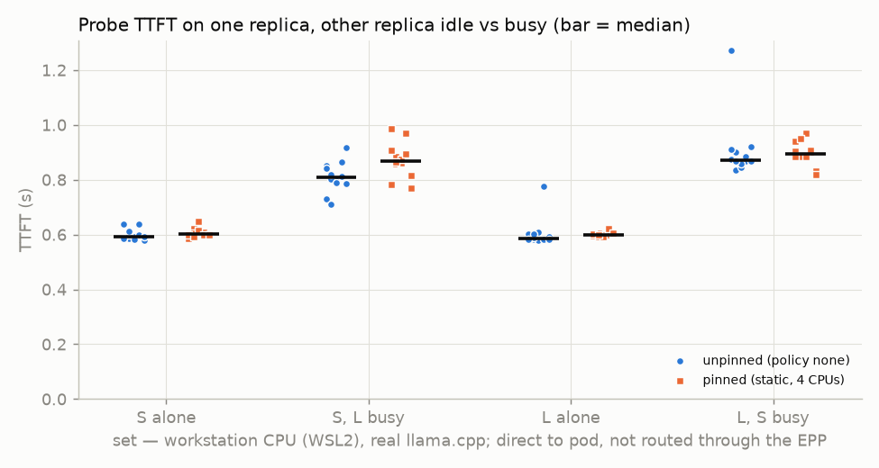
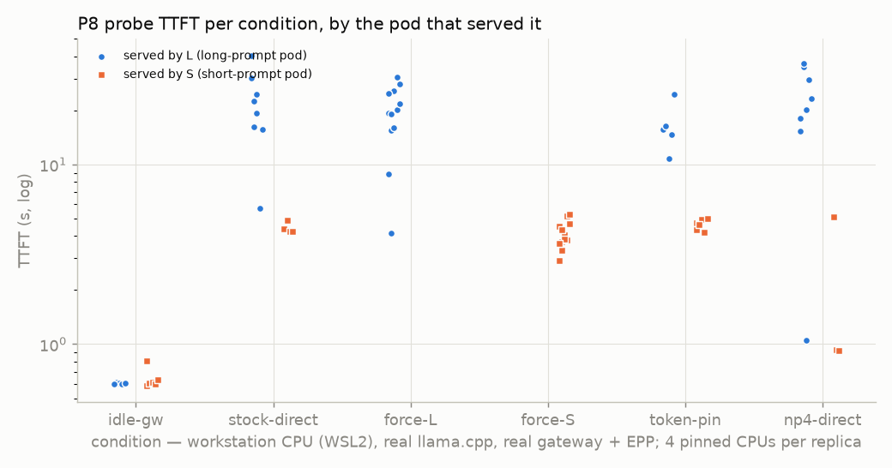

# P8 on real llama.cpp — size-blind routing, CPU-pinned replicas

**Label: workstation CPU (WSL2), real llama.cpp, real gateway + EPP; 4 pinned CPUs per replica.** Rows sent straight
to a pod (interference sets, "forced to L / S") are labelled **direct to pod, not routed through the EPP**.

Question (GAPS.md P8, #23): with two real llama.cpp replicas, one holding 2 long prompts (L) and one holding 3 short
ones (S), which pod does the stock EPP pick for a short probe, and what does the probe pay? Same with the upstream
token-load-scorer. And how much do two replicas on one CPU slow each other down, unpinned vs pinned by the kubelet
static CPU manager?

Status: done 2026-10-23 (09:36–11:17 EDT); cluster reverted to policy `none` (see [Revert](#revert)). Sections are in
run order; every prediction was written into this file before its run and is left as written.

**Headlines**
- **Stock EPP, real engines:** 8 of 12 probes went to the long-prompt replica (TTFT p50 20.9 s there vs 4.3 s on the
  short-prompt replica). All 5 probes that saw S's deferred request went to L; the 7 where llama.cpp's queue gauge
  showed no deferred request were random tie-breaks (3 L / 4 S). Forced, the L pick costs +15.85 s TTFT p50
  (19.80 vs 3.94 s).
- **token-load-scorer on:** 5 / 12 to L. It breaks every tie toward S (7 / 7), but loses to the queue scorer whenever
  S's deferred request is visible (5 / 5 to L), because it counts a 3,056-token prompt as 960 tokens (bytes/4,
  rounded to 64).
- **Pinning did not remove the replica-to-replica slowdown:** a probe on an idle replica pays +36 % / +48 % TTFT p50
  when the other replica is busy unpinned, and +44 % / +49 % pinned to disjoint full cores. What remains (L3, memory
  bandwidth, WSL2 vCPU placement, turbo) could not be separated here.

## Task 0 — baseline and topology (2026-10-23, no changes)

| | value | source |
|---|---|---|
| Host | i7-10700 (WSL2 guest, kernel 6.18.33.2-microsoft-standard-WSL2), `nproc` 16 | `nproc`, `uname -r` |
| Topology (guest view) | 1 socket, 8 cores, 2 threads each; siblings are `2k,2k+1` (cpu0: 0-1 … cpu15: 14-15); one shared L3 | `lscpu -e`, `/sys/devices/system/cpu/cpu*/topology/thread_siblings_list` |
| k3s | v1.36.2+k3s1 (01b6f04a), single node `ravi-home` | `k3s --version`, `kubectl get nodes` |
| `/etc/rancher/k3s/config.yaml` | `kubelet-arg: [container-log-max-size=10Mi, container-log-max-files=5]`, `disable: [traefik]` (sha256 `3609cf7f…`) | `cat` (file is 0644) |
| kubelet flags | `--config-dir=/var/lib/rancher/k3s/agent/etc/kubelet.conf.d --container-log-max-files=5 --container-log-max-size=10Mi …`; no `--root-dir`, so root dir = kubelet default `/var/lib/kubelet` | k3s journal line "Running kubelet …" (2026-10-14 06:09:07); default from `kubelet --help` v1.36.2 |
| CPU manager | `cpuManagerPolicy: none`, options none, `reservedSystemCPUs` none, `cpuCFSQuota: true`, period 100ms | `kubectl get --raw /api/v1/nodes/ravi-home/proxy/configz`; journal `cpu_manager.go:235 "Starting" policy="none"` |
| `cpu_manager_state` | `/var/lib/kubelet/cpu_manager_state`: **not readable without root** (Permission denied); journal shows default CPUSet "" and assignments {} | `cat`, journal `state_mem.go:123/141` |
| `helm test inf` | 3/3 Succeeded (gateway, llamacpp, sim sanity) 09:39 EDT | `helm test inf -n inference` |
| One request per pool | cpu (`x-pool: cpu`): 200, 31 prompt / 8 completion tokens, 0.188 s; sim: 200, 0.052 s | `curl` to 192.168.117.204 |
| Host load | loadavg 1.23 → 1.02 over 30 s; CPU 94.7–98.2 % idle; top: k3s-server 12.6 %, sim-pool EPP 6.8 %, prometheus 5.8 % | `top -b -d 5 -n 7`, `/proc/loadavg` |
| Other workloads | namespace `netcortex` (2 pods, another project) and kube-prometheus-stack, KEDA, agentgateway, 2 sim pods | `kubectl get pods -A` |
| sim-pool EPP | running **`token-load.yaml`** (the `make epp-plugin-on` state) — "restore as it was" means token-load on | `kubectl get deploy sim-pool-epp … args`, backup below |

**WSL2 caveat.** The guest's 16 vCPUs are not pinned to physical cores on the Windows side: Hyper-V schedules them
on whatever logical processors it likes. The sibling pairs above are what the guest is told, not a hardware
guarantee. "Pinned" in this file means pinned to guest vCPUs.

Backups of everything changed (helm values of all three releases, EPP ConfigMap data, EPP args, ScaledObject pause
state, the k3s config): `benchmarks/results/probes/p8_cpu/backup/`.

### Flag and option names, and where they came from

- llama-server: `llama-server --help` and `--version` inside the pinned image (`version: 0.5.0-dev (build 11146, commit 7fe450e19)`, GNU 14.2.0).
  `-t/--threads`, `-tb/--threads-batch` (default "same as --threads"), `-c/--ctx-size`, `-np/--parallel`,
  `-kvu/--kv-unified` ("default: enabled if number of slots is auto"), `--cache-prompt/--no-cache-prompt`,
  `-cram/--cache-ram` (default 8192 MiB), `--metrics`.
- Context split in b11146: with an explicit `--parallel 2` the pod log says
  `load_model: initializing, n_slots = 2, n_ctx_slot = 2048, kv_unified = 'false'` at `-c 4096`, so `-c` is divided
  per slot. This run uses `-c 8192` → 4,096 per slot (log: `n_ctx` 4096 per slot in `/slots`).
- kubelet: `kubelet --help` of the official v1.36.2 binary (dl.k8s.io, sha256 verified against the published
  `.sha256`): `--cpu-manager-policy` ('none', 'static'), `--cpu-manager-policy-options`, `--reserved-cpus`,
  `--kube-reserved`, `--cpu-cfs-quota`. `CPUManagerPolicyBetaOptions` (BETA, default true) and
  `CPUManagerPolicyAlphaOptions` (ALPHA, default false) are listed; **`DisableCPUQuotaWithExclusiveCPUs` is not listed**
  in this version's feature-gate help. `k3s` has no `kubelet --help` ("No help topic for 'kubelet'"); `k3s server --help`
  lists `--kubelet-arg`.
- Metrics: `/metrics` of the pod: `llamacpp:requests_processing`, `llamacpp:requests_deferred`, `llamacpp:prompt_tokens_total`, … (no KV metric).

## Setup used in both phases

Overlay `deploy/charts/inference/values-k3s-p8cpu.yaml` on values-k3s.yaml (`OVERLAYS=... deploy/release.sh`,
release revision 34): `-c 8192 --parallel 2 --threads 4 --threads-batch 4 --no-cache-prompt --cache-ram 0 --metrics`,
model `/models/qwen2.5-0.5b-instruct-q4_k_m.gguf` sha256 `74a4da8c9fdbcd15bd1f6d01d621410d31c6fc00986f5eb687824e7b93d7a9db`,
CPU request 4. llama.cpp ScaledObject paused at 2 (`autoscaling.keda.sh/paused-replicas=2`, the method autoscaling/README.md uses).

Client: `scripts/probe_p8_size_blind.py --pool cpu`, from the host (the k3s node) straight to pod IPs (no
port-forward) or to the gateway LB 192.168.117.204 with `x-pool: cpu`. Prompts are P8's `"w0 w1 …"` text cut to
3,000 / 200 / 100 real tokens with the pod's `/tokenize` + `/detokenize`, each with a fresh uuid prefix; with the chat
template the engine reports 3,056 / ~230 / ~160 prompt tokens. Background: closed loop, streamed, `max_tokens` 64,
`ignore_eos`, temperature 0. Probe: streamed, `max_tokens` 32, `ignore_eos`, temperature 0.
TTFT = POST → first chunk with non-empty `delta.content` (`stream_chat`, the repo harness definition).
Per condition: 2 blocks × 6 probes, L/S roles swap between the two physical pods in block 2, idle guard before each
block, the background must hold its in-flight count for 3 s, then each probe goes out after a seeded uniform 0–8 s
delay and ≥ 2 s after the previous one. "Mid-prefill" = at the probe's send time an L background request had been
sent and had not yet returned its first chunk (Build 11's test).

## Calibration (unpinned, one replica, other idle, `/completion` timings)

`benchmarks/results/probes/p8_cpu/calibration-unpinned.jsonl` (09:42 EDT, git 1ccaef8):

| prompt | prompt_n | prefill | prefill tok/s | decode tok/s (64 tokens) |
|---|---|---|---|---|
| long | 3,029 / 3,031 | 13.68 / 13.77 s | 221.4 / 220.1 | 37.6 / 37.2 |
| short | 230 / 228 | 0.87 / 0.86 s | 265.6 / 263.8 | 53.5 / 59.0 |

One long prefill takes ~13.7 s at 4 threads (≤ 60 s), so the long prompt stays at the Build 11 size (3,000 tokens).

## Task 1 — unpinned control (policy `none`, Burstable, no CPU limit)

**Prediction (written before the run, from the calibration only).** Probe on an idle pod, ~160 prompt tokens at
~265 tok/s → TTFT ≈ 0.6 s; decode ≈ 54–59 tok/s (short-context calibration). "Neighbour busy": 8 busy threads on
16 vCPUs with no pinning, so the kernel may put a probe thread on the sibling of a busy one; expected TTFT ≥ alone and
decode ≤ alone. The calibration has no two-pod measurement, so no magnitude is predicted.

**Measured (09:48–09:58 EDT, git 15304a9, direct to pod, not routed through the EPP).** n = 12 per row (2 blocks × 6,
roles swapped between the two physical pods). p95 at n = 12 is the nearest-rank value (= max).

| set (unpinned) | n | probe TTFT p50 / p95 / max (s) | decode p50 (tok/s) | e2e p50 (s) | neighbour busy CPUs | host busy CPUs | raw |
|---|---|---|---|---|---|---|---|
| S alone | 12 | 0.592 / 0.639 / 0.639 | 56.4 | 1.14 | 0.01 | 1.7 | `p8_cpu/20261023-134846-u-S-alone.jsonl` |
| S, L busy (2 long) | 12 | 0.808 / 0.918 / 0.918 | 49.9 | 1.44 | 3.97 | 5.8 | `p8_cpu/20261023-134954-u-S-Lbusy.jsonl` |
| L alone | 12 | 0.587 / 0.777 / 0.777 | 57.3 | 1.14 | 0.01 | 1.7 | `p8_cpu/20261023-135145-u-L-alone.jsonl` |
| L, S busy (3 short) | 12 | 0.871 / 1.272 / 1.272 | 46.9 | 1.61 | 4.0 | 5.3 | `p8_cpu/20261023-135306-u-L-Sbusy.jsonl` |

Neighbour / host busy CPUs = cgroup `cpu.stat usage_usec` and `/proc/stat` deltas over each block (`usage_window` in
every row). All four pods' `cpu.max` = `max 100000` (no quota), `nr_throttled` 0. 11 / 12 "S, L busy" probes went out
while an L long request was mid-prefill. Prediction: direction held (TTFT up, decode down); unpinned, a busy neighbour
costs the probe +0.216 s (+36 %) TTFT p50 on S and +0.284 s (+48 %) on L, and 12–18 % of decode speed.

## Task 2 — static CPU manager, 4 exclusive CPUs per pod

Change (`make cpu-pin-on` → `deploy/k3s/cpu-pin.sh on`, then `values-k3s-pinned.yaml`): kubelet-arg
`cpu-manager-policy=static`, `cpu-manager-policy-options=full-pcpus-only=true`, `reserved-cpus=0-1`
(`deploy/k3s/config-cpu-pinned.yaml`). `reserved-cpus` rather than kube/system-reserved: it names the CPUs, and 0-1 is
exactly one full physical core by sibling list, so the reservation is a known core, not "the lowest-numbered 2 CPUs
the policy happens to pick". llama.cpp pods: Guaranteed, CPU 4 / 4, memory 1Gi / 1Gi (VmHWM of a loaded replica
728,660 kB, cgroup `memory.peak` ~249 MB, measured 09:59 EDT; ~345 MB headroom over VmHWM).

**Prediction (before the switch).** Node allocatable CPU 16 → 14. The static policy hands out full cores from the
free pool above the reserved core: the two pods get two disjoint pairs of sibling pairs, e.g. 2-5 and 6-9; the shared
pool (everything else: k3s, gateway, EPP, Prometheus, KEDA, sim pods, the client) shrinks to the remaining 8 logical
CPUs (0-1 + 10-15 if the guess holds). `cpu.max` of the pinned pods: `400000 100000` if the kubelet still applies a CFS
quota to exclusive-CPU containers, `max` if it drops it; the v1.36.2 help no longer lists a feature gate for this, so
the run decides. Throttling counts are recorded either way.

**Measured (10:07–10:12 EDT).** `make cpu-pin-on` was run by the user (sudo) at ~10:07; everything below was read back
from the cluster, not assumed.

| check | result | source |
|---|---|---|
| kubelet config | `cpuManagerPolicy: static`, `cpuManagerPolicyOptions: {full-pcpus-only: "true"}`, `reservedSystemCPUs: 0-1`, `cpuCFSQuota: true` | configz |
| kubelet start | `Running kubelet … --cpu-manager-policy=static --cpu-manager-policy-options=full-pcpus-only=true …`; `policy_static.go:187 "Reserved CPUs not available for exclusive assignment" reserved="0-1" reservedPhysicalCPUs="0-1"`; `cpu_manager.go:235 "Starting" policy="static"` | k3s journal 10:07:34 |
| `cpu_manager_state` | printed by `cpu-pin.sh` to the user's terminal; not readable from this session (root only) | — |
| node allocatable CPU | 14 (was 16) | `kubectl get node` |
| **first try: QoS Burstable**, cpusets 0-15 | the chart's `fetch-model` init container had no resources, and QoS counts init containers. Fixed with a new optional chart value `llamacpp.initResources` (unset by default: the default render is unchanged, checked with `release.sh diff`), set to 100m / 64Mi requests = limits in values-k3s-pinned.yaml (release revision 36) | `kubectl get pod … qosClass`, `/proc/<pid>/status` |
| QoS | both llama.cpp pods **Guaranteed** | `.status.qosClass` |
| cpusets | pod `…-l6sph`: `Cpus_allowed_list` **2-5** (siblings 2-3, 4-5); pod `…-t2nnd`: **6-9** (6-7, 8-9). Disjoint, each = two full sibling pairs | `/proc/<llama-server pid>/status`, `thread_siblings_list` |
| CFS quota on the pinned pods | **none**: `cpu.max` = `max 100000` at the pod and container level although the CPU limit is 4; `nr_throttled` 0 | cgroup files |
| shared pool | gateway (agentgateway), both EPPs, Prometheus, KEDA, sim pods: `Cpus_allowed_list` **0-1,10-15** (8 logical CPUs) | `/proc/<pid>/status` of each container's main process |
| **not** restricted | `k3s-server` and `containerd` (host processes, not pods): 0-15. The CPU manager only sets pod cgroups; moving them needs a systemd `CPUAffinity` (root), not done. The probe client is started under `taskset -c 0-1,10-15` | `/proc/<pid>/status` |
| health | `helm test inf` 3/3 Succeeded; one request per pool: cpu 200 (0.279 s), sim 200 (0.039 s) | 10:11 EDT |

Prediction check: allocatable 16 → 14 and cpusets 2-5 / 6-9 as predicted; the CFS question came out as "no quota".
Sim pods kept at 2: they used 0.023 CPU each in Task 0 (`kubectl top`), so they don't compete.

## Task 3 — measured runs, pinned

### Interference, pinned

**Prediction (before the run).** Probes alone: as unpinned (TTFT p50 ≈ 0.59 s, decode ≈ 56–57 tok/s), since 4
threads on 4 dedicated vCPUs vs 4 threads free to roam an idle 16 should be about the same. Neighbour busy: smaller
penalty than unpinned (+36 % / +48 % TTFT p50), because the pods no longer share sibling vCPUs; not zero, because L3,
memory bandwidth and the Windows-side scheduling of the vCPUs are still shared.

**Measured (10:10–10:20 EDT, git c7cf2a5, direct to pod, not routed through the EPP; client under `taskset -c 0-1,10-15`).**

Calibration pinned (`p8_cpu/calibration-pinned.jsonl`, pod on 2-5): long prefill 13.86 / 13.84 s = 218.8 / 218.7 tok/s,
decode 37.1 / 39.7 tok/s; short 270.6 / 259.9 tok/s prefill, decode 53.7 / 57.0 tok/s — the same as unpinned.

| set (pinned) | n | probe TTFT p50 / p95 / max (s) | decode p50 (tok/s) | e2e p50 (s) | neighbour busy CPUs | host busy CPUs | raw |
|---|---|---|---|---|---|---|---|
| S alone | 12 | 0.602 / 0.647 / 0.647 | 55.2 | 1.17 | 0.01 | 1.7 | `p8_cpu/20261023-141051-p-S-alone.jsonl` |
| S, L busy (2 long) | 12 | 0.869 / 0.986 / 0.986 | 48.6 | 1.52 | 3.94–3.95 | 5.8 | `p8_cpu/20261023-141159-p-S-Lbusy.jsonl` |
| L alone | 12 | 0.600 / 0.623 / 0.623 | 55.2 | 1.16 | 0.01 | 1.7 | `p8_cpu/20261023-141352-p-L-alone.jsonl` |
| L, S busy (3 short) | 12 | 0.894 / 0.968 / 0.968 | 48.1 | 1.55 | 3.97–3.98 | 5.3 | `p8_cpu/20261023-141514-p-L-Sbusy.jsonl` |

Shared pool (gateway + llamacpp EPP pods) 0.03 CPU; `cpu.max` `max 100000`, `nr_throttled` / `throttled_usec` deltas
0 / 0 on both pinned pods in every block. Prediction partly wrong: alone held (0.60 s, 55 tok/s), but the neighbour
penalty did **not** shrink: +0.267 s (+44 %) on S and +0.294 s (+49 %) on L pinned vs +36 % / +48 % unpinned.

### P8 conditions, pinned — predictions (all written before the first P8 run, 10:25 EDT)

Inputs: calibration above; Task 1 background logs (`p8_cpu/*-u-S-Lbusy.bg.jsonl`, `*-u-L-Sbusy.bg.jsonl`): with 2 long
prompts sharing a pod, first chunk after 18.6–29.4 s and e2e 30.5–32.2 s; 3 short prompts on 2 slots, e2e 3.4–4.4 s.
bytes/4 estimates (`est_tokens`, llm-d-router v0.9.0 estimate backend) vs llama.cpp `usage.prompt_tokens`: long 954 vs
3,056–3,060; short 77 vs 253–261; probe 44 vs 155–161. Stock profile: queue ×2, kv ×2, prefix ×3; kv is "" for
llama.cpp, so both pods score the same on it.

1. **Idle, through the gateway.** Queue and kv tie. If the prefix scorer matches the shared chat-template prefix, picks
   stick to whichever pod served the previous probe; otherwise they split at random. TTFT ≈ 0.60 s on either pod plus
   the gateway hop.
2. **Stock, load direct.** L 2 running / 0 deferred, S 2 running / 1 deferred → queue scorer L = 1, S = 0: L wins by 2.
   Predict L for every probe where the EPP's last scrape showed S's deferred request (≥ 11 / 12). Cost on L: the probe
   waits for a long request to finish (one frees every ~15 s on average with two desynchronised 31 s requests), then
   prefills next to a long prefill: TTFT p50 ≈ 8–16 s, max ≈ 30 s.
3. **Forced S:** 1 deferred ahead and both slots busy → wait for two short completions, then ~0.9 s prefill:
   TTFT ≈ 1.5–4.5 s. **Forced L:** as in 2.
4. **Token-load on, load through the gateway (pinned per pod by session-affinity-filter).** While L's two long requests
   are prefilling, the scorer holds 2 × 954 = 1,908 tokens on L and ≤ 3 × 77 = 231 on S: token scores 0.767 vs 0.972,
   × 4 → S +0.82, less than the queue scorer's +2 for L. **Predict L again (≥ 11 / 12).** With real counts (6,116 vs
   ~770) S would get +2.62 and win: the bytes/4 undercount decides it, as in Build 11 (23 / 24 to L).

### P8 conditions 1–3, pinned — measured (10:21–10:53 EDT, git c7cf2a5 + harness fixes in the next commit)

llamacpp-pool EPP: stock profile (`epp-llamacpp.values.yaml`) with `--v=4` (`make epp-cpu-token-off EPP_V=4`).
Pick = the EPP's "Completed running picker" line for the probe's `x-request-id`; cross-check = the agentgateway access
log (`endpoint=`, matched by start time and duration, P9's method): **agreed on 12 / 12 (idle) and 12 / 12 (stock)**.

| condition | via EPP | n | picks L / S | TTFT p50 / max (s) | TTFT p50 on L / on S (s) | e2e p50 (s) | mid-L-prefill | raw |
|---|---|---|---|---|---|---|---|---|
| 1. idle | yes | 12 | 6 / 6 | 0.606 / 0.808 | 0.604 / 0.609 | 1.18 | 0 / 12 | `p8_cpu/20261023-142143-idle-gw.jsonl` |
| 2. stock, load direct | yes | 12 | **8 / 4** | 15.903 / 40.480 | **20.921 / 4.330** | 29.55 | 12 / 12 | `p8_cpu/20261023-142326-stock-direct.jsonl` |
| 3a. forced to L | no (direct) | 12 | 12 / 0 | 19.795 / 30.527 | 19.795 / — | 33.65 | 12 / 12 | `p8_cpu/20261023-143413-force-L.jsonl` |
| 3b. forced to S | no (direct) | 12 | 0 / 12 | 3.944 / 5.284 | — / 3.944 | 6.00 | 10 / 12 | `p8_cpu/20261023-144651-force-S.jsonl` |

- **Why 8 / 4 and not 12 / 0: the queue signal flickers.** Per the EPP's own queue-scorer scores (v=4 "Calculated
  score" lines, `p8_cpu/epp-stock-direct-b0.log` / `-b1.log`, 36 lines each): in 5 / 12 probes S had its deferred request
  (queue L 1 / S 0) and **all 5 went to L**; in 7 / 12 S showed 0 deferred, the queue scores tied (1 / 1) and the
  max-score picker's random tie-break sent 3 to L and 4 to S. kv and prefix were tied in every probe (kv 1 / 1,
  prefix 0 / 0). The client's own scrape just before each send agrees (S deferred 1 in the same 5 probes). With three
  closed-loop short requests on two slots, S has a deferred request only part of the time.
- **Cost of the L pick.** On L the probe waits for a long request to end, then prefills and decodes next to a long
  prefill: decode p50 1.5 tok/s, e2e p50 38.3 s (picked L) vs 23.2 tok/s and 6.1 s (picked S). Forced, the
  difference is 19.795 − 3.944 = **15.85 s TTFT p50** and 33.65 − 6.00 = 27.65 s e2e p50.
- Prediction: 1 held (split, 0.60 s; the prefix scorer did not match the shared chat-template prefix). 2 **wrong on the
  split** (predicted ≥ 11 / 12 to L, measured 8 / 4: I assumed S's deferred request would be visible almost all the
  time) and **low on the cost** (predicted L p50 8–16 s, measured 19.8–20.9 s). 3b held (1.5–4.5 s predicted, 3.94 s).
- Hold gate: the exact-count gate (processing + deferred = workers for 3 s) never held, because S's count dips between a
  short request's end and its re-send; each block started after the 120 s gate timeout (`gate.ok` false in the rows).
  The load was in place anyway (both pods' gauges just before every send: L 2 running, S 2 running + 0–1 deferred).
  From condition 4 on, S may be one below its worker count during the hold.
- Shared pool and throttling: host busy 8.7–8.8 CPUs (8 of them the two pinned pods), loadavg 8.3–9.5, gateway +
  EPP pods 0.033 CPU; the 8-CPU shared pool was not saturated. Pinned pods: `cpu.max` `max 100000`,
  `nr_throttled` delta 0 in every block.

### P8 condition 4 — token-load-scorer on, load through the gateway (10:54–10:59 EDT)

`make epp-cpu-token-on` (`deploy/gateway/epp-llamacpp-token-load.values.yaml`: stock llamacpp profile +
session-affinity-filter + inflight-load-producer + token-load-scorer, threshold 8192, weight 4, `--v=4`). Background
sent through the gateway with `x-session-token` per pod (Build 4's placement method). **Placement verified, not
assumed:** the hold gate held (`gate.ok` true in both blocks) and the gauges just before every probe show L 2
processing / 0 deferred and S 2 processing / 0–1 deferred; 16 L-role and 126 S-role background requests completed or
were cut at block end (`p8_cpu/20261023-145402-token-pin.bg.jsonl`). Pick cross-check: gateway log = EPP log 12 / 12.

| condition | via EPP | n | picks L / S | TTFT p50 / max (s) | TTFT p50 on L / on S (s) | e2e p50 on L / on S (s) | mid-L-prefill | raw |
|---|---|---|---|---|---|---|---|---|
| 4. token-load, load via gateway | yes | 12 | **5 / 7** | 4.967 / 24.547 | 15.658 / 4.683 | 31.80 / 6.68 | 12 / 12 | `p8_cpu/20261023-145402-token-pin.jsonl` |

**Scores per probe** (v=4 "Calculated score" and `tokenload/token_load.go:125 "TokenLoadScorer scoring" … tokenLoad`
lines, `p8_cpu/epp-token-pin-b0.log`, `-b1.log`):
- 5 / 12 probes: S showed its deferred request → queue L 1 / S 0 (+2 for L); token scores L 0.758 or 0.875 vs S 0.977
  or 0.961 → +0.41 to +0.88 for S. **All 5 went to L.**
- 7 / 12 probes: queue tied → token-load broke the tie: **all 7 went to S** (vs a random 3 / 4 with the stock profile).

**Token estimate in the request path vs llama.cpp's count** (`tokenLoad` values over all 300+ scoring lines in the run,
by pod role; real = `usage.prompt_tokens` of the same requests):

| request | client bytes | bytes/4 (`est_tokens`) | scorer's per-request step | llama.cpp prompt tokens | scorer / real |
|---|---|---|---|---|---|
| long | 3,810 | 954 | 960 (L: 960, 1,920 = 1 or 2 longs) | 3,055–3,060 | 0.31 |
| short | 302 | 77 | 128 (S: 128, 256, 384) | 253–261 | 0.50 |
| probe | 169 | 44 | 64 (+64 on every endpoint at a probe's own decision: L 1,024 / 1,984, S 192 / 320) | 151–160 | 0.41 |

The steps are bytes/4 rounded up to a multiple of 64 (954 → 960, 77 → 128, 44 → 64); that rounding is read off the
logged values, not from the source. Counterfactual, **computed, not run**: with llama.cpp's real counts L would hold
2 × 3,058 + 158 ≈ 6,274 → token score 0.234, S ≈ 2 × 257 + 158 = 672 → 0.918; × 4 → +2.74 for S, more than the queue
scorer's +2, so S would win all 12.

Prediction (L ≥ 11 / 12) **wrong**: it assumed S's deferred request would show at nearly every decision (as in
condition 2's prediction). The bytes/4 undercount did decide the 5 queue-split probes, as predicted. Shared pool:
gateway + EPP 0.07 CPU, host busy 8.75–8.78 CPUs, loadavg 9.0–9.5; pinned pods `nr_throttled` delta 0.

### P8 condition 5 (optional) — parallel 4 — prediction (before the run)

`values-k3s-p8cpu-np4.yaml`: `--parallel 4 -c 16384` (4,096 per slot, as before), stock EPP at `--v=4`, load direct.
L 2 running / 0 deferred, S 3 running / 0 deferred → the queue scorer ties every time → picks split at random
(≈ 6 / 6). A probe on L gets a slot at once but shares each batch with the long prefills: TTFT on L ≈ 1–10 s
(up to one 2,048-token batch at ~219 tok/s); on S ≈ 1–2 s.

**Measured (11:01–11:08 EDT, release revision 37, pods re-created by the upgrade).** Pinning re-checked after the
rollout: both Guaranteed, `Cpus_allowed_list` **10-13** (10-11, 12-13) and **2-5** (2-3, 4-5) — the surge pod took
6-9 during the rollout, so the static policy handed the replacement the next free cores. Pod log:
`n_slots = 4, n_ctx_slot = 4096, kv_unified = 'false'` on both.

| condition | via EPP | n | picks L / S | TTFT p50 / max (s) | TTFT p50 on L / on S (s) | e2e p50 (s) | mid-L-prefill | raw |
|---|---|---|---|---|---|---|---|---|
| 5. parallel 4, stock, load direct | yes | 12 | **9 / 3** | 19.126 / 36.458 | 23.280 / 0.933 | 31.81 | 10 / 12 | `p8_cpu/20261023-150110-np4-direct.jsonl` |

Every scorer tied on all 12 probes (queue 1 / 1, kv 1 / 1, prefix 0 / 0; `p8_cpu/epp-np4-direct-b*.log`): 9 / 3 is the
max-score picker's random tie-break, not a preference. Gateway log = EPP log 12 / 12. **Prediction wrong on the cost:**
a free slot on L did not make the probe fast. 8 of the 9 probes on L had TTFT 15.3–36.5 s, and one had 1.05 s.
Decode on L p50 was 8.9 tok/s. So in b11146 the probe's prompt waited behind the long prefills, not only behind slots.
This is measured, but the scheduling mechanism inside llama.cpp was not checked. Host busy 8.78 CPUs; `nr_throttled` delta 0.

## Interference: unpinned vs pinned

Direct to pod, not routed through the EPP. Probe TTFT p50 (s), n = 12 each; p50 / p95 linear interpolation
(`benchmarks/analyze.py --p8cpu` → [p8_cpu/summary.md](p8_cpu/summary.md)).

| probe on | alone, unpinned | neighbour busy, unpinned | penalty | alone, pinned | neighbour busy, pinned | penalty |
|---|---|---|---|---|---|---|
| S (neighbour: 2 long prompts) | 0.592 | 0.808 | +0.216 s (+36 %) | 0.602 | 0.869 | +0.267 s (+44 %) |
| L (neighbour: 3 short prompts) | 0.587 | 0.871 | +0.284 s (+48 %) | 0.600 | 0.894 | +0.294 s (+49 %) |
| decode p50, S / L probe (tok/s) | 56.4 / 57.3 | 49.9 / 46.9 | | 55.2 / 55.2 | 48.6 / 48.1 | |

**How much pinning removed: none measurable.** Neither p50 penalty shrank. Pinned p95/max are tighter on the alone
rows (L alone max 0.623 s vs 0.777 s unpinned), but at n = 12 that is one probe. What can and can't be separated here:
- *Same logical CPU / SMT sibling sharing between the two pods:* removed by pinning (disjoint full cores, verified), so
  it was not the cause.
- *CFS throttling:* ruled out (no quota on the pinned pods, `nr_throttled` 0 throughout).
- *Shared pool saturation:* ruled out for the routed path (gateway + EPP ≤ 0.07 CPU; host busy ≤ 8.8 of 16).
- *Shared L3, memory bandwidth, package power / turbo frequency, Hyper-V placement of the guest vCPUs:* **not
  separable on this setup.** The guest can't read MSRs or host scheduling, and WSL2's sibling pairs are not a hardware
  guarantee. k3s-server and containerd were not restricted to the shared pool (0-15).

## P8 summary (Build 4 format) and comparison

| condition | label | n | picks long-pod / short-pod | probe TTFT p50 / max (s) | TTFT p50 on long / short pod (s) | e2e p50 (s) |
|---|---|---|---|---|---|---|
| idle | CPU pinned, routed | 12 | 6 / 6 | 0.606 / 0.808 | 0.604 / 0.609 | 1.18 |
| stock / load direct | CPU pinned, routed | 12 | **8 / 4** | 15.903 / 40.480 | 20.921 / 4.330 | 29.55 |
| stock, forced to long pod | CPU pinned, direct to pod | 12 | 12 / 0 | 19.795 / 30.527 | 19.795 / — | 33.65 |
| stock, forced to short pod | CPU pinned, direct to pod | 12 | 0 / 12 | 3.944 / 5.284 | — / 3.944 | 6.00 |
| token-load / load via gateway (pinned per pod) | CPU pinned, routed | 12 | **5 / 7** | 4.967 / 24.547 | 15.658 / 4.683 | 7.26 |
| parallel 4, stock / load direct | CPU pinned, routed | 12 | 9 / 3 (all ties) | 19.126 / 36.458 | 23.280 / 0.933 | 31.81 |

| source | label | stock: picks to long pod | token-load: picks to long pod | cost of the long pick (TTFT p50) |
|---|---|---|---|---|
| Build 4 (`deploy/gateway/GAPS.md` P8) | SIMULATED, routed by the real EPP | 16 / 16 (direct 8 / 8, pin 8 / 8) | 0 / 8 (load via gateway), 8 / 8 (load direct) | 7.75 s vs 0.53 s |
| Build 11, mns2 ([t4/p8_t4x2.md](../t4/p8_t4x2.md)) | Kaggle 2×T4, real vLLM; picks **computed offline**, routing not exercised | 21 / 24 | 23 / 24 | see that file |
| this run | workstation CPU (WSL2), real llama.cpp, **real gateway + EPP**; 4 pinned CPUs per replica | **8 / 12** | **5 / 12** | 20.92 s vs 4.33 s (as picked); 19.80 s vs 3.94 s (forced) |

Why this run differs from both: the sim's and vLLM's waiting gauge held S's queued request steadily. llama.cpp's
`requests_deferred` showed it at only 5 of 12 decisions, so the queue scorer often tied. When it didn't tie, the stock
EPP and the token-load EPP both picked L every time (10 / 10 across conditions 2 and 4).

## Does NOT show

- One node, one WSL2 guest: guest vCPUs are not pinned to host cores; "pinned" = guest vCPUs only.
- Qwen2.5-0.5B Q4_K_M on 4 CPUs per replica, b11146: absolute TTFTs (0.6 s idle, ~20 s behind long prompts) are this
  model on this CPU. They are not GPU numbers and not big-model numbers.
- llama.cpp exports no KV signal: the kv scorer tied in every decision (GAPS.md P4). A KV-aware engine could change
  stock picks.
- `requests_deferred` sampling: how often the EPP sees S's deferred request depends on its scrape timing and on llama.cpp
  updating the gauge between batches. The 5 / 12 split is this workload's, not a constant.
- Single EPP replica: the token-load scorer counts only what this replica dispatched (GAPS.md P8 "remaining gap");
  with load sent direct it would see nothing.
- Single client process (asyncio, one host): background and probes share one event loop; probes are sequential.
- n = 12 per condition, 2 blocks with roles swapped; no confidence intervals computed.
- The parallel-4 split (9 / 3) is a random tie-break at n = 12, not a preference.

## Revert

`make cpu-pin-off` (run by the user, sudo, ~11:15 EDT) restored `/etc/rancher/k3s/config.yaml` (sha256 `3609cf7f…`,
= the original) and removed the static `cpu_manager_state`. Read back at 11:16–11:17:
- configz `cpuManagerPolicy: none`, options none, reserved none; journal `cpu_manager.go:235 "Starting" policy="none"`
  11:15:59; allocatable CPU 16.
- `deploy/release.sh upgrade k3s` with no overlays (revision 39): pods back to the original template (hash
  `5d577dcf66`), Burstable, `Cpus_allowed_list` 0-15. Release values = the pre-run backup except the new chart key
  `llamacpp.initResources: {}` (default, renders nothing).
- `paused-replicas` annotation removed from `inf-llamacpp` (KEDA owns replicas again; it was not paused before).
  `inf-vllm-sim` still paused at 2, as before. Sim pods were never scaled.
- sim-pool and llamacpp-pool EPPs: ConfigMap data, helm values and container args **byte-identical** to the backups
  in `p8_cpu/backup/` (sim-pool still on `token-load.yaml`, as found).
- `helm test inf` 3/3 Succeeded; one request per pool: cpu 200 (0.173 s), sim 200 (0.064 s).
