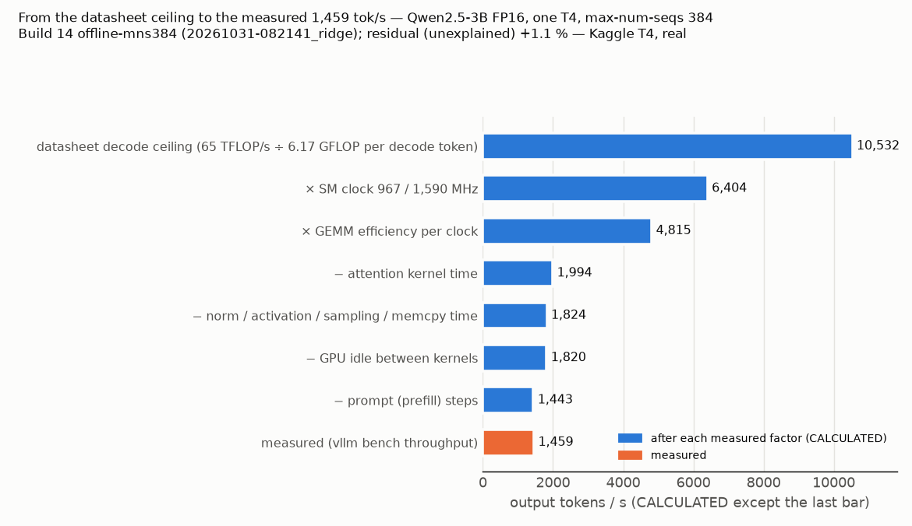
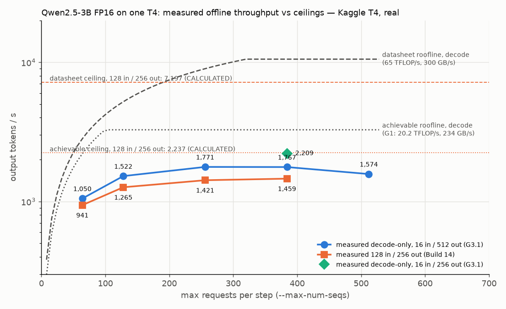

# Where the throughput goes — Qwen2.5-3B FP16 on one T4 (Kaggle T4, real)

Question: Build 14 measured **1,458.6 output tok/s** offline at max-num-seqs 384 (in 128 / out 256, util 0.95,
max-num-batched-tokens 8,192) on one Kaggle T4. The datasheet roofline predicted **≈ 7,000** (CALCULATED in
[ridge.md](ridge.md)). This file splits that gap into measured parts.

Every measured number below comes from a JSONL row or a raw file in a run directory, with the command that made it.
Numbers marked CALCULATED are arithmetic on measured numbers or on the model config. Anything not measured goes into a
"residual / unexplained" line.

## Predictions (written before any Part G run, verbatim from the assignment)

- Throttle reason under sustained vLLM load: sw_power_cap active most of the time; power.limit = 70 W; thermal reasons rare.
- Memory bandwidth (large device-to-device copy / triad): 220–260 GB/s (75–85 % of 300).
- Large FP16 GEMM (8192³, cuBLAS via torch.matmul) sustained for 60 s: 20–40 TFLOP/s with SM clock near 1 GHz under the power cap; short bursts higher before the clock drops.
- Qwen-shaped GEMMs at decode batch sizes (M = 64…512): well below the large-GEMM rate at M = 64, approaching it by M = 384–512.
- Decode-only run (input 1–16 tokens, output 512, ignore_eos) at max-num-seqs 384: output tok/s clearly above the mixed 1,459 (no prompt compute).
- Profile at max-num-seqs 384: GEMMs 50–65 % of GPU time, attention 15–25 %, the rest elementwise/sampling; GPU idle gaps between kernels < 10 % of step time at 384 but larger at 64.
- CUDA graphs off (`--enforce-eager`): lower throughput, larger penalty at small batch.
- If clock locking is permitted: output tok/s roughly proportional to SM clock (compute-bound).
- Cross-session / cross-card variance in sustained SM clock: up to ±20 %.

## Setup

- Model: `Qwen/Qwen2.5-3B-Instruct` @ `aa8e72537993ba99e69dfaafa59ed015b17504d1`. Its config.json (fetched at that
  revision; also saved in-session as `logs/model-config.json`) gives: 36 layers, hidden 2048, 16 query heads, 2 KV
  heads (head_dim 2048 / 16 = 128), intermediate 11,008, vocab 151,936, `tie_word_embeddings: true`.
- Engine: vLLM 0.31.0, `--dtype half`, everything as in Build 14 unless a row says otherwise.
- Instrumentation (G0): [benchmarks/gpu_sampler.py](../../gpu_sampler.py) now samples, at 2 Hz by default, the old
  NVML columns plus `nvidia-smi --query-gpu` fields named exactly as `nvidia-smi --help-query-gpu` lists them on the
  machine (clocks, power draw and limits, temperature, pstate, every clock-throttle / clock-event reason).
  `nvidia-smi -q -d PERFORMANCE,POWER,CLOCK,TEMPERATURE` is saved before and after every load run.
- Kaggle stage: `bneck` in [t4_notebook.py](../../kaggle/t4_notebook.py), one ordered `--plan` per session.

## Decisions made

- **The new stage has a plan per session.** Part G is split into a few Kaggle sessions. Each one runs the reference
  point (G4) at its start and end. The budget guard always keeps time for the end reference.
- **Profiling uses vLLM's own torch profiler.** In vLLM 0.31.0 that is `--profiler-config` (a `ProfilerConfig`,
  `vllm/config/profiler.py`) together with `vllm bench throughput --profile`. The config sets `delay_iterations` /
  `max_iterations`, so the trace covers a window of steady-state steps (300 steps skipped, then 300 at 384 / 400 at 64).
  `detailed_trace_annotation` puts each step's scheduled token and request counts into its annotation name
  (`vllm/v1/worker/gpu_worker.py`, `annotate_profile`). `VLLM_CUSTOM_SCOPES_FOR_PROFILING=1` (`vllm/envs.py`) adds the
  runner's forward / postprocess / sample scopes. Stack recording is off and the front end is ignored to keep the
  overhead low. The profiled run's tok/s is not used as a speed number: the profiler and the trace export slow it.
  Unprofiled runs give the speed.
- **The x-axis label fix goes into [report_ridge.py](../../kaggle/report_ridge.py).** The assignment names
  `benchmarks/analyze.py`, but the Build 14 ridge chart is drawn by `benchmarks/kaggle/report_ridge.py`.

## G0 — instrumentation and tool availability

Smoke run **20261031-192426_bneck** (Kaggle T4, real; 51 s of session = 0.014 GPU-h; git `b29d107`; Tesla T4 GPU 0
`GPU-102fc0c7-3bc4-bf6a-d730-8db13e0984bd`, driver 580.178.04, CUDA 13.0 (driver); Kaggle's own torch 2.11.0+cu128, no
vLLM). Command: `make t4-run STAGE=bneck ARGS='--args "--plan tools,micro:0 --no-install --micro-quick --budget-h 0.2"'`.
Raw files: `results/bneck/bneck.jsonl` row `tools`, `results/bneck/logs/`.

**Sampler fields.** `nvidia-smi --help-query-gpu` on this driver lists every wanted field
([logs/nvidia-smi-help-query-gpu.txt](20261031-192426_bneck/results/bneck/logs/nvidia-smi-help-query-gpu.txt)).
Reason fields are listed as `clocks_event_reasons.X` with `clocks_throttle_reasons.X` as the alias; the sampler uses
the throttle name. There are 10 of them: `supported`, `active` (hex bitmasks), `gpu_idle`, `applications_clocks_setting`,
`sw_power_cap`, `hw_slowdown`, `hw_thermal_slowdown`, `hw_power_brake_slowdown`, `sw_thermal_slowdown`, `sync_boost`.
`power.draw.average` reads `[N/A]` on this card; `power.draw` and `power.draw.instant` return values. Unit tests:
[benchmarks/tests/test_gpu_sampler.py](../../tests/test_gpu_sampler.py).

**Limits read-only** (`nvidia-smi -i 0 --query-gpu=power.limit,...`): power.limit 70.00 W, enforced 70.00 W, default
70.00 W, min 60.00 W, max 70.00 W; clocks.max.sm 1,590 MHz; clocks.applications.graphics 585 MHz; persistence mode
Disabled; compute mode Default. `nvidia-smi -q -d SUPPORTED_CLOCKS` lists graphics clocks 300–1,590 MHz in 15 MHz steps.
The container runs as uid 0 (root).

| tool / command | permitted? | exact result |
|---|---|---|
| `dcgmi` (DCGM SM-active / tensor-active) | **no: not installed** | not on PATH, not in /usr/local/cuda*/bin or /opt/nvidia/*/bin; `nv-hostengine` also absent |
| `nsys` | **no: not installed** | not found in the same places |
| `ncu` | **installed, not usable** | `/usr/local/cuda/bin/ncu` "Version 2025.1.1.0"; profiling a 2048² FP16 matmul: `==ERROR== ERR_NVGPUCTRPERM - The user does not have permission to access NVIDIA GPU Performance Counters on the target device 0.` (rc 1) |
| `nvidia-smi -i 0 -pl 60.00` | **no** | `Failed to set power management limit for GPU 00000000:00:04.0: Insufficient Permissions` (rc 4); the reset to 70.00 failed the same way; the limit read back 70.00 W |
| `nvidia-smi -i 0 -lgc 1590,1590` | **no** | `The current user does not have permission to change clocks for GPU 00000000:00:04.0.` (rc 4); `-rgc` the same |

GPU state was not changed: both writes were refused. The `-rgc` that the stage runs on exit is a no-op here.
Consequences: G3.7 (clock locking) cannot run. DCGM SM-active and Nsight counters are not available. The profile in G2
uses the torch profiler (CUPTI activity tracing, which needs no counter permission).

## Sessions (Kaggle T4, real)

| run | plan | GPU-h (script session) | git | vLLM / torch | GPU 0 UUID |
|---|---|---:|---|---|---|
| [20261031-192426_bneck](20261031-192426_bneck/) | G0 smoke: `tools,micro:0` (quick), no vLLM | 0.014 | `b29d107` | — / 2.11.0+cu128 (Kaggle's) | GPU-102fc0c7-3bc4-bf6a-d730-8db13e0984bd |
| [20261031-192649_bneck](20261031-192649_bneck/) "P1" | `tools,ref:start,micro:0,micro:1,base:64,prof:64,prof:384,eager:64,eager:384,ref:gpu1@1,ref:end` | 0.857 | `977557c-dirty`¹ | 0.31.0 / 2.13.0+cu130 | GPU-7b51045e-14ea-8b26-91ba-69a9e955ed85 (GPU 1: GPU-7f90bc46-f86e-060c-93f6-c225fd16108e) |
| [20261031-192658_bneck](20261031-192658_bneck/) "P2" | `ref:start,dec:64…512,dec:384/256,pre,mbt:2048,mbt:16384,attn:FLEX_ATTENTION,attn:FLASH_ATTN,attn:FLASHINFER,attn:TURBOQUANT,awq,clk,ref:end` | 1.486 | `977557c-dirty`¹ | 0.31.0 / 2.13.0+cu130 | not recorded (no `tools` item in this plan; bus 00000000:00:04.0) |

¹ `-dirty`: the working tree held an uncommitted chart change (report_ridge.py) when both were pushed; the stage code
was the committed `977557c`. Part G total: **2.357 GPU-h** of the 3.5 h budget. Every load run in these sessions:
driver 580.178.04, CUDA 13.0 (driver), Tesla T4, `Qwen/Qwen2.5-3B-Instruct` @ `aa8e72537993ba99e69dfaafa59ed015b17504d1`,
`--dtype half --gpu-memory-utilization 0.95 --no-enable-prefix-caching`, offline `vllm bench throughput`
(temperature 1.0, hard-coded by the tool), power limit 70 W (enforced 70 W in every sample). Per-row provenance,
every flag and the bench command: the run's `results/bneck/bneck.jsonl` (`bench_cmd`, `env_extra`), with the
nvidia-smi `-q` snapshots before / after each run in `logs/`.

## G1 — hardware ceilings without vLLM

[benchmarks/microbench/gpu_ceilings.py](../../microbench/gpu_ceilings.py), session P1, after the vLLM install (so the
same torch 2.13.0+cu130 / cuBLAS as the engine), one GPU at a time (`CUDA_DEVICE_ORDER=PCI_BUS_ID CUDA_VISIBLE_DEVICES=N`),
sampler at 4 Hz. Raw: `micro-gpu0/`, `micro-gpu1/` (`microbench.jsonl`, `gemm_sustained.csv`, `gpu.csv`).

| | GPU 0 (…ed85) | GPU 1 (…08e) |
|---|---:|---:|
| copy, 1 GiB fp32, median of 20 (GB/s) | **234.3** | **233.2** |
| triad a = b + 2c, median of 20 (GB/s) | **243.3** | **239.4** |
| 8192³ FP16 GEMM, first 0.1 s chunk (TFLOP/s) | 20.4 | 25.5 |
| same, max chunk | 21.1 | 25.7 |
| same, **median after 10 s of 60 s** | **20.2** | **24.2** |
| SM clock after 10 s, mean (nvidia-smi) | **557 MHz** | **669 MHz** |
| power after 10 s, mean | 66.3 W of 70 | 68.8 W of 70 |
| temperature max | 80 °C | 72 °C |
| throttle reasons after 10 s | sw_power_cap 100 % of samples, every other reason 0 % | the same |
| TFLOP/s per GHz of SM clock (CALCULATED) | 36.3 | 36.1 |

The datasheet's 65 TFLOP/s at 1,590 MHz is 40.9 TFLOP/s per GHz (CALCULATED). cuBLAS reaches **89 % of that per
clock**, but the **power cap holds the clock at 557–669 MHz** while the big GEMM runs. The "burst" is short and small:
in second 0 the clock was 742 / 911 MHz, and by second 1 it was down at 570 / 705 MHz.

Qwen2.5-3B layer GEMMs (`torch.matmul(x[M,K], W[N,K].t())`, ≥ 2 s per point), TFLOP/s, GPU 0 (GPU 1 is 12–20 % higher at
M ≥ 64, at a 70–180 MHz higher clock):

| shape (K → N) | M=1 | M=16 | M=64 | M=128 | M=256 | M=384 | M=512 | M=2048 | M=8192 |
|---|---:|---:|---:|---:|---:|---:|---:|---:|---:|
| qkv (2048 → 2560) | 0.2 | 2.9 | 8.9 | 13.9 | 14.6 | 15.8 | 20.8 | 21.2 | 17.5 |
| o (2048 → 2048) | 0.2 | 2.7 | 8.5 | 13.4 | 13.7 | 15.6 | 20.4 | 16.9 | 16.9 |
| gate_up (2048 → 22016) | 0.1 | 3.1 | 8.6 | 12.5 | 16.5 | 15.8 | 18.7 | 20.0 | 19.8 |
| down (11008 → 2048) | 0.1 | 2.8 | 8.6 | 12.3 | 13.2 | 16.3 | 13.8 | 16.4 | 19.4 |
| lm_head (2048 → 151936) | 0.1 | 3.1 | 8.5 | 13.1 | 16.4 | 17.9 | 19.1 | 18.6 | 16.5 |
| SM clock, mean over the 5 shapes (MHz) | 443 | 729 | 555 | 510 | 530 | 534 | 568 | 550 | 517 |
| GB/s, CALCULATED from minimum bytes (gate_up) | 123 | 195 | 139 | 104 | 73 | 49 | 47 | 20 | 13 |

- At M ≤ 64 the shapes stream weights at 140–195 GB/s (CALCULATED minimum traffic): memory-bound, 60–80 % of copy.
- The FLOP-weighted step mix (36 × [qkv, o, gate_up, down] + lm_head, CALCULATED) reaches 8.6 TFLOP/s at M=64,
  12.6 at 128, 15.3 at 256, **16.1 at 384** and 17.3 at 512 (GPU 0). Per GHz of clock that is 15.5 / 24.7 / 28.8 /
  **30.1** / 30.4. So from M ≈ 256 the layer GEMMs are compute-bound and reach ~74 % of the per-clock peak.
- **Achievable ridge (CALCULATED):** 20.2 TFLOP/s ÷ 234.3 GB/s = **86 FLOP/byte** on GPU 0; 24.2 ÷ 233.2 = **104** on
  GPU 1. The datasheet ridge is 65 ÷ 0.300 = 217.

## G2 — where vLLM's step time goes

Session P1. vLLM's torch profiler on 400 steps (max-num-seqs 64) and 300 steps (384), each after 300 steps of the
timed run. Command (row `prof-mns384`, `bench_cmd`): the Build 14 workload plus
`--profile --profiler-config '{"profiler": "torch", "torch_profiler_dir": ".../trace-mns384", "torch_profiler_with_stack": false,
"torch_profiler_record_shapes": false, "torch_profiler_use_gzip": true, "detailed_trace_annotation": true, "ignore_frontend": true,
"delay_iterations": 300, "max_iterations": 300}'` with `VLLM_CUSTOM_SCOPES_FOR_PROFILING=1`. Traces (gzip, 7.9 MB each):
[trace-mns64/](20261031-192649_bneck/results/bneck/trace-mns64/), [trace-mns384/](20261031-192649_bneck/results/bneck/trace-mns384/),
with vLLM's own kernel table `profiler_out_0.txt`. Summaries: `prof-mns64.breakdown.json`, `prof-mns384.breakdown.json`
from [trace_breakdown.py](../../kaggle/trace_breakdown.py) (method in its docstring; re-run locally with the fixed parser,
see Decisions). Every device event joined to its launch (0 unjoined).

GPU time, share of the profiled window (window = first kernel of the first complete step → first kernel of the last step):

| category | max-num-seqs 64 (26.6 s, 399 steps) | max-num-seqs 384 (77.9 s, 299 steps) |
|---|---:|---:|
| GEMM (cuBLAS `turing_fp16_s1688gemm_*`) | **58.5 %** | **44.1 %** |
| attention (`kernel_unified_attention` + `reduce_segments`, Triton) | **38.0 %** | **51.7 %** |
| KV-cache write (`reshape_and_cache_kernel_flash`) | 0.2 % | 0.2 % |
| sampling (`_gumbel_sample_kernel`) | 0.4 % | 0.6 % |
| norms / activation / other elementwise (Inductor Triton kernels) | 2.3 % | 3.2 % |
| memcpy / memset | 0.1 % | 0.0 % |
| **GPU idle between kernels** | **0.5 %** | **0.2 %** |

| per step (CALCULATED from the trace) | 64, decode-only | 384, decode-only | 384, prefill-mix |
|---|---:|---:|---:|
| steps | 396 | 290 | 9 |
| tokens per step | 64 | 384 | up to 8,192 |
| GPU step period, mean | 60.6 ms | 208.0 ms | 1,958 ms |
| GEMM / attention / idle share | 57.1 / 39.8 / 0.6 % | 37.8 / 58.5 / 0.2 % | 65.6 / 29.7 / 0.0 % |
| GEMM rate inside the GEMM kernels | 11.4 TFLOP/s | **30.1 TFLOP/s** | 25.1 TFLOP/s |
| KV tokens read per step (from the annotation) | 15,988 | 94,322 | — |
| attention kernel time per step | 24.0 ms | 121.2 ms | — |
| **KV read rate inside attention** (36,864 B per token) | 24.6 GB/s | **28.7 GB/s** | — |
| CPU time in execute_model, p50 | 2.2 ms | 2.9 ms | 50.7 ms |

- **The GPU is never waiting.** Gaps between kernels are p50 0.45 µs, p99 3 µs. CPU-side launch (`execute_*`
  annotation) takes 2–3 ms of a 60–208 ms step.
- **GEMMs in vLLM run at the microbench rate per clock.** At M=384: 30.1 TFLOP/s at 980 MHz = **30.7 TFLOP/s per GHz**,
  vs 30.1 (GPU 0) / 30.4 (GPU 1) for the same shape mix in G1. Per shape in vLLM: gate_up 31.6, down 29.3, lm_head 34.3,
  qkv 24.4, o 23.0 TFLOP/s. At M=64: 11.4 TFLOP/s in vLLM (at 1,110 MHz) vs 8.6 / 10.3 in G1 (memory-bound there, so a
  per-clock comparison does not apply).
- **Attention is the largest single cost at 384.** It reads ~3.48 GB of KV per decode step (CALCULATED) in 121 ms, i.e.
  ~29 GB/s: **12 % of the 234 GB/s copy rate**. Attention is ~1 % of the step's FLOPs (CALCULATED) but 58 % of its time.
- The profiled run's own tok/s (1,255.7) is lower than unprofiled runs because the trace export stalls the engine; its
  decode steps inside the window ran at 384 tokens / 208 ms = 1,846 tok/s at 980 MHz.

## G3 — engine-side ablations (offline, util 0.95)

| ablation | run / key | output tok/s | total tok/s | SM MHz | power W | throttle | util % | notes |
|---|---|---:|---:|---:|---:|---|---:|---|
| reference (same session) | P2 `ref-start` / `ref-end` | 1,491.1 / 1,493.2 | 2,236.6 / 2,239.7 | 987 / 987 | 66.5 / 66.5 | sw_power_cap 99 % | 99.2 / 99.6 | |
| 1. decode-only 16/512, mns 64 | P2 `dec-mns64` | 1,050.2 | 1,083.0 | 1,078 | 67.0 | sw_power_cap | 97.6 | 0 preemptions |
| … mns 128 | `dec-mns128` | 1,521.8 | 1,569.3 | 1,089 | 66.4 | sw_power_cap | 98.7 | 0 |
| … mns 256 | `dec-mns256` | 1,771.1 | 1,826.4 | 1,072 | 66.3 | sw_power_cap | 99.2 | 0 |
| … mns 384 | `dec-mns384` | 1,767.2 | 1,822.4 | 1,055 | 66.3 | sw_power_cap | 99.4 | **38 preemptions**, KV max 0.999 |
| … mns 512 | `dec-mns512` | 1,574.2 | 1,623.4 | 1,040 | 66.9 | sw_power_cap | 99.7 | **308 preemptions**, running mean 400 |
| … 16/256 at mns 384 (fits the KV pool) | `dec-mns384-out256` | **2,209.1** | 2,347.2 | 947 | 66.2 | sw_power_cap | 98.9 | 0 |
| 2. prefill-only 2,048/1, 192 prompts | `pre-in2048` | prompt **1,463.1 tok/s** | 1,463.9 | 1,244 | 64.3 | sw_power_cap | 99.6 | **8.6 TFLOP/s** CALCULATED (11.98 TFLOP per prompt incl. 5 % attention) |
| 3. `--enforce-eager`, mns 64 | P1 `eager-mns64` | 875.7 | 1,313.5 | 946 | 65.3 | sw_power_cap | 98.2 | vs `base-mns64` 890.1 at 957 MHz: 0.926 vs 0.930 tok/s per MHz (−0.5 %) |
| `--enforce-eager`, mns 384 | P1 `eager-mns384` | 1,403.2 | 2,104.8 | 929 | 65.2 | sw_power_cap | 99.5 | vs `ref-start` 1,404.3 at 929 MHz: −0.1 % |
| 4. max-num-batched-tokens 2,048 | P2 `mbt2048-mns384` | 1,510.7 | 2,266.0 | 1,001 | 66.5 | sw_power_cap | 99.3 | 1.509 tok/s per MHz |
| max-num-batched-tokens 8,192 | P2 refs | 1,491.1 / 1,493.2 | | 987 | | | | 1.511 / 1.513 per MHz |
| max-num-batched-tokens 16,384 | P2 `mbt16384-mns384` | 1,471.3 | 2,207.0 | 974 | 66.4 | sw_power_cap | 99.5 | 1.511 per MHz; KV pool 175,328 |
| 5. attention TRITON_ATTN (default) | P2 refs | 1,491.1 | | 987 | | | | log: `Using TRITON_ATTN attention backend out of potential backends: ['TRITON_ATTN', 'FLEX_ATTENTION']` |
| FLEX_ATTENTION | P2 `attn-FLEX_ATTENTION-mns384` | **413.3** | 619.9 | 1,361 | 67.7 | sw_power_cap | 99.8 | accepted; 3.6× slower |
| FLASH_ATTN | `attn-FLASH_ATTN-mns384` | **error** | | | | | | `ValueError: Selected backend AttentionBackendEnum.FLASH_ATTN is not valid for this configuration. Reason: ['compute capability not supported']` (and `FA2 is only supported on devices with compute capability >= 8`) |
| FLASHINFER | `attn-FLASHINFER-mns384` | **error** | | | | | | `… FLASHINFER is not valid for this configuration. Reason: ['compute capability not supported']` |
| TURBOQUANT | `attn-TURBOQUANT-mns384` | **error** | | | | | | `… TURBOQUANT is not valid for this configuration. Reason: ['kv_cache_dtype not supported']` |
| 6. AWQ (Qwen2.5-3B-Instruct-AWQ @ 3559b226) | P2 `awq-mns384` | 1,432.2 | 2,148.2 | 1,120 | 66.7 | sw_power_cap | 99.6 | quantization auto_awq; weights 1.95 GiB, KV pool 304,688; 1.279 tok/s per MHz vs FP16 1.511 |
| 7. clock locking | P2 `clk` | **not run** | | | | | | `nvidia-smi -i 0 -lgc 1590,1590` refused (G0); the item recorded the refusal and stopped |

Backend selector source: `--attention-backend` (`vllm bench throughput --help=all`; `AttentionBackendEnum`,
`vllm/v1/attention/backends/registry.py`; priority list for non-MLA CUDA in `vllm/platforms/cuda.py`
`_get_backend_priorities`: FLASH_ATTN, FLASHINFER, TRITON_ATTN, FLEX_ATTENTION, TURBOQUANT).

## G4 — variance (reference point: Build 14 workload, max-num-seqs 384, offline)

| run | GPU (UUID) | when (UTC) | output tok/s | SM clock mean MHz | power W | temp max °C | throttle reasons | tok/s per MHz (CALCULATED) |
|---|---|---|---:|---:|---:|---:|---|---:|
| Build 14 `offline-mns384` (20261031-082141_ridge) | 0 | 2026-10-31 12:47 | 1,458.6 | 967 (NVML) | 65.3 | — | "SW Power Capping" counter 4.6 s | 1.509 |
| P1 `ref-start` | 0 (…ed85) | 23:38 | 1,404.3 | 929 | 65.1 | 81 | sw_power_cap 99 % | 1.512 |
| P1 `ref-gpu1` | **1** (…08e) | 00:12 | **1,552.7** | **1,034** | 66.7 | 81 | sw_power_cap 99 % | 1.502 |
| P1 `ref-end` | 0 (…ed85) | 00:18 | 1,418.5 | 938 | 65.9 | 81 | sw_power_cap 99 % | 1.513 |
| P2 `ref-start` | 0 (bus 00:04.0) | 23:37 | 1,491.1 | 987 | 66.5 | 82 | sw_power_cap 99 % | 1.511 |
| P2 `ref-end` | 0 (bus 00:04.0) | 00:56 | 1,493.2 | 987 | 66.5 | 80 | sw_power_cap 99 % | 1.513 |

- Across 3 cards (2 sessions + Build 14): output **1,404–1,553 tok/s** (±5 % around 1,478) and SM clock **929–1,034 MHz**
  (±5 %). Within a session start → end: +1.0 % (P1) and +0.1 % (P2).
- **Output tok/s per MHz is 1.502–1.513 in all six runs** (±0.4 %). The spread between cards is the clock the power cap
  leaves each card, nothing else measured here.
- hw_slowdown, hw_thermal_slowdown, hw_power_brake_slowdown and sw_thermal_slowdown were 0 % of samples in every run;
  temperatures stayed at 78–82 °C.

## G5 — the gap, decomposed (analysis, no GPU)

[report_bneck.py](../../kaggle/report_bneck.py) `g5()`; every factor and input in
[g5.json](20261031-192649_bneck/results/bneck/g5.json). Model arithmetic (CALCULATED from config.json): linear
layers 2,774,532,096 params per token and lm_head 311,164,928, so a decode token costs 2 × (P_lin + P_lm) =
**6.171 GFLOP** (attention is charged as time, below). The full 128-in / 256-out request is 9.031 GFLOP per output token
including prompt and attention FLOPs, so the datasheet ceiling for the Build 14 workload is 65 ÷ 9.031 = **7,197 output
tok/s** (Build 14 rounded this to ≈ 7,000).

Waterfall for the Build 14 number (1,458.6 tok/s at 967 MHz). The chain starts at the decode-only ceiling so that the
prompt share is a measured factor, not the 256/384 assumption:

| step | factor (measured) | source | tok/s after |
|---|---:|---|---:|
| datasheet decode ceiling, 65 TFLOP/s ÷ 6.171 GFLOP | — | datasheet + config.json (CALCULATED) | 10,532 |
| × sustained SM clock ÷ 1,590 | 967 / 1,590 = **0.608** | Build 14 run's NVML mean; G4 shows the same per-MHz rate on every card | 6,404 |
| × GEMM efficiency per clock at M = 384 | 30.7 ÷ 40.9 TFLOP/s per GHz = **0.752** | G2 trace (GEMM kernels, decode steps); G1 microbench gives 0.737 / 0.742 | 4,815 |
| − attention kernel time | (GEMM + other) ÷ busy = **0.414** | G2 trace, decode steps at 384 (attention 58.5 % of the step) | 1,994 |
| − norms / activation / sampling / memcpy | GEMM ÷ (GEMM + other) = **0.915** | G2 trace | 1,824 |
| − GPU idle between kernels | busy ÷ step = **0.998** | G2 trace | 1,820 |
| − prompt (prefill) steps | all-steps rate ÷ decode-steps rate = **0.793** | G2 trace window: 1,463 vs 1,846 tok/s (it holds one wave's prefill) | 1,443 |
| **measured** | | Build 14 `offline-mns384` | **1,458.6** |
| **residual (unexplained)** | **+1.1 %** | measured ÷ predicted | |

The same chain with each run's own clock: P1 ref-start +1.3 %, P1 ref-end +1.4 %, P1 GPU 1 +0.6 %, P2 ref-start
+1.3 %, P2 ref-end +1.4 % (`g5.json`). The residual is the same sign everywhere. Likely parts (none measured): the
profiled window's steps being slightly slower than unprofiled ones; the assumption that GEMM and attention time scale
1/clock between 929 and 1,034 MHz (G4 supports it to ±0.4 %).

G3 cross-checks of the prompt factor: decode-only 16/256 at 384 made 2,209.1 tok/s at 947 MHz = 2.333 tok/s per MHz
vs the mixed reference's 1.511 in the same session. That ratio (0.648) also removes 112 tokens of context per sequence
(16 vs 128 prompt), so it mixes prompt cost with attention cost. The in-trace factor (0.793) changes only the prompt and
is the one used.

**Recomputed ridge and ceiling with measured peaks (CALCULATED).** With G1's 20.2 TFLOP/s and 234.3 GB/s (GPU 0), the
card's ridge is 86 FLOP/byte (datasheet 217). A decode step at B sequences does B × 6.171 GFLOP over 6.22 GB of weights
plus B × 246 × 36,864 B of KV, so the model reaches the achievable ridge at **B ≈ 99 sequences** (datasheet: ≈ 320). The
achievable ceilings are 3,273 decode tok/s and **2,237 output tok/s** for the 128/256 mix (GPU 1: 3,918 / 2,678).
Measured 1,458.6 is **65 % of the achievable mix ceiling** and 20 % of the datasheet one. The engine runs its GEMMs
faster than this "achievable" GEMM-only peak (30.1 vs 20.2 TFLOP/s), because during attention the card draws less power
and the cap lets the clock rise to ~980 MHz.

Charts:
-  — [charts/bottlenecks_waterfall.png](charts/bottlenecks_waterfall.png)
-  — [charts/bottlenecks_curve.png](charts/bottlenecks_curve.png):
  measured decode-only (G3.1) and mixed (Build 14) curves, the decode rooflines (datasheet, achievable) and the
  mixed-workload ceilings, against "max requests per step (--max-num-seqs)". Log scale.

**The top 3 reasons, by size of factor.** (1) **Attention takes 58 % of a decode step at 384 sequences** (factor 0.414,
G2): vLLM 0.31.0's Triton `kernel_unified_attention` is the only usable fast backend on sm_75 (FLASH_ATTN and
FLASHINFER refuse compute capability 7.5, FLEX_ATTENTION is 3.6× slower, G3.5), and it reads KV at ~29 GB/s, 12 % of
the 234 GB/s the card can copy (G1). (2) **The 70 W power cap holds the SM clock at 929–1,034 MHz** under this load
(factor 0.608 vs 1,590 MHz; sw_power_cap active in 99 % of samples, G0/G4). Output tok/s per MHz is constant to ±0.4 %
across cards and sessions. (3) **GEMMs reach 75 % of the per-clock tensor peak** at M = 384 (factor 0.752, G2, the same as
cuBLAS alone in G1). Smaller: prefill steps (0.793), elementwise kernels (0.915), idle (0.998); residual +1.1 %.

**Throttle-reason verdict.** The ~1 GHz clock was caused by the 70 W software power cap. Evidence: sw_power_cap was
active in 98–100 % of samples in every loaded run while every thermal and hardware reason stayed at 0 %. Power sat at
65–67 W against an enforced 70 W limit, at 78–82 °C. A pure GEMM load drives the clock even lower (557–669 MHz) at the
same power.

## Predicted vs measured (Part G)

| Prediction | Measured | Verdict |
|---|---|---|
| sw_power_cap active most of the time; power.limit = 70 W; thermal reasons rare | sw_power_cap 98–100 % of samples in every loaded run (68 % / 88 % in the two profiled runs, which stall during trace export); power.limit and enforced 70 W; thermal / hardware reasons 0 % | **as predicted** (thermal reasons never seen, not just rare) |
| memory bandwidth 220–260 GB/s | copy 234.3 / 233.2, triad 243.3 / 239.4 GB/s | **as predicted** (78–81 % of 300) |
| 8192³ GEMM sustained 20–40 TFLOP/s at ~1 GHz; short bursts higher | 20.2 / 24.2 TFLOP/s sustained, but at **557 / 669 MHz**; bursts 20.4–21.1 / 25.3–25.7 for < 1 s | rate inside the range at its low end; clock **far below** the predicted ~1 GHz; the burst is barely higher (+2–5 %) |
| Qwen GEMMs well below the large-GEMM rate at M=64, approaching it by 384–512 | step mix 8.6 (M=64) → 16.1 (384) → 17.3 (512) vs 20.2 TFLOP/s large GEMM, GPU 0 | **as predicted** (80–86 % of it at 384–512) |
| decode-only at 384 clearly above the mixed 1,459 | 1,767.2 (16/512, 38 preemptions); 2,209.1 (16/256) vs 1,491 same session | **as predicted** |
| GEMMs 50–65 % of GPU time, attention 15–25 %, idle < 10 % at 384, larger at 64 | at 384: GEMM 44.1 %, **attention 51.7 %**, idle 0.2 %; at 64: GEMM 58.5 %, attention 38.0 %, idle 0.5 % | **wrong**: attention is 2–3× the predicted share; idle is tiny at both and *not* larger at 64 in a meaningful way |
| `--enforce-eager`: lower throughput, larger penalty at small batch | −0.5 % per MHz at 64, −0.1 % at 384 | **no measurable penalty**; the direction at 64 matches but is within run-to-run spread |
| if clock locking is permitted, tok/s ∝ clock | locking refused; natural spread 929–1,034 MHz gives tok/s ∝ clock to ±0.4 % (G4, CALCULATED) | untested as asked; the natural-variation data agree |
| cross-session / cross-card SM clock variance up to ±20 % | ±5 % (929–1,034 MHz over 3 cards, 6 runs) | **within** the predicted bound; much smaller |

## Decisions made (after the runs)

- **The trace parser was fixed after the P1 download, and the summaries were re-made locally from the saved traces.**
  The fix: per-step busy now clips every device interval to the step window; driver-API (Triton `cuLaunchKernel*`)
  launches are joined; sampler kernels are classified by name, because vLLM 0.31.0 wrote no `gpu_model_runner:` scopes
  in these traces despite `VLLM_CUSTOM_SCOPES_FOR_PROFILING=1`. The `prof-*-breakdown` rows in `bneck.jsonl` hold the
  in-session (pre-fix) numbers; the `.breakdown.json` files are the fixed ones.
- **Decode-only also at 16/256.** At 16/512 the KV demand at max-num-seqs 384 (384 × 528 = 202,752 tokens) exceeds the
  192,960-token pool, and the run preempted (38). The extra 16/256 point fits and gives a clean decode-only number.
- **num-prompts = 2 × max-num-seqs** for the decode-only points (output 512 makes them long), 192 prompts for
  prefill-only, 4 × for everything at the Build 14 workload.
- **The waterfall starts at the decode-only ceiling (10,532),** not at the 7,000 mixed number. The 7,000 assumed that
  prompts cost a third of the compute; the trace measures the prompt factor directly (0.793). The 7,197 mixed ceiling
  is still reported.
- **GEMM efficiency is taken per GHz of SM clock** and assumed clock-independent. G1 (530–630 MHz) and G2 (980 MHz) give
  the same 30–31 TFLOP/s per GHz at M = 384.
- **One reference per session start and end, plus one on GPU 1 (P1).** That is 5 reference runs (0.5 GPU-h), more than
  G4's 0.3 h. The references double as the same-session baselines for G2 / G3, so no separate baseline runs were needed.

## Does NOT show

- No DCGM SM-active / tensor-active and no Nsight counters (not permitted on Kaggle, G0). SM occupancy and tensor-pipe
  use are not measured; "attention reads KV at 29 GB/s" is CALCULATED from the KV length in the step annotation and the
  kernel time, not from a counter.
- Clock locking was refused, so "tok/s ∝ clock" rests on natural card-to-card spread (929–1,034 MHz), not a sweep.
- One profile per batch size, in one session, with the profiler on; its overhead inside the window is not separated.
- Why prefill-only runs at 8.6 TFLOP/s (G3.2) is not broken down (no profile of that run). The 9 prefill-mix steps in
  the 384 trace ran GEMMs at 25.1 TFLOP/s with attention 30 % of their time.
- Offline only, temperature 1.0 (hard-coded in the tool), one model, vLLM 0.31.0 only. P2's GPU UUID was not recorded.
