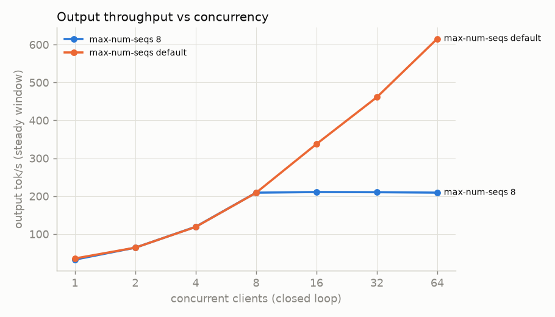
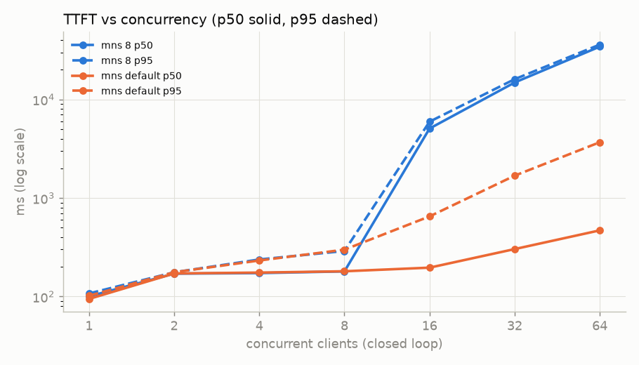
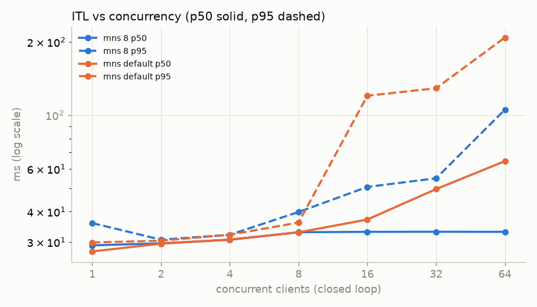

# T4 engine results — summary

Generated by `benchmarks/analyze.py` from the stage JSONL files; do not edit by hand. Every row links its JSONL. Narrative and caveats: [README.md](README.md).

## Task 1 — baseline serve

### vLLM version attempts (latest first)

| vLLM | result | torch after install | startup s | detail | source |
|---|---|---|---:|---|---|
| 0.31.0 | serves | 2.13.0+cu130 13.0 | 187.7 | (EngineCore pid=254) INFO 10-15 02:02:31 [cuda.py:526] Using TRITON_ATTN attention backend out of potential backends: ['TRITON_ATTN', 'FLEX_ATTENTION']. | [20261014-215653_baseline](../../../benchmarks/results/t4/20261014-215653_baseline/results/baseline/baseline.jsonl) |
| 0.30.0 | flags missing from serve --help: ['--dtype', '--gpu-memory-utilization', '--max-model-len', '--max-num-seqs', '--no-enable-prefix-caching', '--served-model-name', '--port'] | 2.13.0+cu130 13.0 | — |  | [20261014-214232_baseline](../../../benchmarks/results/t4/20261014-214232_baseline/results/baseline/baseline.jsonl) |
| 0.29.0 | flags missing from serve --help: ['--dtype', '--gpu-memory-utilization', '--max-model-len', '--max-num-seqs', '--no-enable-prefix-caching', '--served-model-name', '--port'] | 2.13.0+cu130 13.0 | — |  | [20261014-214232_baseline](../../../benchmarks/results/t4/20261014-214232_baseline/results/baseline/baseline.jsonl) |
| 0.28.0 | flags missing from serve --help: ['--dtype', '--gpu-memory-utilization', '--max-model-len', '--max-num-seqs', '--no-enable-prefix-caching', '--served-model-name', '--port'] | 2.13.0+cu130 13.0 | — |  | [20261014-214232_baseline](../../../benchmarks/results/t4/20261014-214232_baseline/results/baseline/baseline.jsonl) |

Model: `Qwen/Qwen2.5-3B-Instruct` @ `aa8e72537993ba99e69dfaafa59ed015b17504d1` — SUBSTITUTE for meta-llama/Llama-3.2-3B-Instruct (no download access)

Serving flags: `--dtype half --gpu-memory-utilization 0.9 --max-model-len 4096 --no-enable-prefix-caching` · vLLM 0.31.0 · torch 2.13.0+cu130 13.0

### Startup facts (from the server log and /metrics `vllm:cache_config_info`)

| fact | value | where |
|---|---|---|
| num GPU blocks | 10,938 | `vllm:cache_config_info` label (fallback: log) |
| block size | 16 | `vllm:cache_config_info` label |
| blocks × block size | 175,008 tokens | computed |
| GPU KV cache size | 175,008 tokens | log `GPU KV cache size:` |
| available KV memory | 6.01 GiB | log `Available KV cache memory:` |
| model weights | 5.79 GiB | log `Model loading took` |
| max concurrency @ 4,096 tok | 42.73× | log `Maximum concurrency for` |
| attention backend | (EngineCore pid=254) INFO 10-15 02:02:31 [cuda.py:526] Using TRITON_ATTN attention backend out of potential backends: ['TRITON_ATTN', 'FLEX_ATTENTION']. (EngineCore pid=254) WARNING 10-15 02:03:16 [topk_topp_sampler.py:131] FlashInfer top-p/top-k sampling unavailable: unsupported compute capability 7.5; falling back. Set VLLM_USE_FLASHINFER_SAMPLER=0 to silence. | log |

KV bytes/token from `config.json`: 2 (K,V) × 36 layers × 2 KV heads × 128 head_dim × 2 B (FP16) = 36,864 B/token.

Consistency check (computed): available KV 6.01 GiB / 36,864 B = 175,053 tokens.

### Batch-1 decode

5 streamed runs, prompt “Write a long, detailed essay about the history of computing, from mechanical calculators to GPUs.”, max_tokens 256, ignore_eos, temperature 0. Decode tok/s = (completion_tokens − 1) / (last − first content chunk).

**median 16.30 tok/s**, min 10.59, max 21.09, spread 64.39 % · runs: 21.09, 11.47, 10.59, 16.30, 18.62 · TTFT median 0.075 s · [20261014-215653_baseline](../../../benchmarks/results/t4/20261014-215653_baseline/results/baseline/baseline.jsonl)

- `chat-nonstream`: HTTP 200, usage {'prompt_tokens': 35, 'total_tokens': 44, 'completion_tokens': 9, 'prompt_tokens_details': None, 'completion_tokens_details': None}, content “Hello, how can I help you?”
- `chat-stream`: HTTP 200, usage {'prompt_tokens': 35, 'total_tokens': 44, 'completion_tokens': 9}, content “Hello, how can I help you?”

### /metrics names by role (from the `# TYPE` lines of the idle scrape)

| role | metric(s) |
|---|---|
| ttft | `vllm:time_to_first_token_seconds (histogram)`, `vllm:time_to_first_token_seconds_created (gauge)` |
| itl | `vllm:inter_token_latency_seconds (histogram)`, `vllm:inter_token_latency_seconds_created (gauge)`, `vllm:request_time_per_output_token_seconds (histogram)`, `vllm:request_time_per_output_token_seconds_created (gauge)` |
| waiting | `vllm:num_requests_waiting (gauge)`, `vllm:num_requests_waiting_by_reason (gauge)` |
| running | `vllm:num_requests_running (gauge)` |
| kv_usage | `vllm:kv_cache_usage_perc (gauge)` |
| preemptions | `vllm:num_preemptions_created (gauge)`, `vllm:num_preemptions_total (counter)`, `vllm:request_num_preemptions (histogram)`, `vllm:request_num_preemptions_created (gauge)` |
| queue_time | `vllm:request_queue_time_seconds (histogram)`, `vllm:request_queue_time_seconds_created (gauge)` |
| prefix_cache | `vllm:external_prefix_cache_hits_created (gauge)`, `vllm:external_prefix_cache_hits_total (counter)`, `vllm:external_prefix_cache_queries_created (gauge)`, `vllm:external_prefix_cache_queries_total (counter)`, `vllm:prefix_cache_hits_created (gauge)`, `vllm:prefix_cache_hits_total (counter)`, `vllm:prefix_cache_queries_created (gauge)`, `vllm:prefix_cache_queries_total (counter)` |

Raw scrapes: `logs/metrics-idle.txt`, `logs/metrics-load.txt` (c=16 load), `logs/metrics-after.txt` in the run dir.

## Predictions vs measured

Measured model: `Qwen/Qwen2.5-3B-Instruct`. The predictions were made for Llama-3.2-3B; the KV rows are restated for this model from its config.json (formula above).

| quantity | predicted | measured | why different |
|---|---|---|---|
| batch-1 decode tok/s | ≤ 50 (expect 30-35) | 16.30 baseline session (spread 64.4 %); 37.16 quant session (spread 1.0 %) | sessions differ in GPU clock (SW power capping), README |
| KV bytes/token | 114,688 (Llama-3.2-3B) | 36,864 (config.json) | different model (Qwen2.5-3B: 2 KV heads, GQA, per its config.json) |
| KV pool tokens @ 0.90 | ≈ 55,000 → 171,111 restated (same KV bytes, this model's B/token) | 175,008 (log) | see notes |
| GPU blocks × block size ≈ KV pool | ≈ KV pool | 10,938 × 16 = 175,008 | — |

## Task 2 — KV capacity (8B AWQ INT4)

Full table: [benchmarks/kv_capacity_table.md](../../kv_capacity_table.md).

## Task 4 — concurrency sweep

Model `Qwen/Qwen2.5-3B-Instruct` @ `aa8e72537993ba99e69dfaafa59ed015b17504d1` (SUBSTITUTE for meta-llama/Llama-3.2-3B-Instruct (no download access)) · vLLM 0.31.0 · prefix caching: disabled (--no-enable-prefix-caching) + unique random prompts.
Client: benchmarks/harness, `/v1/completions` streamed, 256 prompt tokens (unique random words, uuid prefix), max_tokens 128 ± 25 %, ignore_eos, start jitter 0 s, requests max(20, 4×c), 2 warmup. TTFT/ITL client-side (first token chunk / chunk gaps); srv_* = vLLM /metrics sampled at 1 Hz; gpu_* = NVML at 1 Hz.

| max-num-seqs | c | ok | err | TTFT p50 / p95 ms | ITL p50 / p95 ms | steady out tok/s | req/s | running max | waiting max | KV usage max | preempt | GPU util mean % | power mean W | row |
|---|---:|---:|---:|---:|---:|---:|---:|---:|---:|---:|---:|---:|---:|---|
| 8 | 1 | 20 | 0 | 100 / 107 | 29.1 / 35.9 | 32.5 | 0.25 | 1 | 0 | 0.002 | 0 | 96.3 | 67.1 | [20261014-230457_sweep](../../../benchmarks/results/t4/20261014-230457_sweep/results/sweep/sweep.jsonl) |
| 8 | 2 | 20 | 0 | 171 / 176 | 29.6 / 30.7 | 63.9 | 0.46 | 2 | 0 | 0.004 | 0 | 94.2 | 66.4 | [20261014-230457_sweep](../../../benchmarks/results/t4/20261014-230457_sweep/results/sweep/sweep.jsonl) |
| 8 | 4 | 20 | 0 | 173 / 238 | 30.6 / 32.1 | 119.2 | 0.82 | 4 | 0 | 0.008 | 0 | 94.1 | 65.8 | [20261014-230457_sweep](../../../benchmarks/results/t4/20261014-230457_sweep/results/sweep/sweep.jsonl) |
| 8 | 8 | 32 | 0 | 180 / 290 | 32.9 / 39.9 | 209.1 | 1.48 | 8 | 0 | 0.015 | 0 | 92.7 | 65.9 | [20261014-230457_sweep](../../../benchmarks/results/t4/20261014-230457_sweep/results/sweep/sweep.jsonl) |
| 8 | 16 | 64 | 0 | 5,070 / 5,951 | 33.0 / 50.6 | 210.8 | 1.52 | 8 | 8 | 0.015 | 0 | 96.2 | 66.5 | [20261014-230457_sweep](../../../benchmarks/results/t4/20261014-230457_sweep/results/sweep/sweep.jsonl) |
| 8 | 32 | 128 | 0 | 14,867 / 16,067 | 33.1 / 54.9 | 210.4 | 1.57 | 8 | 24 | 0.015 | 0 | 96.7 | 66.6 | [20261014-230457_sweep](../../../benchmarks/results/t4/20261014-230457_sweep/results/sweep/sweep.jsonl) |
| 8 | 64 | 256 | 0 | 34,381 / 36,049 | 33.0 / 105.1 | 209.2 | 1.61 | 8 | 56 | 0.015 | 0 | 97.8 | 66.7 | [20261014-230457_sweep](../../../benchmarks/results/t4/20261014-230457_sweep/results/sweep/sweep.jsonl) |
| default (None) | 1 | 20 | 0 | 95 / 102 | 27.4 / 29.9 | 35.4 | 0.27 | 1 | 0 | 0.002 | 0 | 96.1 | 67.0 | [20261014-230457_sweep](../../../benchmarks/results/t4/20261014-230457_sweep/results/sweep/sweep.jsonl) |
| default (None) | 2 | 20 | 0 | 171 / 176 | 29.5 / 30.4 | 63.9 | 0.46 | 2 | 0 | 0.005 | 0 | 95.5 | 66.0 | [20261014-230457_sweep](../../../benchmarks/results/t4/20261014-230457_sweep/results/sweep/sweep.jsonl) |
| default (None) | 4 | 20 | 0 | 175 / 232 | 30.7 / 32.1 | 118.7 | 0.81 | 4 | 0 | 0.009 | 0 | 94.1 | 65.4 | [20261014-230457_sweep](../../../benchmarks/results/t4/20261014-230457_sweep/results/sweep/sweep.jsonl) |
| default (None) | 8 | 32 | 0 | 180 / 299 | 32.9 / 36.1 | 208.8 | 1.48 | 8 | 0 | 0.016 | 0 | 93.5 | 65.7 | [20261014-230457_sweep](../../../benchmarks/results/t4/20261014-230457_sweep/results/sweep/sweep.jsonl) |
| default (None) | 16 | 64 | 0 | 196 / 650 | 37.1 / 120.0 | 337.5 | 2.33 | 16 | 0 | 0.031 | 0 | 94.6 | 66.4 | [20261014-230457_sweep](../../../benchmarks/results/t4/20261014-230457_sweep/results/sweep/sweep.jsonl) |
| default (None) | 32 | 128 | 0 | 303 / 1,685 | 49.5 / 128.9 | 461.2 | 3.39 | 32 | 1 | 0.064 | 0 | 93.7 | 65.7 | [20261014-230457_sweep](../../../benchmarks/results/t4/20261014-230457_sweep/results/sweep/sweep.jsonl) |
| default (None) | 64 | 256 | 0 | 469 / 3,681 | 64.6 / 208.4 | 615.5 | 4.75 | 64 | 36 | 0.129 | 0 | 94.0 | 65.2 | [20261014-230457_sweep](../../../benchmarks/results/t4/20261014-230457_sweep/results/sweep/sweep.jsonl) |

Knee (smallest concurrency with steady_output_tok_s >= 90% of max): c = 64, 4.745 req/s, max steady 615.46 tok/s → open-loop rates [3.559, 4.745, 5.931] req/s.

### Open loop (Poisson arrivals)

| rate req/s | × knee | ok | err | TTFT p50 / p95 ms | ITL p50 / p95 ms | output tok/s (wall) | achieved req/s | running max | waiting max | KV max | preempt | row |
|---:|---:|---:|---:|---:|---:|---:|---:|---:|---:|---:|---:|---|
| 3.559 | 0.75 | 320 | 0 | 260 / 454 | 52.0 / 133.3 | 439.5 | 3.44 | 52 | 0 | 0.094 | 0 | [20261014-230457_sweep](../../../benchmarks/results/t4/20261014-230457_sweep/results/sweep/sweep.jsonl) |
| 4.745 | 1.0 | 427 | 0 | 337 / 695 | 65.2 / 205.1 | 583.9 | 4.58 | 83 | 0 | 0.157 | 0 | [20261014-230457_sweep](../../../benchmarks/results/t4/20261014-230457_sweep/results/sweep/sweep.jsonl) |
| 5.931 | 1.25 | 533 | 0 | 493 / 1,035 | 115.2 / 308.5 | 709.2 | 5.54 | 162 | 0 | 0.297 | 0 | [20261014-230457_sweep](../../../benchmarks/results/t4/20261014-230457_sweep/results/sweep/sweep.jsonl) |

### Cross-check: harness vs `vllm bench serve`

Both in the **same Kaggle session, back to back**, same server (default max-num-seqs), same workload: 256 random prompt tokens, 128 output tokens, ignore_eos, no jitter, max(20, 4×c) requests. Both clocks start just before the HTTP POST and stop at the first SSE chunk carrying `choices` (harness: benchmarks/harness/client.py `one_request`; bench: vLLM 0.31.0 `vllm/benchmarks/lib/endpoint_request_func.py` `async_request_openai_completions`, lines 202–240). Server-side `vllm:time_to_first_token_seconds` mean shown for the harness run.

| c | tool | TTFT p50 ms | TTFT p95 ms | ITL p50 ms | TPOT p50 ms | output tok/s | SM clock mean MHz | srv TTFT mean ms | row |
|---:|---|---:|---:|---:|---:|---:|---:|---:|---|
| 1 | harness | 110.8 | 124.0 | 40.5 | 40.5 | 23.9 (wall) | 500 | 106.7 | [20261014-230457_sweep](../../../benchmarks/results/t4/20261014-230457_sweep/results/sweep/sweep.jsonl) |
| 1 | vllm bench serve | 116.1 | 142.9 | 45.1 | 44.9 | 21.3 | 461 | — | [20261014-230457_sweep](../../../benchmarks/results/t4/20261014-230457_sweep/results/sweep/sweep.jsonl) |
| 16 | harness | 1,215.7 | 1,570.5 | 38.2 | 41.4 | 316.1 (wall) | 754 | 1,156.3 | [20261014-230457_sweep](../../../benchmarks/results/t4/20261014-230457_sweep/results/sweep/sweep.jsonl) |
| 16 | vllm bench serve | 1,574.6 | 10,510.6 | 38.4 | 39.6 | 234.1 | 762 | — | [20261014-230457_sweep](../../../benchmarks/results/t4/20261014-230457_sweep/results/sweep/sweep.jsonl) |

### c=16 TTFT-tail diagnosis (`vllm bench serve`)

A then B on one server (A on a cold server, B warm); C and D each on a fresh server.

| run | extra flags | TTFT p50 / p95 ms | first 16 requests TTFT s (min–max) | later requests TTFT s (max) | TPOT p50 ms | output tok/s | row |
|---|---|---:|---:|---:|---:|---:|---|
| benchdiag-A | `--save-detailed` | 1,488.9 / 12,463.1 | 4.48–12.47 | 1.56 | 39.4 | 223.5 | [20261014-232257_sweep](../../../benchmarks/results/t4/20261014-232257_sweep/results/sweep/sweep.jsonl) |
| benchdiag-B | `--save-detailed --num-warmups 2 --temperature 0` | 1,237.8 / 1,606.3 | 0.11–1.57 | 1.61 | 42.9 | 305.8 | [20261014-232257_sweep](../../../benchmarks/results/t4/20261014-232257_sweep/results/sweep/sweep.jsonl) |
| benchdiag-C | `--save-detailed --num-warmups 2` | 1,407.9 / 12,367.4 | 3.71–12.37 | 1.58 | 38.8 | 226.4 | [20261014-233928_sweep](../../../benchmarks/results/t4/20261014-233928_sweep/results/sweep/sweep.jsonl) |
| benchdiag-D | `--save-detailed --temperature 0` | 1,561.9 / 2,680.4 | 1.23–2.69 | 1.60 | 42.3 | 298.0 | [20261014-233928_sweep](../../../benchmarks/results/t4/20261014-233928_sweep/results/sweep/sweep.jsonl) |

## Task 5 — quantization: speed, quality, cost

| variant | engine | model | batch-1 decode tok/s (median, spread) | c=16 steady tok/s | c=16 TTFT p50 ms | PPL (wikitext-2, 40×512, 2nd half) | gsm8k | hellaswag | $/1M out tok @ c=16 | rows |
|---|---|---|---:|---:|---:|---:|---:|---:|---:|---|
| fp16 | vLLM 0.31.0 | `Qwen/Qwen2.5-3B-Instruct` | 37.16 (1.0 %) | 341.7 | 196 | 8.018 | flexible-extract 0.656 ± 0.030 strict-match 0.116 ± 0.020 | acc 0.536 ± 0.032 acc_norm 0.656 ± 0.030 | 0.428 | [20261014-230851_quant](../../../benchmarks/results/t4/20261014-230851_quant/results/quant/quant.jsonl) |
| awq-int4 | vLLM 0.31.0 | `Qwen/Qwen2.5-3B-Instruct-AWQ` | 84.06 (1.9 %) | 536.6 | 144 | 8.659 | flexible-extract 0.624 ± 0.031 strict-match 0.120 ± 0.021 | acc 0.512 ± 0.032 acc_norm 0.628 ± 0.031 | 0.272 | [20261014-230851_quant](../../../benchmarks/results/t4/20261014-230851_quant/results/quant/quant.jsonl) |
| gguf-q8_0 | llama.cpp b11146 (CUDA 12.8 prebuilt) | `Qwen/Qwen2.5-3B-Instruct-GGUF/qwen2.5-3b-instruct-q8_0.gguf` | 60.04 (2.2 %) | 284.7 | 245 | 8.137 | failed (rc 1) | failed (rc 1) | 0.513 | [20261014-230851_quant](../../../benchmarks/results/t4/20261014-230851_quant/results/quant/quant.jsonl) |
| gguf-q4_k_m | llama.cpp b11146 (CUDA 12.8 prebuilt) | `Qwen/Qwen2.5-3B-Instruct-GGUF/qwen2.5-3b-instruct-q4_k_m.gguf` | 76.61 (2.0 %) | 304.5 | 241 | 8.410 | failed (rc 1) | failed (rc 1) | 0.480 | [20261014-230851_quant](../../../benchmarks/results/t4/20261014-230851_quant/results/quant/quant.jsonl) |

lm-eval 0.4.12 `local-completions`, --limit 250 (first N docs), command in the row (`lmeval_cmd`).

Cost: Azure Standard_NC4as_T4_v3 US East Linux on-demand 0.526 USD/1 Hour; fetched 2026-10-15T01:46:38Z from: https://prices.azure.com/api/retail/prices?$filter=armSkuName eq 'Standard_NC4as_T4_v3' and armRegionName eq 'eastus' and priceType eq 'Consumption'. Formula `$ / 1M = $/h ÷ (tok/s × 3600) × 1e6` (benchmarks/cost.py).

## Kaggle runs (GPU time)

| run | stage | status | script session s | GPU-h (script) | GPU-h (push→done, upper bound) |
|---|---|---|---:|---:|---:|
| 20261014-213711_smoke | smoke | complete | 20.9 | 0.006 | 0.015 |
| 20261014-214014_smoke | smoke | complete | 29.1 | 0.008 | 0.017 |
| 20261014-214129_smoke | smoke | complete | 20.7 | 0.006 | 0.013 |
| 20261014-214232_baseline | baseline | complete | 760.0 | 0.211 | 0.225 |
| 20261014-215653_baseline | baseline | complete | 636.8 | 0.177 | 0.190 |
| 20261014-220946_sweep | sweep | complete | 2,064.3 | 0.573 | 0.587 |
| 20261014-220938_kvgrid | kvgrid | complete | 2,372.8 | 0.659 | 0.667 |
| 20261014-225021_sweep | sweep | complete | 800.1 | 0.222 | 0.232 |
| 20261014-224513_quant | quant | complete | 1,263.9 | 0.351 | 0.370 |
| 20261014-230757_smoke | smoke | complete | 20.3 | 0.006 | 0.013 |
| 20261014-230457_sweep | sweep | complete | 895.7 | 0.249 | 0.260 |
| 20261014-232257_sweep | sweep | complete | 882.7 | 0.245 | 0.258 |
| 20261014-230851_quant | quant | complete | 1,864.8 | 0.518 | 0.537 |
| 20261014-233928_sweep | sweep | complete | — | — | 0.290 |
| **total** | | | | **3.231** | **3.674** |

