# T4 engine results — summary

Generated by `benchmarks/analyze.py` from the stage JSONL files; do not edit by hand. Every row links its JSONL. Narrative and caveats: [README.md](README.md).

## Task 1 — baseline serve: `meta-llama/Llama-3.2-3B-Instruct`

### vLLM version attempts (latest first)

| vLLM | result | torch after install | startup s | detail | source |
|---|---|---|---:|---|---|

Model: `meta-llama/Llama-3.2-3B-Instruct` @ `0cb88a4f764b7a12671c53f0838cd831a0843b95` — preferred

Serving flags: `--dtype half --gpu-memory-utilization 0.9 --max-model-len 4096 --no-enable-prefix-caching` · vLLM 0.31.0 · torch 2.13.0+cu130 13.0

### Startup facts (from the server log and /metrics `vllm:cache_config_info`)

| fact | value | where |
|---|---|---|
| num GPU blocks | 3,369 | `vllm:cache_config_info` label (fallback: log) |
| block size | 16 | `vllm:cache_config_info` label |
| blocks × block size | 53,904 tokens | computed |
| GPU KV cache size | 53,904 tokens | log `GPU KV cache size:` |
| available KV memory | 5.76 GiB | log `Available KV cache memory:` |
| model weights | 6.04 GiB | log `Model loading took` |
| max concurrency @ 4,096 tok | 13.16× | log `Maximum concurrency for` |
| attention backend | (EngineCore pid=255) INFO 10-15 10:58:07 [cuda.py:526] Using TRITON_ATTN attention backend out of potential backends: ['TRITON_ATTN', 'FLEX_ATTENTION']. (EngineCore pid=255) WARNING 10-15 10:58:47 [topk_topp_sampler.py:131] FlashInfer top-p/top-k sampling unavailable: unsupported compute capability 7.5; falling back. Set VLLM_USE_FLASHINFER_SAMPLER=0 to silence. | log |

KV bytes/token from `config.json`: 2 (K,V) × 28 layers × 8 KV heads × 128 head_dim × 2 B (FP16) = 114,688 B/token.

Consistency check (computed): available KV 5.76 GiB / 114,688 B = 53,926 tokens.

### Batch-1 decode

5 streamed runs, prompt “Write a long, detailed essay about the history of computing, from mechanical calculators to GPUs.”, max_tokens 256, ignore_eos, temperature 0. Decode tok/s = (completion_tokens − 1) / (last − first content chunk).

**median 36.65 tok/s**, min 35.67, max 37.10, spread 3.90 % · runs: 37.10, 36.96, 36.65, 36.22, 35.67 · TTFT median 0.075 s · [20261015-064953_baseline](../../../benchmarks/results/t4/20261015-064953_baseline/results/baseline/baseline.jsonl)

- `chat-nonstream`: HTTP 200, usage {'prompt_tokens': 41, 'total_tokens': 49, 'completion_tokens': 8, 'prompt_tokens_details': None, 'completion_tokens_details': None}, content “Hello, how are you today?”
- `chat-stream`: HTTP 200, usage {'prompt_tokens': 41, 'total_tokens': 49, 'completion_tokens': 8}, content “Hello, how are you today?”

### /metrics names by role (from the `# TYPE` lines of the idle scrape)

| role | metric(s) |
|---|---|
| ttft | `vllm:time_to_first_token_seconds (histogram)`, `vllm:time_to_first_token_seconds_created (gauge)` |
| itl | `vllm:inter_token_latency_seconds (histogram)`, `vllm:inter_token_latency_seconds_created (gauge)`, `vllm:request_time_per_output_token_seconds (histogram)`, `vllm:request_time_per_output_token_seconds_created (gauge)` |
| waiting | `vllm:num_requests_waiting (gauge)`, `vllm:num_requests_waiting_by_reason (gauge)` |
| running | `vllm:num_requests_running (gauge)` |
| kv_usage | `vllm:kv_cache_usage_perc (gauge)` |
| preemptions | `vllm:num_preemptions_created (gauge)`, `vllm:num_preemptions_total (counter)`, `vllm:request_num_preemptions (histogram)`, `vllm:request_num_preemptions_created (gauge)` |
| queue_time | `vllm:request_queue_time_seconds (histogram)`, `vllm:request_queue_time_seconds_created (gauge)` |
| prefix_cache | `vllm:external_prefix_cache_hits_created (gauge)`, `vllm:external_prefix_cache_hits_total (counter)`, `vllm:external_prefix_cache_queries_created (gauge)`, `vllm:external_prefix_cache_queries_total (counter)`, `vllm:prefix_cache_hits_created (gauge)`, `vllm:prefix_cache_hits_total (counter)`, `vllm:prefix_cache_queries_created (gauge)`, `vllm:prefix_cache_queries_total (counter)` |

Raw scrapes: `logs/metrics-idle.txt`, `logs/metrics-load.txt` (c=16 load), `logs/metrics-after.txt` in the run dir.

## Task 1 — baseline serve: `Qwen/Qwen2.5-3B-Instruct`

### vLLM version attempts (latest first)

| vLLM | result | torch after install | startup s | detail | source |
|---|---|---|---:|---|---|

Model: `Qwen/Qwen2.5-3B-Instruct` @ `aa8e72537993ba99e69dfaafa59ed015b17504d1` — SUBSTITUTE for meta-llama/Llama-3.2-3B-Instruct (no download access)

Serving flags: `--dtype half --gpu-memory-utilization 0.9 --max-model-len 4096 --no-enable-prefix-caching` · vLLM 0.31.0 · torch 2.13.0+cu130 13.0

### Startup facts (from the server log and /metrics `vllm:cache_config_info`)

| fact | value | where |
|---|---|---|
| num GPU blocks | 10,938 | `vllm:cache_config_info` label (fallback: log) |
| block size | 16 | `vllm:cache_config_info` label |
| blocks × block size | 175,008 tokens | computed |
| GPU KV cache size | 175,008 tokens | log `GPU KV cache size:` |
| available KV memory | 6.01 GiB | log `Available KV cache memory:` |
| model weights | 5.79 GiB | log `Model loading took` |
| max concurrency @ 4,096 tok | 42.73× | log `Maximum concurrency for` |
| attention backend | (EngineCore pid=254) INFO 10-15 02:02:31 [cuda.py:526] Using TRITON_ATTN attention backend out of potential backends: ['TRITON_ATTN', 'FLEX_ATTENTION']. (EngineCore pid=254) WARNING 10-15 02:03:16 [topk_topp_sampler.py:131] FlashInfer top-p/top-k sampling unavailable: unsupported compute capability 7.5; falling back. Set VLLM_USE_FLASHINFER_SAMPLER=0 to silence. | log |

KV bytes/token from `config.json`: 2 (K,V) × 36 layers × 2 KV heads × 128 head_dim × 2 B (FP16) = 36,864 B/token.

Consistency check (computed): available KV 6.01 GiB / 36,864 B = 175,053 tokens.

### Batch-1 decode

5 streamed runs, prompt “Write a long, detailed essay about the history of computing, from mechanical calculators to GPUs.”, max_tokens 256, ignore_eos, temperature 0. Decode tok/s = (completion_tokens − 1) / (last − first content chunk).

**median 16.30 tok/s**, min 10.59, max 21.09, spread 64.39 % · runs: 21.09, 11.47, 10.59, 16.30, 18.62 · TTFT median 0.075 s · [20261014-215653_baseline](../../../benchmarks/results/t4/20261014-215653_baseline/results/baseline/baseline.jsonl)

- `chat-nonstream`: HTTP 200, usage {'prompt_tokens': 35, 'total_tokens': 44, 'completion_tokens': 9, 'prompt_tokens_details': None, 'completion_tokens_details': None}, content “Hello, how can I help you?”
- `chat-stream`: HTTP 200, usage {'prompt_tokens': 35, 'total_tokens': 44, 'completion_tokens': 9}, content “Hello, how can I help you?”

### /metrics names by role (from the `# TYPE` lines of the idle scrape)

| role | metric(s) |
|---|---|
| ttft | `vllm:time_to_first_token_seconds (histogram)`, `vllm:time_to_first_token_seconds_created (gauge)` |
| itl | `vllm:inter_token_latency_seconds (histogram)`, `vllm:inter_token_latency_seconds_created (gauge)`, `vllm:request_time_per_output_token_seconds (histogram)`, `vllm:request_time_per_output_token_seconds_created (gauge)` |
| waiting | `vllm:num_requests_waiting (gauge)`, `vllm:num_requests_waiting_by_reason (gauge)` |
| running | `vllm:num_requests_running (gauge)` |
| kv_usage | `vllm:kv_cache_usage_perc (gauge)` |
| preemptions | `vllm:num_preemptions_created (gauge)`, `vllm:num_preemptions_total (counter)`, `vllm:request_num_preemptions (histogram)`, `vllm:request_num_preemptions_created (gauge)` |
| queue_time | `vllm:request_queue_time_seconds (histogram)`, `vllm:request_queue_time_seconds_created (gauge)` |
| prefix_cache | `vllm:external_prefix_cache_hits_created (gauge)`, `vllm:external_prefix_cache_hits_total (counter)`, `vllm:external_prefix_cache_queries_created (gauge)`, `vllm:external_prefix_cache_queries_total (counter)`, `vllm:prefix_cache_hits_created (gauge)`, `vllm:prefix_cache_hits_total (counter)`, `vllm:prefix_cache_queries_created (gauge)`, `vllm:prefix_cache_queries_total (counter)` |

Raw scrapes: `logs/metrics-idle.txt`, `logs/metrics-load.txt` (c=16 load), `logs/metrics-after.txt` in the run dir.

## Predictions vs measured: `meta-llama/Llama-3.2-3B-Instruct`

Measured model: `meta-llama/Llama-3.2-3B-Instruct`.

| quantity | predicted | measured | why different |
|---|---|---|---|
| batch-1 decode tok/s | ≤ 50 (expect 30-35) | 36.65 baseline session (spread 3.9 %) | within the ≤ 50 ceiling; +4.7 % vs the top of the expected 30–35 |
| KV bytes/token | 114,688 (Llama-3.2-3B) | 114,688 (config.json) | same model |
| KV pool tokens @ 0.90 | ≈ 55,000 | 53,904 (log) | -2.0 % vs prediction; available KV 5.76 GiB ÷ 114,688 B = 53,926 tokens |
| GPU blocks × block size ≈ KV pool | ≈ KV pool | 3,369 × 16 = 53,904 | — |

## Predictions vs measured: `Qwen/Qwen2.5-3B-Instruct` (substitute)

Measured model: `Qwen/Qwen2.5-3B-Instruct`. The predictions were made for Llama-3.2-3B; the KV rows are restated for this model from its config.json (formula above).

| quantity | predicted | measured | why different |
|---|---|---|---|
| batch-1 decode tok/s | ≤ 50 (expect 30-35) | 16.30 baseline session (spread 64.4 %); 37.16 quant session (spread 1.0 %) | sessions differ in GPU clock (SW power capping), README |
| KV bytes/token | 114,688 (Llama-3.2-3B) | 36,864 (config.json) | different model (Qwen2.5-3B: 2 KV heads, GQA, per its config.json) |
| KV pool tokens @ 0.90 | ≈ 55,000 → 171,111 restated (same KV bytes, this model's B/token) | 175,008 (log) | +2.3 % vs prediction; available KV 6.01 GiB ÷ 36,864 B = 175,053 tokens |
| GPU blocks × block size ≈ KV pool | ≈ KV pool | 10,938 × 16 = 175,008 | — |

## Task 2 — KV capacity (8B AWQ INT4)

Full table: [benchmarks/kv_capacity_table.md](../../kv_capacity_table.md).

## Task 4 — concurrency sweep: `meta-llama/Llama-3.2-3B-Instruct`

Model `meta-llama/Llama-3.2-3B-Instruct` @ `0cb88a4f764b7a12671c53f0838cd831a0843b95` (preferred) · vLLM 0.31.0 · prefix caching: disabled (--no-enable-prefix-caching) + unique random prompts.
Client: benchmarks/harness, `/v1/completions` streamed, 256 prompt tokens (unique random words, uuid prefix), max_tokens 128 ± 25 %, ignore_eos, start jitter 0 s, requests max(20, 4×c), 2 warmup. TTFT/ITL client-side (first token chunk / chunk gaps); srv_* = vLLM /metrics sampled at 1 Hz; gpu_* = NVML at 1 Hz.

| max-num-seqs | c | ok | err | TTFT p50 / p95 ms | ITL p50 / p95 ms | steady out tok/s | req/s | running max | waiting max | KV usage max | preempt | GPU util mean % | power mean W | row |
|---|---:|---:|---:|---:|---:|---:|---:|---:|---:|---:|---:|---:|---:|---|
| 8 | 1 | 20 | 0 | 192 / 202 | 104.3 / 106.8 | 9.6 | 0.07 | 1 | 0 | 0.007 | 0 | 98.9 | 58.1 | [20261015-070248_sweep](../../../benchmarks/results/t4/20261015-070248_sweep/results/sweep/sweep.jsonl) |
| 8 | 2 | 20 | 0 | 291 / 329 | 36.0 / 103.1 | 51.0 | 0.32 | 2 | 0 | 0.014 | 0 | 96.4 | 61.1 | [20261015-070248_sweep](../../../benchmarks/results/t4/20261015-070248_sweep/results/sweep/sweep.jsonl) |
| 8 | 4 | 20 | 0 | 265 / 350 | 40.4 / 103.7 | 88.9 | 0.53 | 4 | 0 | 0.027 | 0 | 97.0 | 60.0 | [20261015-070248_sweep](../../../benchmarks/results/t4/20261015-070248_sweep/results/sweep/sweep.jsonl) |
| 8 | 8 | 32 | 0 | 254 / 450 | 42.7 / 51.3 | 158.1 | 1.08 | 8 | 0 | 0.049 | 0 | 96.1 | 61.1 | [20261015-070248_sweep](../../../benchmarks/results/t4/20261015-070248_sweep/results/sweep/sweep.jsonl) |
| 8 | 16 | 64 | 0 | 6,829 / 7,878 | 42.4 / 106.3 | 158.7 | 1.12 | 8 | 8 | 0.049 | 0 | 98.8 | 62.0 | [20261015-070248_sweep](../../../benchmarks/results/t4/20261015-070248_sweep/results/sweep/sweep.jsonl) |
| 8 | 32 | 128 | 0 | 19,653 / 21,086 | 42.5 / 106.6 | 161.2 | 1.16 | 8 | 24 | 0.051 | 0 | 98.5 | 63.3 | [20261015-070248_sweep](../../../benchmarks/results/t4/20261015-070248_sweep/results/sweep/sweep.jsonl) |
| 8 | 64 | 256 | 0 | 44,671 / 47,103 | 42.0 / 144.4 | 160.3 | 1.24 | 8 | 56 | 0.049 | 0 | 98.6 | 64.4 | [20261015-070248_sweep](../../../benchmarks/results/t4/20261015-070248_sweep/results/sweep/sweep.jsonl) |
| default (None) | 1 | 20 | 0 | 187 / 205 | 103.5 / 106.5 | 12.0 | 0.09 | 1 | 0 | 0.008 | 0 | 98.5 | 59.3 | [20261015-070248_sweep](../../../benchmarks/results/t4/20261015-070248_sweep/results/sweep/sweep.jsonl) |
| default (None) | 2 | 20 | 0 | 244 / 354 | 35.2 / 100.9 | 51.3 | 0.32 | 2 | 0 | 0.015 | 0 | 96.7 | 61.1 | [20261015-070248_sweep](../../../benchmarks/results/t4/20261015-070248_sweep/results/sweep/sweep.jsonl) |
| default (None) | 4 | 20 | 0 | 264 / 400 | 40.2 / 68.6 | 89.4 | 0.54 | 4 | 0 | 0.029 | 0 | 97.0 | 60.0 | [20261015-070248_sweep](../../../benchmarks/results/t4/20261015-070248_sweep/results/sweep/sweep.jsonl) |
| default (None) | 8 | 32 | 0 | 259 / 465 | 43.0 / 51.1 | 156.5 | 1.07 | 8 | 0 | 0.053 | 0 | 96.5 | 60.9 | [20261015-070248_sweep](../../../benchmarks/results/t4/20261015-070248_sweep/results/sweep/sweep.jsonl) |
| default (None) | 16 | 64 | 0 | 378 / 1,075 | 53.9 / 173.3 | 231.2 | 1.58 | 16 | 0 | 0.105 | 0 | 97.1 | 61.2 | [20261015-070248_sweep](../../../benchmarks/results/t4/20261015-070248_sweep/results/sweep/sweep.jsonl) |
| default (None) | 32 | 128 | 0 | 454 / 2,331 | 76.2 / 190.9 | 306.4 | 2.30 | 32 | 4 | 0.209 | 0 | 96.5 | 61.8 | [20261015-070248_sweep](../../../benchmarks/results/t4/20261015-070248_sweep/results/sweep/sweep.jsonl) |
| default (None) | 64 | 256 | 0 | 664 / 4,840 | 107.8 / 298.7 | 402.1 | 3.12 | 64 | 39 | 0.420 | 0 | 97.2 | 63.5 | [20261015-070248_sweep](../../../benchmarks/results/t4/20261015-070248_sweep/results/sweep/sweep.jsonl) |

Knee (smallest concurrency with steady_output_tok_s >= 90% of max): c = 64, 3.125 req/s, max steady 402.15 tok/s → open-loop rates [2.344, 3.125, 3.906] req/s.

### Open loop (Poisson arrivals)

| rate req/s | × knee | ok | err | TTFT p50 / p95 ms | ITL p50 / p95 ms | output tok/s (wall) | achieved req/s | running max | waiting max | KV max | preempt | row |
|---:|---:|---:|---:|---:|---:|---:|---:|---:|---:|---:|---:|---|
| 2.344 | 0.75 | 210 | 0 | 376 / 639 | 80.6 / 191.4 | 295.9 | 2.30 | 47 | 0 | 0.281 | 0 | [20261015-070248_sweep](../../../benchmarks/results/t4/20261015-070248_sweep/results/sweep/sweep.jsonl) |
| 3.125 | 1.0 | 281 | 0 | 470 / 928 | 116.5 / 292.4 | 370.6 | 2.90 | 86 | 0 | 0.526 | 0 | [20261015-070248_sweep](../../../benchmarks/results/t4/20261015-070248_sweep/results/sweep/sweep.jsonl) |
| 3.906 | 1.25 | 351 | 0 | 728 / 1,259 | 182.7 / 439.0 | 433.1 | 3.40 | 131 | 0 | 0.814 | 0 | [20261015-070248_sweep](../../../benchmarks/results/t4/20261015-070248_sweep/results/sweep/sweep.jsonl) |

### Cross-check: harness vs `vllm bench serve`

Both in the **same Kaggle session, back to back**, same server (default max-num-seqs), same workload: 256 random prompt tokens, 128 output tokens, ignore_eos, no jitter, max(20, 4×c) requests. Both clocks start just before the HTTP POST and stop at the first SSE chunk carrying `choices` (harness: benchmarks/harness/client.py `one_request`; bench: vLLM 0.31.0 `vllm/benchmarks/lib/endpoint_request_func.py` `async_request_openai_completions`, lines 202–240). Server-side `vllm:time_to_first_token_seconds` mean shown for the harness run.

| c | tool | TTFT p50 ms | TTFT p95 ms | ITL p50 ms | TPOT p50 ms | output tok/s | SM clock mean MHz | srv TTFT mean ms | row |
|---:|---|---:|---:|---:|---:|---:|---:|---:|---|
| 1 | harness | 192.9 | 201.3 | 104.4 | 103.9 | 9.6 (wall) | 306 | 189.8 | [20261015-070248_sweep](../../../benchmarks/results/t4/20261015-070248_sweep/results/sweep/sweep.jsonl) |
| 1 | vllm bench serve | 165.2 | 312.6 | 104.9 | 104.0 | 9.5 | 348 | — | [20261015-070248_sweep](../../../benchmarks/results/t4/20261015-070248_sweep/results/sweep/sweep.jsonl) |
| 16 | harness | 1,381.4 | 1,857.6 | 53.6 | 56.8 | 237.2 (wall) | 654 | 1,321.8 | [20261015-070248_sweep](../../../benchmarks/results/t4/20261015-070248_sweep/results/sweep/sweep.jsonl) |
| 16 | vllm bench serve | 1,637.8 | 7,110.6 | 54.0 | 59.3 | 191.3 | 806 | — | [20261015-070248_sweep](../../../benchmarks/results/t4/20261015-070248_sweep/results/sweep/sweep.jsonl) |

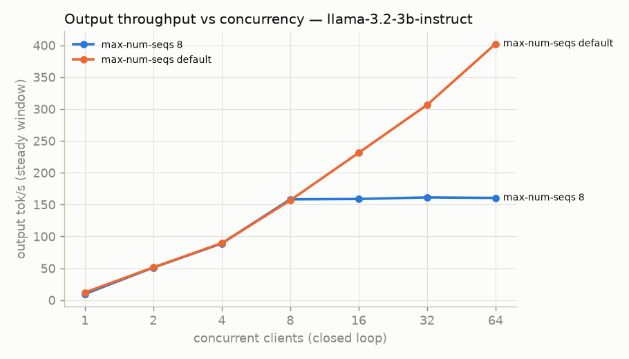
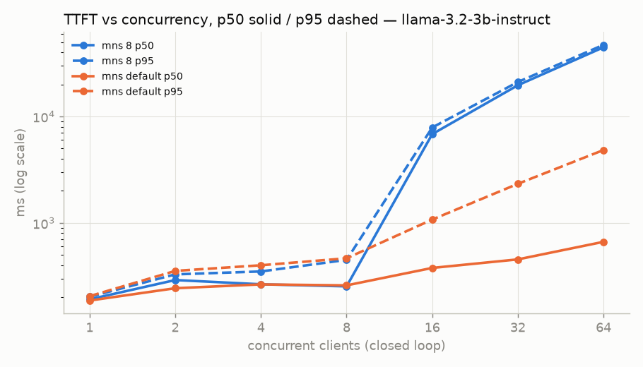
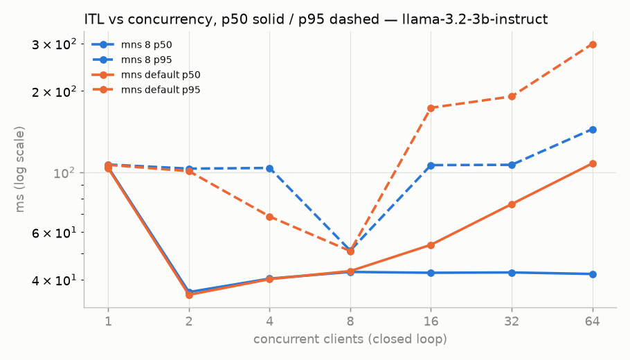

## Task 4 — concurrency sweep: `Qwen/Qwen2.5-3B-Instruct`

Model `Qwen/Qwen2.5-3B-Instruct` @ `aa8e72537993ba99e69dfaafa59ed015b17504d1` (SUBSTITUTE for meta-llama/Llama-3.2-3B-Instruct (no download access)) · vLLM 0.31.0 · prefix caching: disabled (--no-enable-prefix-caching) + unique random prompts.
Client: benchmarks/harness, `/v1/completions` streamed, 256 prompt tokens (unique random words, uuid prefix), max_tokens 128 ± 25 %, ignore_eos, start jitter 0 s, requests max(20, 4×c), 2 warmup. TTFT/ITL client-side (first token chunk / chunk gaps); srv_* = vLLM /metrics sampled at 1 Hz; gpu_* = NVML at 1 Hz.

| max-num-seqs | c | ok | err | TTFT p50 / p95 ms | ITL p50 / p95 ms | steady out tok/s | req/s | running max | waiting max | KV usage max | preempt | GPU util mean % | power mean W | row |
|---|---:|---:|---:|---:|---:|---:|---:|---:|---:|---:|---:|---:|---:|---|
| 8 | 1 | 20 | 0 | 100 / 107 | 29.1 / 35.9 | 32.5 | 0.25 | 1 | 0 | 0.002 | 0 | 96.3 | 67.1 | [20261014-230457_sweep](../../../benchmarks/results/t4/20261014-230457_sweep/results/sweep/sweep.jsonl) |
| 8 | 2 | 20 | 0 | 171 / 176 | 29.6 / 30.7 | 63.9 | 0.46 | 2 | 0 | 0.004 | 0 | 94.2 | 66.4 | [20261014-230457_sweep](../../../benchmarks/results/t4/20261014-230457_sweep/results/sweep/sweep.jsonl) |
| 8 | 4 | 20 | 0 | 173 / 238 | 30.6 / 32.1 | 119.2 | 0.82 | 4 | 0 | 0.008 | 0 | 94.1 | 65.8 | [20261014-230457_sweep](../../../benchmarks/results/t4/20261014-230457_sweep/results/sweep/sweep.jsonl) |
| 8 | 8 | 32 | 0 | 180 / 290 | 32.9 / 39.9 | 209.1 | 1.48 | 8 | 0 | 0.015 | 0 | 92.7 | 65.9 | [20261014-230457_sweep](../../../benchmarks/results/t4/20261014-230457_sweep/results/sweep/sweep.jsonl) |
| 8 | 16 | 64 | 0 | 5,070 / 5,951 | 33.0 / 50.6 | 210.8 | 1.52 | 8 | 8 | 0.015 | 0 | 96.2 | 66.5 | [20261014-230457_sweep](../../../benchmarks/results/t4/20261014-230457_sweep/results/sweep/sweep.jsonl) |
| 8 | 32 | 128 | 0 | 14,867 / 16,067 | 33.1 / 54.9 | 210.4 | 1.57 | 8 | 24 | 0.015 | 0 | 96.7 | 66.6 | [20261014-230457_sweep](../../../benchmarks/results/t4/20261014-230457_sweep/results/sweep/sweep.jsonl) |
| 8 | 64 | 256 | 0 | 34,381 / 36,049 | 33.0 / 105.1 | 209.2 | 1.61 | 8 | 56 | 0.015 | 0 | 97.8 | 66.7 | [20261014-230457_sweep](../../../benchmarks/results/t4/20261014-230457_sweep/results/sweep/sweep.jsonl) |
| default (None) | 1 | 20 | 0 | 95 / 102 | 27.4 / 29.9 | 35.4 | 0.27 | 1 | 0 | 0.002 | 0 | 96.1 | 67.0 | [20261014-230457_sweep](../../../benchmarks/results/t4/20261014-230457_sweep/results/sweep/sweep.jsonl) |
| default (None) | 2 | 20 | 0 | 171 / 176 | 29.5 / 30.4 | 63.9 | 0.46 | 2 | 0 | 0.005 | 0 | 95.5 | 66.0 | [20261014-230457_sweep](../../../benchmarks/results/t4/20261014-230457_sweep/results/sweep/sweep.jsonl) |
| default (None) | 4 | 20 | 0 | 175 / 232 | 30.7 / 32.1 | 118.7 | 0.81 | 4 | 0 | 0.009 | 0 | 94.1 | 65.4 | [20261014-230457_sweep](../../../benchmarks/results/t4/20261014-230457_sweep/results/sweep/sweep.jsonl) |
| default (None) | 8 | 32 | 0 | 180 / 299 | 32.9 / 36.1 | 208.8 | 1.48 | 8 | 0 | 0.016 | 0 | 93.5 | 65.7 | [20261014-230457_sweep](../../../benchmarks/results/t4/20261014-230457_sweep/results/sweep/sweep.jsonl) |
| default (None) | 16 | 64 | 0 | 196 / 650 | 37.1 / 120.0 | 337.5 | 2.33 | 16 | 0 | 0.031 | 0 | 94.6 | 66.4 | [20261014-230457_sweep](../../../benchmarks/results/t4/20261014-230457_sweep/results/sweep/sweep.jsonl) |
| default (None) | 32 | 128 | 0 | 303 / 1,685 | 49.5 / 128.9 | 461.2 | 3.39 | 32 | 1 | 0.064 | 0 | 93.7 | 65.7 | [20261014-230457_sweep](../../../benchmarks/results/t4/20261014-230457_sweep/results/sweep/sweep.jsonl) |
| default (None) | 64 | 256 | 0 | 469 / 3,681 | 64.6 / 208.4 | 615.5 | 4.75 | 64 | 36 | 0.129 | 0 | 94.0 | 65.2 | [20261014-230457_sweep](../../../benchmarks/results/t4/20261014-230457_sweep/results/sweep/sweep.jsonl) |

Knee (smallest concurrency with steady_output_tok_s >= 90% of max): c = 64, 4.745 req/s, max steady 615.46 tok/s → open-loop rates [3.559, 4.745, 5.931] req/s.

### Open loop (Poisson arrivals)

| rate req/s | × knee | ok | err | TTFT p50 / p95 ms | ITL p50 / p95 ms | output tok/s (wall) | achieved req/s | running max | waiting max | KV max | preempt | row |
|---:|---:|---:|---:|---:|---:|---:|---:|---:|---:|---:|---:|---|
| 3.559 | 0.75 | 320 | 0 | 260 / 454 | 52.0 / 133.3 | 439.5 | 3.44 | 52 | 0 | 0.094 | 0 | [20261014-230457_sweep](../../../benchmarks/results/t4/20261014-230457_sweep/results/sweep/sweep.jsonl) |
| 4.745 | 1.0 | 427 | 0 | 337 / 695 | 65.2 / 205.1 | 583.9 | 4.58 | 83 | 0 | 0.157 | 0 | [20261014-230457_sweep](../../../benchmarks/results/t4/20261014-230457_sweep/results/sweep/sweep.jsonl) |
| 5.931 | 1.25 | 533 | 0 | 493 / 1,035 | 115.2 / 308.5 | 709.2 | 5.54 | 162 | 0 | 0.297 | 0 | [20261014-230457_sweep](../../../benchmarks/results/t4/20261014-230457_sweep/results/sweep/sweep.jsonl) |

### Cross-check: harness vs `vllm bench serve`

Both in the **same Kaggle session, back to back**, same server (default max-num-seqs), same workload: 256 random prompt tokens, 128 output tokens, ignore_eos, no jitter, max(20, 4×c) requests. Both clocks start just before the HTTP POST and stop at the first SSE chunk carrying `choices` (harness: benchmarks/harness/client.py `one_request`; bench: vLLM 0.31.0 `vllm/benchmarks/lib/endpoint_request_func.py` `async_request_openai_completions`, lines 202–240). Server-side `vllm:time_to_first_token_seconds` mean shown for the harness run.

| c | tool | TTFT p50 ms | TTFT p95 ms | ITL p50 ms | TPOT p50 ms | output tok/s | SM clock mean MHz | srv TTFT mean ms | row |
|---:|---|---:|---:|---:|---:|---:|---:|---:|---|
| 1 | harness | 110.8 | 124.0 | 40.5 | 40.5 | 23.9 (wall) | 500 | 106.7 | [20261014-230457_sweep](../../../benchmarks/results/t4/20261014-230457_sweep/results/sweep/sweep.jsonl) |
| 1 | vllm bench serve | 116.1 | 142.9 | 45.1 | 44.9 | 21.3 | 461 | — | [20261014-230457_sweep](../../../benchmarks/results/t4/20261014-230457_sweep/results/sweep/sweep.jsonl) |
| 16 | harness | 1,215.7 | 1,570.5 | 38.2 | 41.4 | 316.1 (wall) | 754 | 1,156.3 | [20261014-230457_sweep](../../../benchmarks/results/t4/20261014-230457_sweep/results/sweep/sweep.jsonl) |
| 16 | vllm bench serve | 1,574.6 | 10,510.6 | 38.4 | 39.6 | 234.1 | 762 | — | [20261014-230457_sweep](../../../benchmarks/results/t4/20261014-230457_sweep/results/sweep/sweep.jsonl) |

### c=16 TTFT-tail diagnosis (`vllm bench serve`)

A then B on one server (A on a cold server, B warm); C and D each on a fresh server.

| run | extra flags | TTFT p50 / p95 ms | first 16 requests TTFT s (min–max) | later requests TTFT s (max) | TPOT p50 ms | output tok/s | row |
|---|---|---:|---:|---:|---:|---:|---|
| benchdiag-A | `--save-detailed` | 1,488.9 / 12,463.1 | 4.48–12.47 | 1.56 | 39.4 | 223.5 | [20261014-232257_sweep](../../../benchmarks/results/t4/20261014-232257_sweep/results/sweep/sweep.jsonl) |
| benchdiag-B | `--save-detailed --num-warmups 2 --temperature 0` | 1,237.8 / 1,606.3 | 0.11–1.57 | 1.61 | 42.9 | 305.8 | [20261014-232257_sweep](../../../benchmarks/results/t4/20261014-232257_sweep/results/sweep/sweep.jsonl) |
| benchdiag-C | `--save-detailed --num-warmups 2` | 1,407.9 / 12,367.4 | 3.71–12.37 | 1.58 | 38.8 | 226.4 | [20261014-233928_sweep](../../../benchmarks/results/t4/20261014-233928_sweep/results/sweep/sweep.jsonl) |
| benchdiag-D | `--save-detailed --temperature 0` | 1,561.9 / 2,680.4 | 1.23–2.69 | 1.60 | 42.3 | 298.0 | [20261014-233928_sweep](../../../benchmarks/results/t4/20261014-233928_sweep/results/sweep/sweep.jsonl) |

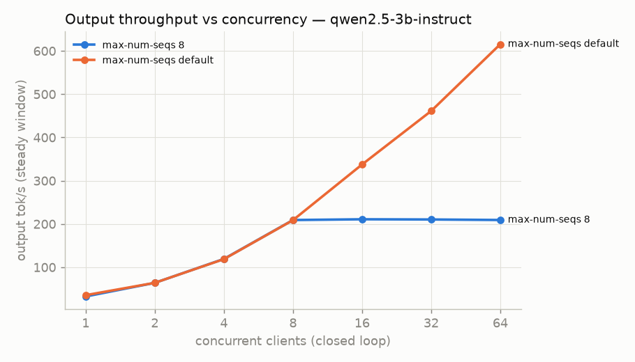
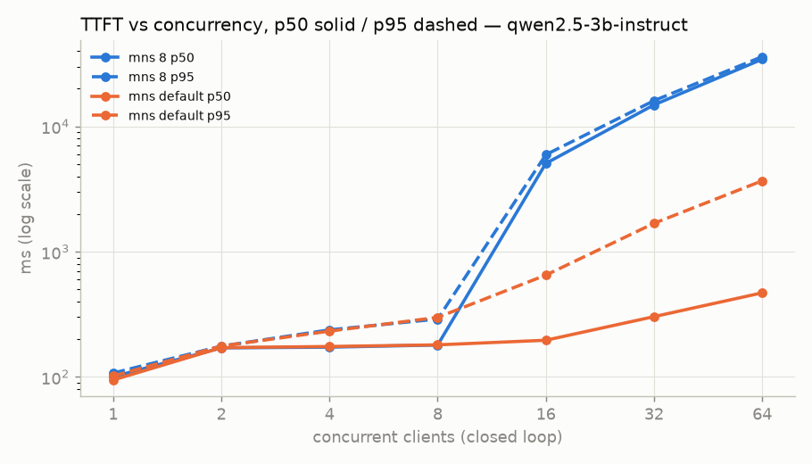
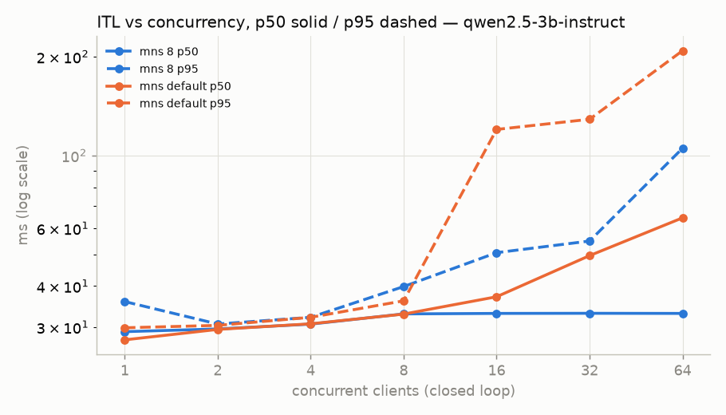

## Task 5 — quantization: speed, quality, cost

| variant | engine | model | batch-1 decode tok/s (median, spread) | c=16 steady tok/s | c=16 TTFT p50 ms | PPL (wikitext-2, 40×512, 2nd half) | gsm8k | hellaswag | $/1M out tok @ c=16 | rows |
|---|---|---|---:|---:|---:|---:|---:|---:|---:|---|
| fp16 | vLLM 0.31.0 | `Qwen/Qwen2.5-3B-Instruct` | 37.16 (1.0 %) | 341.7 | 196 | 8.018 | flexible-extract 0.656 ± 0.030 strict-match 0.116 ± 0.020 | acc 0.536 ± 0.032 acc_norm 0.656 ± 0.030 | 0.428 | [20261014-234235_quant](../../../benchmarks/results/t4/20261014-234235_quant/results/quant/quant.jsonl) |
| awq-int4 | vLLM 0.31.0 | `Qwen/Qwen2.5-3B-Instruct-AWQ` | 84.06 (1.9 %) | 536.6 | 144 | 8.659 | flexible-extract 0.624 ± 0.031 strict-match 0.120 ± 0.021 | acc 0.512 ± 0.032 acc_norm 0.628 ± 0.031 | 0.272 | [20261014-234235_quant](../../../benchmarks/results/t4/20261014-234235_quant/results/quant/quant.jsonl) |
| gguf-q8_0 | llama.cpp b11146 (CUDA 12.8 prebuilt) | `Qwen/Qwen2.5-3B-Instruct-GGUF/qwen2.5-3b-instruct-q8_0.gguf` | 60.04 (2.2 %) | 284.7 | 245 | 8.137 | flexible-extract 0.692 ± 0.029 strict-match 0.248 ± 0.027 | failed (rc 0) | 0.513 | [20261014-234235_quant](../../../benchmarks/results/t4/20261014-234235_quant/results/quant/quant.jsonl) |
| gguf-q4_k_m | llama.cpp b11146 (CUDA 12.8 prebuilt) | `Qwen/Qwen2.5-3B-Instruct-GGUF/qwen2.5-3b-instruct-q4_k_m.gguf` | 76.61 (2.0 %) | 304.5 | 241 | 8.410 | flexible-extract 0.676 ± 0.030 strict-match 0.332 ± 0.030 | failed (rc 0) | 0.480 | [20261014-234235_quant](../../../benchmarks/results/t4/20261014-234235_quant/results/quant/quant.jsonl) |

lm-eval 0.4.12 `local-completions`, --limit 250 (first N docs), command in the row (`lmeval_cmd`).

Cost: Azure Standard_NC4as_T4_v3 US East Linux on-demand 0.526 USD/1 Hour; fetched 2026-10-15T01:46:38Z from: https://prices.azure.com/api/retail/prices?$filter=armSkuName eq 'Standard_NC4as_T4_v3' and armRegionName eq 'eastus' and priceType eq 'Consumption'. Formula `$ / 1M = $/h ÷ (tok/s × 3600) × 1e6` (benchmarks/cost.py).

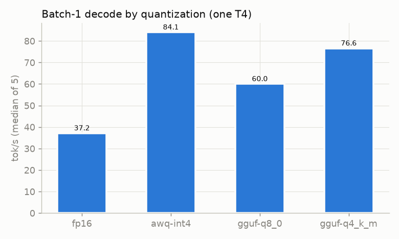

## NCCL — 2 × T4 collectives (PCIe, one box)

**2 × Tesla T4 in one Kaggle VM, GPU↔GPU over PCIe — GPU collective communication inside one box; not the scale-out fabric, not NVLink.** nccl-tests rows from one session: [20261016-153016_nccl](../../../benchmarks/results/t4/20261016-153016_nccl/results/nccl/nccl.jsonl).

- Topology: `nvidia-smi topo -m` GPU0↔GPU1 = **PHB**; `topo -p2p r` = **OK**; torch `can_device_access_peer(0,1)` = **True**; PCIe under load Gen3 x16 (idle Gen3).
- Versions: NCCL **2.28.9+cuda12.9** (`nvidia-nccl-cu12==2.28.9`, library code 22809 printed by nccl-tests); nccl-tests v2.21.0 (`a3d4589e8f32`), nvcc 12.8.93, driver 580.178.04 (CUDA 13.0), torch 2.11.0+cu128 (its NCCL 2.28.9).
- Transport NCCL chose (default run): **SHM/direct/direct**; graph `Pattern 1, crossNic 0, nChannels 1, bw 10.000000/10.000000, type PHB/PIX, sameChannels 1`; 2 coll channels.

| run | env | rc | busbw @ 1 GiB (GB/s) | algbw @ 1 GiB | time @ 8 B (µs) | avg busbw | #wrong | transport | algo/proto @ 8 B → 1 GiB |
|---|---|---:|---:|---:|---:|---:|---:|---|---|
| `allreduce-default-r1` | default | 0 | 3.91 | 3.91 | 16.6 | 1.87 | 0 | SHM/direct/direct | RING/LL/ch1 → RING/SIMPLE/ch2 |
| `allreduce-default-r2` | default | 0 | 3.89 | 3.89 | 18.0 | 1.92 | 0 | SHM/direct/direct | RING/LL/ch1 → RING/SIMPLE/ch2 |
| `allreduce-default-r3` | default | 0 | 3.88 | 3.88 | 18.9 | 1.92 | 0 | SHM/direct/direct | RING/LL/ch1 → RING/SIMPLE/ch2 |
| `allreduce-ring` | NCCL_ALGO=Ring | 0 | 3.87 | 3.87 | 16.4 | 1.92 | 0 | SHM/direct/direct | RING/LL/ch1 → RING/SIMPLE/ch2 |
| `allreduce-tree` | NCCL_ALGO=Tree | 0 | 4.47 | 4.47 | 17.6 | 2.03 | 0 | SHM/direct/direct | TREE/LL/ch1 → TREE/SIMPLE/ch2 |
| `allreduce-p2p-disabled` | NCCL_P2P_DISABLE=1 | 0 | 3.86 | 3.86 | 17.6 | 1.91 | 0 | SHM/direct/direct | RING/LL/ch1 → RING/SIMPLE/ch2 |
| `allgather` | default | 0 | 3.19 | 6.38 | — | 1.53 | 0 | SHM/direct/direct | ? → ? |
| `reducescatter` | default | 0 | 3.60 | 7.20 | — | 1.59 | 0 | SHM/direct/direct | ? → ? |
| `alltoall` | default | 0 | 4.43 | 8.85 | — | 1.78 | 0 | SHM/direct/direct | — |
| `sendrecv` | default | 0 | 3.64 | 3.64 | 14.0 | 1.83 | 0 | SHM/direct/direct | — |
| `allreduce-p2p-shm-disabled` | NCCL_P2P_DISABLE=1 NCCL_SHM_DISABLE=1 | 0 | 2.25 | 2.25 | 66.5 | 0.97 | 0 | NET/Socket/0 | RING/LL/ch1 → RING/SIMPLE/ch2 |

P2P follow-up, one session ([20261016-154427_nccl](../../../benchmarks/results/t4/20261016-154427_nccl/results/nccl/nccl.jsonl)): `topo -p2p r` = OK, torch P2P = True. NCCL 2.28.9 uses P2P only up to PXB by default; `NCCL_P2P_LEVEL=PHB` allows it on this PHB path.

| run | env | rc | busbw @ 1 GiB (GB/s) | algbw @ 1 GiB | time @ 8 B (µs) | avg busbw | #wrong | transport | algo/proto @ 8 B → 1 GiB |
|---|---|---:|---:|---:|---:|---:|---:|---|---|
| `p2pcheck-default` | default | 0 | 3.83 | 3.83 | 19.8 | 1.84 | 0 | SHM/direct/direct | RING/LL/ch1 → RING/SIMPLE/ch2 |
| `p2pcheck-p2p-level-phb` | NCCL_P2P_LEVEL=PHB | 0 | 4.12 | 4.12 | 17.7 | 2.06 | 0 | P2P/direct | RING/LL/ch1 → RING/SIMPLE/ch2 |
| `p2pcheck-p2p-disabled` | NCCL_P2P_DISABLE=1 | 0 | 3.91 | 3.91 | 18.8 | 1.92 | 0 | SHM/direct/direct | RING/LL/ch1 → RING/SIMPLE/ch2 |
| `p2pcheck-tree` | NCCL_ALGO=Tree | 0 | 4.49 | 4.49 | 18.0 | 2.03 | 0 | SHM/direct/direct | TREE/LL/ch1 → TREE/SIMPLE/ch2 |
| `p2pcheck-ring` | NCCL_ALGO=Ring | 0 | 3.94 | 3.94 | 17.8 | 1.93 | 0 | SHM/direct/direct | RING/LL/ch1 → RING/SIMPLE/ch2 |

busbw = algbw × 2(N−1)/N for all-reduce, (N−1)/N for all-gather / reduce-scatter / all-to-all, 1 for send/recv (nccl-tests PERFORMANCE.md); at N = 2 all-reduce busbw = algbw. Out-of-place columns. Model check against fabric/design/collectives.py: [fabric/design/nccl_check.md](../../../fabric/design/nccl_check.md).

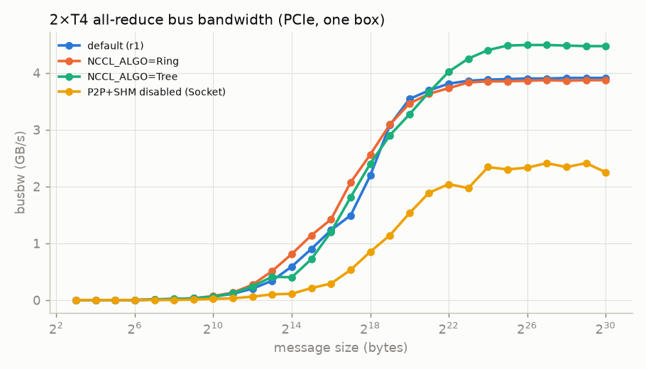

## P8 on 2 × T4 — size-blind routing (real engines)

**Kaggle 2×T4, real engines; routing not exercised.** Run 20261022-221119_p8x2, raw [p8x2.jsonl](../../../benchmarks/results/t4/20261022-221119_p8x2/results/p8x2/p8x2.jsonl), probes [probes.jsonl](../../../benchmarks/results/t4/20261022-221119_p8x2/results/p8x2/probes.jsonl). Narrative and prediction: [p8_t4x2.md](p8_t4x2.md).

Engine: vLLM None, chunked prefill None, max_num_batched_tokens 2048, max_num_seqs 256 (row `engine-config`); KV pool L/S 175,056 / 175,056 tokens (startup log).

| condition | server | probes ok | TTFT p50 / p95 / max (s) | ITL p50 / p95 (ms) | e2e p50 (s) | bg out tok/s (client) | prompt tok/s (server) | running / waiting / KV mean | SM clock mean (MHz) | GPU util mean |
|---|---|---:|---|---|---:|---:|---:|---|---:|---:|
| idle | L | 12/12 | 0.111 / 0.112 / 0.113 | 45.0 / 108.0 | 5.85 | 0.0 | 6.3 | 0.28 / 0.00 / 0.0004 | 552.7 | 27.2 |
| idle | S | 12/12 | 0.112 / 0.113 / 0.113 | 79.0 / 110.0 | 10.75 | 0.0 | 6.3 | 0.40 / 0.00 / 0.0005 | 500.6 | 40.0 |
| main | L | 12/12 | 2.313 / 5.176 / 5.221 | 39.0 / 44.0 | 14.31 | 15.9 | 788.1 | 2.23 / 0.00 / 0.0286 | 1,225.4 | 99.8 |
| main | S | 12/12 | 0.143 / 0.153 / 0.155 | 32.0 / 61.0 | 4.78 | 81.4 | 332.6 | 3.04 / 0.00 / 0.0050 | 813.1 | 99.4 |
| longout | L | 12/12 | 0.182 / 2.543 / 5.402 | 40.0 / 42.0 | 5.29 | 38.7 | 266.0 | 2.29 / 0.00 / 0.0354 | 1,210.3 | 100.0 |
| longout | S | 12/12 | 0.140 / 0.155 / 0.156 | 33.0 / 34.0 | 4.33 | 83.9 | 53.6 | 3.16 / 0.00 / 0.0090 | 865.7 | 100.0 |
| mns2 | L | 12/12 | 2.382 / 4.703 / 5.271 | 35.0 / 41.0 | 12.04 | 14.9 | 728.0 | 1.96 / 0.32 / 0.0243 | 1,222.4 | 100.0 |
| mns2 | S | 12/12 | 1.444 / 2.289 / 2.337 | 31.0 / 32.0 | 5.47 | 53.6 | 220.5 | 1.93 / 1.10 / 0.0029 | 820.0 | 99.9 |

| condition | median TTFT L (s) | median TTFT S (s) | gap L − S (s) | 95 % bootstrap CI of gap (s) | ratio | n L / S | median e2e L / S (s) | L prefilling (share of window) | L probes sent during an L prefill |
|---|---:|---:|---:|---|---:|---|---|---:|---|
| idle | 0.111 | 0.112 | **-0.000** | -0.001 … 0.000 | 1.0 | 12 / 12 | 5.85 / 10.75 | 0.000 | 0 / 12 |
| main | 2.313 | 0.143 | **2.170** | 0.382 … 4.055 | 16.17 | 12 / 12 | 14.31 / 4.78 | 0.674 | 9 / 12 |
| longout | 0.182 | 0.141 | **0.041** | 0.032 … 0.063 | 1.29 | 12 / 12 | 5.29 / 4.33 | 0.204 | 1 / 12 |
| mns2 | 2.382 | 1.444 | **0.938** | -0.262 … 2.123 | 1.65 | 12 / 12 | 12.04 / 5.47 | 0.796 | 9 / 12 |

**What a router would have seen** — computed offline from real engine metrics (pre-send /metrics of both servers per probe; formulas from llm-d-router v0.9.0, see [p8_t4x2.md](p8_t4x2.md#what-a-router-would-have-seen)). Stock = queue ×2 + kv-cache ×2 + prefix ×3, max-score-picker; token-load = stock + token-load ×4, threshold 8192, token load rebuilt from the background log (bytes/4 estimate, released at first chunk).

| condition | n | L running / waiting / KV (mean) | S running / waiting / KV (mean) | stock picks L / S / tie | stock margin (median) | token-load picks L / S / tie |
|---|---:|---|---|---|---:|---|
| idle | 24 | 0.00 / 0.00 / 0.0000 | 0.00 / 0.00 / 0.0000 | 0 / 0 / 24 | 0.0000 | 0 / 0 / 24 |
| main | 24 | 1.75 / 0.00 / 0.0269 | 2.96 / 0.00 / 0.0049 | 0 / 24 / 0 | 0.0598 | 0 / 24 / 0 |
| longout | 24 | 1.96 / 0.00 / 0.0370 | 3.00 / 0.00 / 0.0086 | 0 / 24 / 0 | 0.0576 | 0 / 24 / 0 |
| mns2 | 24 | 1.92 / 0.00 / 0.0285 | 1.96 / 0.88 / 0.0030 | 21 / 3 / 0 | 1.9464 | 23 / 1 / 0 |

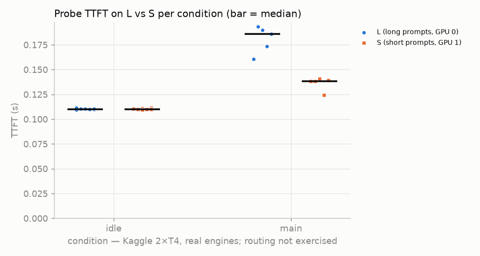
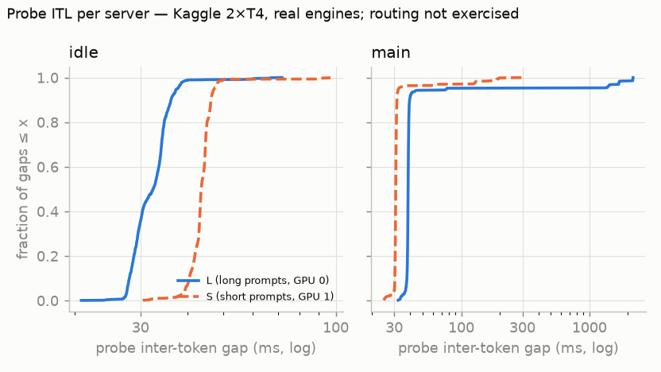
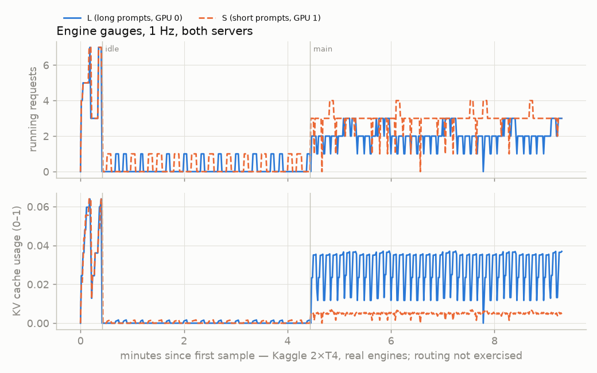

## Kaggle runs (GPU time)

| run | stage | status | script session s | GPU-h (script) | GPU-h (push→done, upper bound) |
|---|---|---|---:|---:|---:|
| 20261014-213711_smoke | smoke | complete | 20.9 | 0.006 | 0.015 |
| 20261014-214014_smoke | smoke | complete | 29.1 | 0.008 | 0.017 |
| 20261014-214129_smoke | smoke | complete | 20.7 | 0.006 | 0.013 |
| 20261014-214232_baseline | baseline | complete | 760.0 | 0.211 | 0.225 |
| 20261014-215653_baseline | baseline | complete | 636.8 | 0.177 | 0.190 |
| 20261014-220946_sweep | sweep | complete | 2,064.3 | 0.573 | 0.587 |
| 20261014-220938_kvgrid | kvgrid | complete | 2,372.8 | 0.659 | 0.667 |
| 20261014-225021_sweep | sweep | complete | 800.1 | 0.222 | 0.232 |
| 20261014-224513_quant | quant | complete | 1,263.9 | 0.351 | 0.370 |
| 20261014-230757_smoke | smoke | complete | 20.3 | 0.006 | 0.013 |
| 20261014-230457_sweep | sweep | complete | 895.7 | 0.249 | 0.260 |
| 20261014-232257_sweep | sweep | complete | 882.7 | 0.245 | 0.258 |
| 20261014-230851_quant | quant | complete | 1,864.8 | 0.518 | 0.537 |
| 20261014-234235_quant | quant | complete | 1,485.0 | 0.412 | 0.577 |
| 20261014-233928_sweep | sweep | complete | 881.6 | 0.245 | 0.290 |
| 20261015-063242_smoke | smoke | complete | 25.7 | 0.007 | 0.015 |
| 20261015-063714_smoke | smoke | complete | 17.3 | 0.005 | 0.010 |
| 20261015-064738_smoke | smoke | complete | 20.3 | 0.006 | 0.010 |
| 20261015-064953_baseline | baseline | complete | 729.6 | 0.203 | 0.215 |
| 20261015-070248_sweep | sweep | complete | 3,408.5 | 0.947 | 0.957 |
| 20261016-152535_nccl | nccl | complete | 125.6 | 0.035 | 0.047 |
| 20261016-153016_nccl | nccl | complete | 722.6 | 0.201 | 0.215 |
| 20261016-154427_nccl | nccl | complete | 429.5 | 0.119 | 0.128 |
| 20261022-211450_p8x2 | p8x2 | complete | 1,822.8 | 0.506 | 0.520 |
| 20261022-221119_p8x2 | p8x2 | complete | 1,889.9 | 0.525 | 0.537 |
| 20261031-082141_ridge | ridge | complete | 1,410.4 | 0.392 | 0.442 |
| 20261031-085014_twoinst | twoinst | complete | 1,018.2 | 0.283 | 0.342 |
| **total** | | | | **7.117** | **7.689** |

